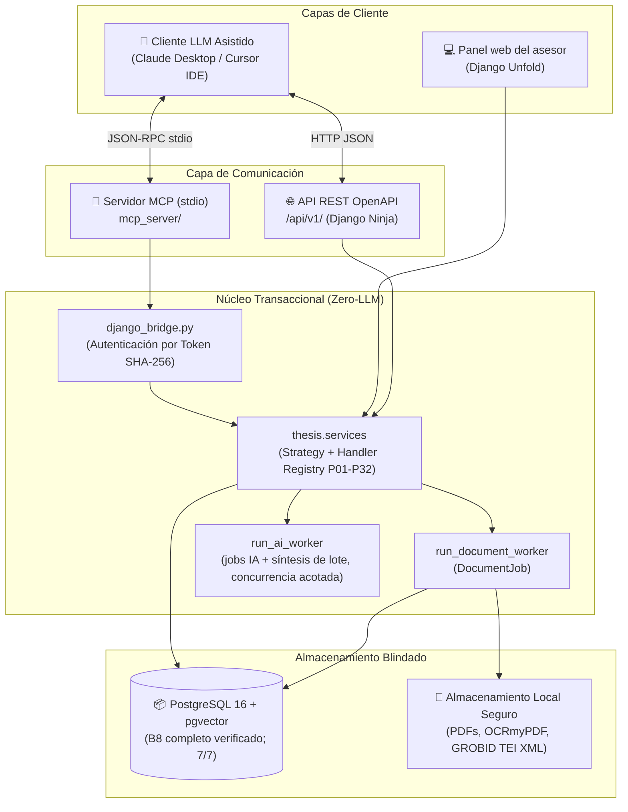

# TesisMCP

> **Para el equipo:** el repositorio contiene el código principal y la documentación. Cada integrante debe crear su propia base local y configurar su entorno. `var/` (documentos de usuario, respaldos, modelos y registros) y las credenciales no se distribuyen por Git. Lee [Ubicación y aislamiento de esta copia](./GUIA_AGENTE.md#ubicación-y-aislamiento-de-esta-copia-renovada) antes de ejecutar servicios o utilizar datos existentes.

> **Corte integral B8 cerrado (26/10/2026):** 58 modelos y 44 migraciones (`0001`–`0044`); puerta 7/7, 479.66 s, pytest 457.26 s, exit code 0. B8.1 versiona datasets; B8.2 genera tablas declarativas; B8.3 genera figuras PNG versionadas; B8.4 congela tabla/figura en snapshots y las incluye en la exportación DOCX aprobada. La llamada real al proveedor IA, OAuth Zotero real, envío de correo, exportación PDF B8 y prueba de uso siguen pendientes. Véase [estado verificable](docs/07_desarrollo_prototipo/estado_version_producto.md), [guía de continuidad](docs/02_arquitectura_y_sistema/guia_continuidad_backend.md) y [paquete B8](docs/02_arquitectura_y_sistema/paquete_b8_datos_figuras.md).

> **Sistema Web con Arquitectura Desacoplada y Protocolo MCP para la Asistencia Metodológica y Supervisión de Tesis Universitarias**  
> *Caso Piloto: Universidad Tecnológica del Perú (UTP) - Sede Piura, 2026*  
> *Curso: Curso Integrador I: Sistemas - Software*

---

## 📌 Descripción General

**TesisMCP** es una plataforma académica diseñada para resolver el problema de la fragmentación metodológica, las alucinaciones bibliográficas generadas por modelos de lenguaje y la sobrecarga docente en la revisión de tesis de titulación universitaria.

A través de **Model Context Protocol (MCP)**, desacopla la propuesta del modelo de lenguaje de la persistencia: el backend valida contratos y reglas metodológicas concretas sobre **PostgreSQL 16** con **`pgvector`**. Estas reglas reducen errores estructurales, pero no certifican verdad científica ni sustituyen al asesor.

---

## 🏗️ Arquitectura del Sistema



---

## 📂 Estructura del Repositorio (Senior Monorepo)

```text
ProyectoCI/
├── backend/                        # Núcleo Django + Django Ninja REST
│   ├── config/                     # Configuración settings.py, api.py, urls.py
│   ├── thesis/
│   │   ├── models/                 # Dominios: acceso, proyectos, investigación, capítulos, fuentes, citas e integraciones
│   │   ├── migrations/             # B8 verificado hasta 0044
│   │   ├── admin.py                # Panel de asesor con Django Unfold
│   │   ├── services/               # Lógica de dominio y reglas deterministas Zero-LLM
│   │   │   ├── steps.py            # Orquestación transaccional P01-P32 y lock_version
│   │   │   ├── step_materializers/ # Strategy Registry por dominio (consistency, literature, instruments)
│   │   │   ├── step_contracts.py   # 32 contratos Pydantic estrictos (extra="forbid")
│   │   │   ├── discovery_peru.py   # Búsqueda y clasificación explicable nacional/local
│   │   │   ├── geography.py        # Expansión geográfica dinámica por lugar de tesis
│   │   │   ├── reviews.py          # Máquina de estados FSM del asesor docente
│   │   │   ├── sources.py          # Incorporación desde OpenAlex o PDF cargado
│   │   │   ├── document_jobs.py    # Cola asíncrona de procesamiento documental
│   │   │   ├── ai_jobs.py          # Jobs IA, reclamo atómico y aceptación de propuestas
│   │   │   └── ai_batches.py       # Lotes atómicos sobre AIGenerationJob (B6.1)
│   │   ├── integrations/           # Adaptadores externos (ALICIA, OpenAlex, Semantic Scholar, Poppler, OCR, GROBID)
│   │   ├── api/                    # Endpoints REST Django Ninja (/api/v1/)
│   │   └── tests/                  # Pruebas automatizadas en pytest
│   └── manage.py                   # CLI Django (run_document_worker, run_ai_worker, issue_token)
├── mcp_server/                     # Servidor MCP stdio (34 herramientas y 35 prompts expuestos)
│   ├── server.py                   # Instancia MCPServer y catálogo P01-P32
│   ├── project_tools.py            # Herramientas operativas (guardar_paso, buscar_antecedentes_peru, etc.)
│   ├── prompts/                    # Plantillas P01-P32 y tres roles secuenciales para el cliente LLM
│   ├── django_bridge.py            # Puente criptográfico anti-spoofing por token SHA-256
│   ├── demo/                       # Datos de demostración de los 32 pasos
│   └── test_local.py               # Demostración E2E sobre transporte stdio con un PDF real y datos metodológicos simulados
├── core/grounding/                 # Capa de auditoría física anti-alucinaciones (9/9 PDFs verificados)
├── scripts/                        # Scripts de utilería (build_informe_ieee.py)
├── docs/                           # Documentación técnica, metodológica y académica
│   ├── 01_vision_y_alcance/        # Ficha técnica del proyecto
│   ├── 02_arquitectura_y_sistema/  # Arquitectura, modelo físico y diagramas_editables/
│   ├── 03_metodologia_y_prompts/   # Pasos P01-P32, contratos y referencias_prompts/
│   ├── 04_modulo_investigacion_y_busqueda/ # Estrategia y matriz de antecedentes
│   ├── 05_modulo_colaborativo_asesor/      # Sistema de comentarios y revisión
│   ├── 06_informe_final_curso/     # Informe académico y versión IEEE histórica
│   └── 07_desarrollo_prototipo/    # Bitácora, pruebas, plan de 5 integrantes
├── compose.yaml                    # Docker Compose (PostgreSQL 16 + pgvector + GROBID)
├── pytest.ini                      # Configuración de pruebas Pytest
├── requirements-backend.txt        # Dependencias Python
├── GUIA_AGENTE.md                  # Guía maestra para desarrolladores y agentes IA
└── AGENTS.md / GEMINI.md           # Regla de oro: Verificación en profundidad (Grounded Truth)
```

---

## ⚡ Guía de Inicio Rápido

### 1. Requisitos previos

- Git y Docker con el complemento Compose, o Podman con un proveedor Compose compatible.
- Para ejecución en el anfitrión: Python 3.12+, Poppler (`pdfinfo` y `pdftotext`) y las dependencias de `requirements-backend.txt`. La imagen Docker instala las herramientas de PDF y OCR que declara el Dockerfile.
- Para el frontend de referencia: Node.js 22 y pnpm 10, según `TesisMCP_Frontend/.mise.toml`.

El repositorio **no incluye** `.venv`, `node_modules`, datos de usuarios, respaldos ni claves; cada integrante los configura en su máquina. `TesisMCP/` contiene la integración parcial de sesión, proyectos y edición de capítulos; su recorrido autenticado con Django aún requiere comprobación en navegador. `TesisMCP_Frontend/` conserva la referencia anterior y no es el frontend activo de esta integración.

### 2. Arrancar backend local con Docker Compose

Desde la raíz del clon. Los siguientes comandos describen el recorrido previsto por `compose.yaml`; la disponibilidad de Docker/Compose debe comprobarse en la máquina de cada integrante. Si ya tienes algo usando los puertos `5432` u `8000`, ajusta la configuración local antes de continuar.

```bash
# Crear la base local y aplicar las migraciones existentes.
docker compose up -d db
docker compose --profile app run --rm web python backend/manage.py migrate

# Opcional: crear una cuenta administradora local mediante el asistente interactivo.
docker compose --profile app run --rm web python backend/manage.py createsuperuser

# Iniciar API y worker documental; Ctrl+C en logs no detiene servicios en segundo plano.
docker compose --profile app up -d web worker
docker compose logs -f web worker
```

La API queda en `http://127.0.0.1:8000/api/v1/docs`; `http://127.0.0.1:8000/health/` revisa la conexión a la base. Las contraseñas de `compose.yaml` son de desarrollo local, no de despliegue. Para detener los servicios: `docker compose --profile app stop`; no ejecutar `down -v` si se desea conservar la base y archivos. Cada máquina tiene sus propios volúmenes; clonar el repositorio **no clona** tesis, usuarios ni los respaldos del autor.

Podman requiere un proveedor de Compose instalado para usar `podman compose`. En esta máquina no se encontró uno durante la preparación. La puerta `./scripts/verify_podman.sh` es específica de Podman y espera por defecto un contenedor `tesismcp-local-pg`; leer el script y la [guía de operación](./docs/02_arquitectura_y_sistema/paquete_b10_operacion_local_y_despliegue.md) antes de ejecutarla en otro entorno. El recorrido Compose anterior no se ha comprobado en esta máquina.

Para abrir el frontend activo de la integración, en otra terminal, con Django ya disponible en `127.0.0.1:8000`:

```bash
cd TesisMCP
pnpm install --frozen-lockfile
pnpm dev
```

Vite usa el puerto `8443` y reenvía `/api` al backend mediante `TESISMCP_API_TARGET` (valor local por defecto). Antes de iniciar Django desde esta copia, configurar una base de datos aislada: el `DATABASE_URL` por defecto puede apuntar a la base compartida con el proyecto original. Para explorar el frontend de referencia anterior, en otra terminal:

```bash
cd TesisMCP_Frontend
pnpm install --frozen-lockfile
pnpm run dev
```

### 2.1 Ejecución Python en el anfitrión

Si se prefiere ejecutar Django fuera de contenedores, crear el entorno en la raíz, instalar dependencias y arrancar una base PostgreSQL 16 con pgvector. Confirmar `DATABASE_URL` antes de migrar: el valor por defecto apunta a `127.0.0.1:5432/tesismcp` y podría ser una base ya existente.

```bash
python3 -m venv .venv
.venv/bin/python -m pip install -r requirements-backend.txt
export DJANGO_DEBUG=1
# Establecer DATABASE_URL para la base de desarrollo propia antes de migrar.
.venv/bin/python backend/manage.py migrate
.venv/bin/python backend/manage.py runserver
```

Los documentos privados y backups se mantienen fuera de Git. Si se requiere compartir una copia de datos reales, acordar por separado autorización, medio seguro, credenciales y restauración DB+media compatibles; no subir `var/`. Los PDF de `docs/` están incluidos en la propuesta para que cada integrante pueda ejecutar la auditoría Grounded y las pruebas que los necesitan. Antes de publicar el repositorio, revisar los permisos de redistribución de los PDF, textos derivados y demás materiales. Si alguno no puede compartirse públicamente, habrá que acordar un medio autorizado para obtenerlo y conservar los nombres/rutas que exige `core/grounding/audit_cli.py` y los tests.

### 3. Demostración MCP Local
Ejecuta la simulación E2E del servidor sobre transporte `stdio` validando el paso de antecedentes con el PDF real `INT1_ARIA_Multi_LLM_Framework_2025.pdf`:
Los datos de la tesis y el coeficiente piloto del caso de ejemplo son simulados; la demo no constituye una evaluación empírica del producto.
```bash
DJANGO_DEBUG=1 .venv/bin/python mcp_server/test_local.py
```

### 4. Ejecutar la Auditoría Grounded de Fuentes Primarias
Verifica físicamente los PDF registrados por el auditor, sus títulos, páginas y expresiones textuales declaradas:
```bash
.venv/bin/python -m core.grounding.audit_cli
```

### 5. Artefacto histórico del informe IEEE
El siguiente generador conserva una versión anterior del informe en IEEE. P20 legado continúa exigiendo APA 7; la nueva vista de citas del editor canónico B4 es una ruta estructurada IEEE preliminar separada y no cambia ese contrato:
```bash
.venv/bin/python scripts/build_informe_ieee.py
```

---

## 📚 Enlaces Clave a la Documentación
* **[Guía Maestra para Agentes y Desarrolladores](./GUIA_AGENTE.md)**
* **[Especificación de búsqueda manual, lectura de documentos, revisión de citas y apoyos invitados](./docs/02_arquitectura_y_sistema/especificacion_busqueda_y_revision_de_evidencia.md)**
* **[Especificación integral del backend](./docs/02_arquitectura_y_sistema/especificacion_integral_backend.md)**
* **[Plan canónico de entregas del backend](./docs/02_arquitectura_y_sistema/plan_entregas_backend.md)**
* **[Guía de Arquitectura Explicada con Manzanitas](./docs/02_arquitectura_y_sistema/guia_arquitectura_con_manzanitas.md)**
* **[Modelo de Datos Físico](./docs/02_arquitectura_y_sistema/modelo_datos_fisico.md)**
* **[Contratos Pydantic y Validadores P01 a P32](./docs/03_metodologia_y_prompts/contratos_pydantic_y_validadores_mvp.md)**
* **[Bitácora de Desarrollo del Prototipo y Evidencias](./docs/07_desarrollo_prototipo/bitacora_desarrollo_y_evidencias.md)**
* **[Informe Académico del Curso Integrador](./docs/06_informe_final_curso/informe_academico_curso_integrador.md)**
