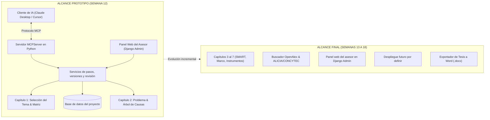

# Plan de Contingencia y Alcance del Prototipo (MVP) - Semana 12

> **Estado histórico actualizado al 18/10/2026:** este plan conserva el cronograma original. El código ya implementa P01–P32, búsqueda, ingestión documental, revisión y borrador DOCX. El despliegue público, la carátula completa y las pruebas con usuarios siguen pendientes.

## 1. Contexto Temporal Crítico
* **Semana Actual:** Semana 9.
* **Fecha Límite del Prototipo Funcional (Demo en Vivo):** Semana 12.
* **Tiempo Disponible de Desarrollo:** **3 Semanas (21 días)**.
* **Causa del Cronograma Ajustado:** Múltiples cambios de alcance y tema por parte de la asesoría docente en semanas previas.

---

## 2. Decisión Arquitectónica Definitiva: Django + Django Ninja

Tras la investigación técnica y comparativa con FastAPI, se adopta formalmente **Django + Django Ninja** por las siguientes razones de ingeniería y supervivencia temporal:

1. **Ahorro de 3 a 4 semanas de infraestructura:** Django provee de fábrica el sistema de autenticación de usuarios, seguridad contra vulnerabilidades web, el ORM relacional y el panel de administración.
2. **El Panel del Asesor listo en el Día 2:** El profesor cuenta inmediatamente con un dashboard visual operativo (`django.contrib.admin`) para auditar tesistas y capítulos sin requerir semanas de desarrollo frontend previo.
3. **Ergonomía de API moderna:** Django Ninja ofrece endpoints tipados y documentación interactiva. Para las operaciones del MVP que usan transacciones del ORM se emplearán vistas y servicios síncronos; la asincronía se evaluará solo donde aporte valor y sea compatible con las operaciones de base de datos.
4. **Compatibilidad con el Protocolo MCP:** El servidor `MCPServer` y la API web llaman a los mismos servicios de dominio, que validan permisos y actualizan los modelos de Django.

---

## 3. Delimitación Estricta del Alcance para la Semana 12 (El MVP)

Para garantizar una sustentación exitosa, se aplica el principio de ingeniería ágil: **"Un camino crítico (*Happy Path*) funcionando al 100% en vivo vale más que todo el sistema a medias"**.

### Lo que SÍ entra en la Demo de la Semana 12:
* **Capítulo 1 Completo:** Generación de temas viables, matriz de factibilidad y delimitación oficial del título (máx. 20 palabras, variables, ODS).
* **Capítulo 2 Completo:** Árbol del problema (causas y efectos) y formulación interrogativa del problema.
* **Servidor MCP Funcional:** Herramientas para que Claude Desktop / Antigravity ejecute los prompts secuenciales sin que el alumno copie o pegue variables manualmente.
* **Persistencia Relacional:** Tras la confirmación del tesista, el sistema registra el contexto en `research_profile`, la pregunta general en `consistency_row`, el avance en `step_progress` y el texto en una `chapter_revision` inmutable. El [modelo físico](../02_arquitectura_y_sistema/modelo_datos_fisico.md) define las claves y restricciones; una propuesta de IA no se persiste por sí sola.
* **Dashboard del Asesor:** El profesor accede vía web (`/admin`), visualiza a sus alumnos asignados, el estatus de sus tesis y las variables registradas.

### Lo que se desarrollará en la Segunda Fase (Semanas 13 a 18):
* Capítulos 3 al 7 (Objetivos SMART, Marco Teórico, Metodología e Instrumentos Likert/Entrevistas).
* Motor de Búsqueda Científica Grounded (OpenAlex y OAI-PMH ALICIA/CONCYTEC).
* El despliegue público queda pendiente porque todavía no se ha elegido infraestructura persistente. El alcance confirmado usa MCP y API para el tesista y conserva el panel web del asesor.
* Exportación de borrador Word (`.docx`) implementada; la carátula institucional completa sigue pendiente.

---

## 4. Cronograma de Sprints de Emergencia

| Semana | Hito Principal | Entregable Técnico Verificable |
| :---: | :--- | :--- |
| **Semana 9 (Actual)** | **Cimiento Django & Base de Datos** | Proyecto Django + Django Ninja configurado; modelos de usuario, proyecto, participantes, perfil, fila general de consistencia, pasos, capítulos, revisiones y auditoría migrados; panel de administración activo. |
| **Semana 10** | **Servidor MCP & Prompts Cap. 1 y 2** | Servidor `MCPServer` conectado a los servicios compartidos de Django; pasos `P01` a `P08` y pruebas locales con un cliente MCP. |
| **Semana 11** | **Integración End-to-End & Pruebas** | Flujo completo verificado: Claude ejecuta prompt $\rightarrow$ MCP guarda en Django $\rightarrow$ Asesor ve los datos reflejados en tiempo real. |
| **Semana 12** | **Presentación del Prototipo (Demo)** | Demostración en vivo frente al profesor de la ejecución con IA y la supervisión web. |
