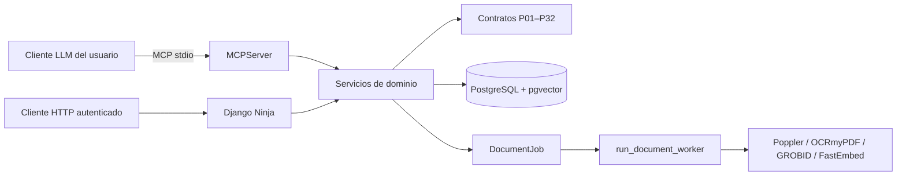

# Circuito cerrado determinista y auditoría documental

> **Estado verificado al 18/10/2026.** Este documento describe el código actual. Las latencias, límites de servicios externos y costos no se presentan como resultados porque no existe un benchmark reproducible guardado en el proyecto.

## 1. Principio de diseño

TesisMCP separa dos responsabilidades:

1. El cliente LLM propone texto y estructuras JSON.
2. El backend decide si puede guardar la propuesta mediante contratos Pydantic, reglas de dominio, permisos y transacciones.

El término *Zero-LLM* se refiere al núcleo de validación: Django no llama por sí mismo a un modelo generativo. El cliente MCP elegido por el usuario sí puede consumir un servicio de IA y tener costos propios.



## 2. Comprobaciones implementadas

- Contratos estrictos P01–P32 con rechazo de campos extra.
- Prerrequisitos secuenciales entre pasos.
- Límites y reglas concretas, como el conteo del título, signos de interrogación, verbos de Bloom y embudo PRISMA.
- Control de pertenencia, rol y versión antes de cada mutación.
- Extracción PDF por página física, hash del archivo y extractos localizados.
- Cola persistente para extracción, OCR, GROBID, cotejo DOI, indexación y DOCX.
- Búsqueda semántica local con FastEmbed y pgvector.
- Detección de campos de citas Word y Zotero en manuscritos DOCX.
- Revisión del asesor mediante revisiones inmutables, comentarios anclados y estados del capítulo.

## 3. Niveles de evidencia

| Nivel o estado | Qué acredita | Qué no acredita |
| :--- | :--- | :--- |
| `METADATA_ONLY` / `METADATA_CHECKED` | Existe un registro devuelto por un proveedor o guardado en el proyecto. | Lectura del PDF, revisión por pares o validez del contenido. |
| `TEXT_CHECKED` | El sistema extrajo texto por página física de un archivo registrado. | Que una persona haya leído críticamente todo el documento. |
| `TEXT_EXTRACTED_WITH_QUOTES` en P16 | Las tres citas exigidas aparecen literalmente en extractos de la fuente, con página y huella. | Que la cita respalde correctamente la interpretación, ni que portada, autores y método hayan sido validados por un humano. |
| `EvidenceLink.CONFIRMED` | Un asesor confirmó un vínculo concreto entre afirmación y extracto. | Validez general de toda la fuente o del capítulo. |

## 4. Integraciones externas

El código contiene adaptadores para OpenAlex, Semantic Scholar, ALICIA y Crossref. Sus respuestas se normalizan como metadatos y las fallas parciales de proveedor se informan. La disponibilidad, cuota y latencia de cada servicio pueden cambiar; deben medirse en el momento del despliegue y no se garantizan desde este repositorio.

Los artículos de OpenAlex con filiación peruana se filtran por tipo `article`, pero ese dato no demuestra revisión por pares. ALICIA conserva solo autores primarios cuando están disponibles y no inventa una institución ausente.

## 5. Límites actuales

- P20 acepta `IEEE` o `APA_7`, pero no comprueba toda la sintaxis ni la correspondencia exhaustiva entre citas y bibliografía.
- P32 recibe un coeficiente declarado por el cliente; no almacena respuestas crudas ni lo recalcula.
- El exportador genera un borrador DOCX. No crea la carátula institucional completa ni un reporte de similitud.
- No existe infraestructura pública validada ni pruebas de aceptación con usuarios reales.
- La calidad científica final requiere revisión humana del asesor.

## 6. Verificación

```bash
DJANGO_DEBUG=1 .venv/bin/python backend/manage.py check
DJANGO_DEBUG=1 .venv/bin/python backend/manage.py makemigrations --check --dry-run
DJANGO_DEBUG=1 .venv/bin/pytest --reuse-db -q
python3 -m core.grounding.audit_cli
```
