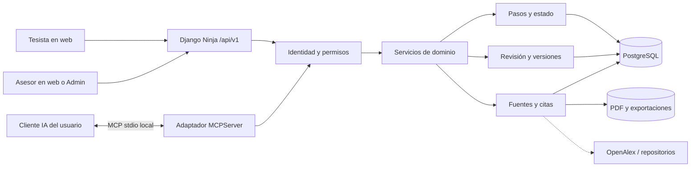
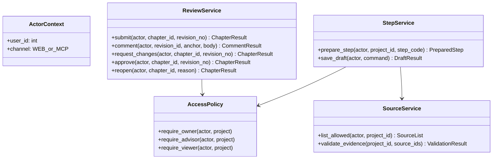
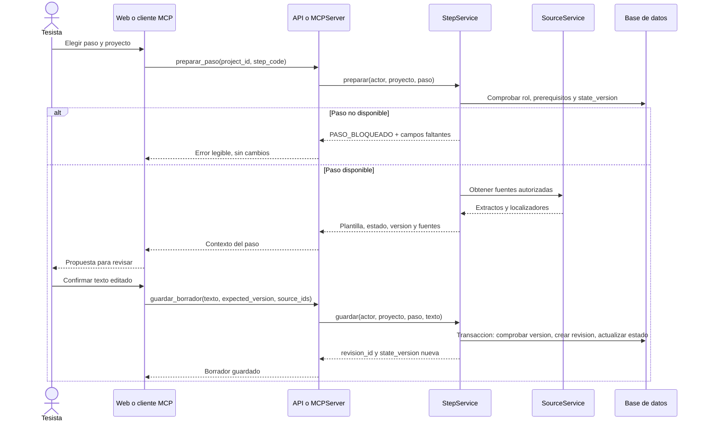

# Especificación de implementación de TesisMCP

> **Nota de vigencia:** las secciones sobre MVP, semanas y frontend excluido describen una planificación anterior. Para la dirección de producto confirmada y el trabajo nuevo de backend, consultar la [guía de desarrollo de la versión completa](./guia_backend_version_completa_para_agentes.md) y el [estado verificable](../07_desarrollo_prototipo/estado_version_producto.md). Este documento sigue siendo referencia de las estructuras y flujos existentes donde coincida con el código.

**Estado base verificado al 18/10/2026:** 27 modelos, 18 migraciones y 59 pruebas. El corte B3.6 llega a 40 modelos/30 migraciones; añade selección y procedencia de candidatos, vínculos con búsquedas declaradas y decisiones humanas versionadas sobre posibles duplicados. B3.5 pasó 7/7 con código 0; la evidencia de B3.6 se presenta en el reporte de este corte. Consultar [estado verificable](../07_desarrollo_prototipo/estado_version_producto.md), [modelo físico](./modelo_datos_fisico.md) y [guía de continuidad](./guia_continuidad_backend.md). Siguen pendientes integración ida/vuelta del editor frontend, anclas de comentario por bloque, validación con usuarios, formato institucional completo y despliegue público.

## 1. Alcance y decisiones de arquitectura

- **MVP (semana 12):** proyectos, roles tesista/asesor, perfil metodológico, pasos 1 a 8 (capítulos 1 y 2), revisión de borradores y panel inicial en Django Admin. Un único asesor por proyecto.
- **Extensión (semanas 13 a 18):** pasos 9 a 32, carga y búsqueda de fuentes, comentarios anclados en la interfaz, exportación Word y frontend específico.
- **Fuente de verdad:** PostgreSQL tanto en desarrollo local como en despliegue. La instancia local puede ejecutarse como servicio o contenedor; Django y el servidor MCP comparten la conexión configurada mediante `DATABASE_URL` y el ORM. Todas las rutas REST y herramientas MCP pasan por los mismos servicios de dominio y sus controles de acceso. El navegador nunca consulta la base de datos directamente.
- **IA BYOA:** el cliente MCP del usuario ejecuta el modelo y devuelve propuestas. `MCPServer` entrega contexto y recibe texto; el servidor valida reglas y persiste. La IA no decide autorizaciones ni cambia estados de aprobación.
- **Nomenclatura:** hay 32 pasos únicos. El antiguo «Prompt 5 bis» se integra en el paso 6, que comprende árbol del problema y formulación de preguntas.

### 1.1 Contenedores y fronteras



| Componente | Responsabilidad | No debe hacer |
| :--- | :--- | :--- |
| `api/` | Validar entrada HTTP, autenticar sesión, traducir errores a HTTP y serializar respuestas. | Escribir reglas de negocio duplicadas. |
| `mcp_server/` | Publicar herramientas tipadas; identificar al usuario de la conexión; traducir errores a resultados MCP. | Confiar en un `user_id` enviado por el modelo. |
| `services/` | Ejecutar casos de uso, comprobar permisos, transiciones y versiones; abrir transacciones. | Depender de objetos HTTP o del cliente LLM. |
| `models/` | Persistir entidades, claves y restricciones. | Contener prompts o lógica de interfaz. |
| `grounding/` | Extraer y localizar evidencia; devolver estado de verificación. | Declarar verdadera una afirmación solo porque sus palabras aparecen en un PDF. |

La autenticación por sesión de Django Ninja y la exposición de herramientas MCP se apoyan en sus mecanismos oficiales; las autorizaciones por proyecto se aplican además en el servicio compartido ([Django Ninja](https://django-ninja.dev/guide/authentication/), [especificación MCP](https://modelcontextprotocol.io/specification/2025-06-18/server/tools)).

### 1.2 Interfaces de servicio para el primer código



`ActorContext` se construye en el adaptador web o MCP; `save_draft` recibe un comando tipado con `project_id`, `step_code`, `chapter_no`, `content_md`, `output`, `source_ids`, `expected_version` e `idempotency_key`. Los métodos devuelven resultados de dominio o errores con código estable; los adaptadores traducen esos códigos a HTTP o MCP. En Django se usa el ORM como capa de acceso a datos; no se añade un DAO paralelo sin necesidad.

Estructura del código:
- `mcp_server/`: Servidor MCP modular implementado con el SDK oficial `mcp >= 2.0` (`from mcp.server.mcpserver import MCPServer`, sucesor oficial de FastMCP en la versión 2.x). Cuenta con suite de pruebas local (`mcp_server/test_local.py`) e inspección gráfica mediante `npx @modelcontextprotocol/inspector`. Para su guía completa de aprendizaje y configuración en clientes de IA (Claude Desktop / Cursor), consultar [`mcp_server/README.md`](../../mcp_server/README.md).
- `backend/`: `backend/config/` (settings y rutas), `backend/thesis/models/__init__.py`, `backend/thesis/step_catalogue.py`, `backend/thesis/services/` (acceso, pasos, revisión, fuentes), `backend/thesis/api/` (schemas y routers Django Ninja) y `backend/thesis/tests/`. El código actual de `core/grounding/` se evalúa para integrarlo en `SourceService`; su coincidencia de palabras o cifras no se tratará como prueba automática de veracidad.

## 2. Flujos que debe implementar el código

### 2.1 Preparar paso y guardar borrador



El guardado rechaza texto vacío, paso ajeno al proyecto, prerequisitos faltantes, fuentes de otro proyecto y versiones antiguas. `expected_version` evita que dos pestañas o clientes MCP sobrescriban cambios sin detectarlo. La llamada con la misma `idempotency_key` y el mismo contenido devuelve la revisión ya creada; con contenido distinto devuelve conflicto.

### 2.2 Envío, revisión y subsanación

```mermaid
sequenceDiagram
    actor Tesista
    actor Asesor
    participant API as API / MCP
    participant Revision as ReviewService
    participant DB as Base de datos
    Tesista->>API: enviar_revision(chapter_id, revision_no)
    API->>Revision: Verificar autor y revision vigente
    Revision->>DB: Estado DRAFT a READY
    API-->>Asesor: Capitulo pendiente en panel
    Asesor->>API: comentar(revision_id, rango, texto)
    API->>Revision: Verificar asignacion y ancla exacta
    Revision->>DB: Crear comentario ligado a revision inmutable
    Asesor->>API: solicitar_cambios(chapter_id)
    Revision->>DB: Estado READY a CHANGES_REQUESTED
    Tesista->>API: guardar nueva revision y marcar subsanacion
    Revision->>DB: Nueva revision; estado DRAFT
    Tesista->>API: reenviar revision actual
    Revision->>DB: Estado READY
    alt Sin observaciones abiertas en revision actual
        Asesor->>API: aprobar(chapter_id, expected_revision_no)
        Revision->>DB: Estado APPROVED y approved_revision_id
    else Revision antigua o comentarios abiertos
        Revision-->>Asesor: CONFLICTO o COMENTARIOS_PENDIENTES
    end
```

### 2.3 Máquina de estados del capítulo

```mermaid
stateDiagram-v2
    [*] --> DRAFT: crear capitulo
    DRAFT --> READY: enviar revision vigente
    READY --> CHANGES_REQUESTED: asesor solicita cambios
    CHANGES_REQUESTED --> DRAFT: tesista crea nueva revision
    READY --> APPROVED: asesor aprueba revision vigente
    APPROVED --> DRAFT: asesor reabre; aprobacion anterior queda en historial
```



| Transición | Actor | Guardas obligatorias | Efecto |
| :--- | :--- | :--- | :--- |
| `DRAFT → READY` | Tesista titular | Revisión vigente no vacía; pasos requeridos del capítulo completos. | Registra fecha de envío. |
| `READY → CHANGES_REQUESTED` | Asesor asignado | Al menos una observación asociada a la revisión vigente. | Registra observaciones pendientes. |
| `CHANGES_REQUESTED → DRAFT` | Tesista titular | Nueva revisión creada; la anterior queda inmutable. | Comentarios anteriores conservan su ancla histórica. |
| `READY → APPROVED` | Asesor asignado | Número esperado igual al vigente; sin comentarios abiertos en esa revisión. | Registra `approved_revision_id`, autor y fecha; agrega evento de auditoría. |
| `APPROVED → DRAFT` | Asesor asignado | Reapertura explícita con motivo. | Conserva aprobación anterior en el historial; habilita edición. |

Nunca se edita en sitio una revisión aprobada. El avance del proyecto se calcula por capítulos aprobados y pasos completos, no por texto generado. La aprobación previa del capítulo anterior era una regla de diseño; `save_step` actualmente verifica que el paso anterior esté completado, pero no exige esa aprobación. La [guía de backend completo](./guia_backend_version_completa_para_agentes.md) describe la corrección necesaria y las tareas bibliográficas que pueden adelantarse.

## 3. Modelo de datos relacional

El [modelo de datos físico](./modelo_datos_fisico.md) es el contrato para modelos y migraciones. El diccionario base conserva el corte de 27 modelos; B1.1/B1.2 documentan snapshots, anclas de revisión y aprobaciones del esquema vigente. Las claves principales incluyen `project` → `research_profile`/`step_progress`/`chapter`; `chapter` → `chapter_revision`/`review_comment`; `chapter` → `chapter_snapshot` → `ReviewComment`/`ReviewEvent`; y `source_document` → `source_excerpt` → `evidence_link` ligado a una revisión. Los roles se guardan en `project_participant`, por lo que no se duplican `owner_id` y `advisor_id` en `project`.

`research_profile` guarda el contexto metodológico y su `lock_version`; `consistency_row` conserva preguntas, objetivos e hipótesis, y las variables, dimensiones e indicadores tienen tablas propias. `consistency_row_variable` une cada fila con sus variables y `instrument_item_indicator` traza qué ítems miden cada indicador; ambas son extensiones posteriores al MVP. Las salidas específicas de cada paso van a `step_progress.output_json`, que se actualiza al guardar de nuevo el paso. Cada `chapter_revision` conserva el texto de un paso; las aprobaciones históricas usan `chapter.approved_revision_id` y las aprobaciones nuevas usan `chapter.approved_snapshot_id`. `review_event` conserva el historial y en decisiones B1.2 apunta al snapshot revisado. Los comentarios pueden anclarse a revisión histórica o snapshot, con una restricción que exige exactamente un destino; sus permisos y anclas textuales se comprueban también en servicios.

La API puede llamar `state_version` al valor público de `research_profile.lock_version`; ambos nombres designan el mismo contador, no dos estados distintos.

### 3.1 Catálogo mínimo que se codifica en el MVP

| Paso | Entradas requeridas | Salida estructurada | Regla para completarlo |
| :--- | :--- | :--- | :--- |
| `P01` | Carrera, interés y área del tesista. | Lista de temas candidatos. | Al menos una opción elegida por el tesista. |
| `P02` | Temas de `P01`. | Matriz de factibilidad y tema elegido. | Puntajes y criterio de elección registrados. |
| `P03` | Tema elegido. | Relevancia y ODS propuesto. | El tesista confirma el vínculo; sin afirmaciones externas no verificadas. |
| `P04` | Tema, unidad de análisis, lugar y período. | Título y delimitación. | Título dentro del límite de 20 palabras del proyecto; campos no vacíos. |
| `P05` | Título y delimitación confirmados. | Introducción en borrador. | Texto no vacío; cualquier cita remite a fuente del proyecto. |
| `P06` | Título y unidad de análisis. | Causas, efectos, pregunta general y específicas. | Pregunta general investigable y correspondencia básica con el título. |
| `P07` | Problema general de `P06`. | Justificación teórica, práctica, metodológica y social. | Cada dimensión tiene contenido; revisión semántica queda al tesista/asesor. |
| `P08` | Problema y justificación. | Aporte propuesto y estado de evidencia. | Si aún no hay literatura verificada, marcar `PENDING_EVIDENCE`; no afirmar originalidad demostrada. |

`save_step` recibe la salida tipada del paso, la valida con los [contratos Pydantic](../03_metodologia_y_prompts/contratos_pydantic_y_validadores_mvp.md), ejecuta el materializador correspondiente y actualiza las entidades declaradas. El texto se guarda como revisión y el avance cambia a `COMPLETED` dentro de la misma transacción. Los 32 contratos y sus materializadores vigentes se encuentran implementados.

`review_comment.start_cp` y `end_cp` son posiciones en puntos de código Unicode sobre el Markdown de una revisión **inmutable**. Al crear el comentario, `content_md[start_cp:end_cp]` debe coincidir con `selected_text`; el frontend convierte la selección visual a esos índices. Un comentario de una revisión anterior no se mueve automáticamente a la nueva.

`source_document` admite `UPLOAD` o `EXTERNAL`. Una fuente externa conserva DOI/Handle/URL y metadatos de procedencia; una carga conserva ruta y hash SHA-256. `verification_status` distingue `PENDING_EXTRACTION`, `METADATA_CHECKED`, `UNVERIFIED_METADATA`, `TEXT_CHECKED`, `OCR_REQUIRED` y `REJECTED`. Un enlace existente no basta para afirmar que el contenido respalda una cita; `source_excerpt` guarda página o localizador y fragmento, mientras `evidence_link` lo relaciona con una afirmación y puede ser revisado por el asesor. El sistema guarda metadatos aun cuando todavía no exista indexación vectorial.

## 4. Contratos de entrada

Las operaciones REST y MCP llaman a los mismos métodos de servicio. El actor se obtiene de la sesión HTTP o de la token local acotado al usuario de la conexión MCP, nunca de un campo enviado por el modelo. La API web emplea autenticación y protección CSRF de Django para sesiones; el transporte MCP local se inicia con un token local acotado al usuario del proceso.

| Caso de uso / servicio | REST propuesto | Tool MCP propuesto | Entrada mínima | Salida |
| :--- | :--- | :--- | :--- | :--- |
| Crear proyecto | `POST /api/v1/projects` | `crear_proyecto` | `name`, `title` opcional | `project_id`, `state_version=0` |
| Consultar estado | `GET /api/v1/projects/{id}` | `obtener_estado` | `project_id` | capítulos, pasos, versión |
| Preparar paso | `POST /api/v1/projects/{id}/steps/{code}/prepare` | `preparar_paso` | `project_id`, `step_code` | plantilla, campos faltantes, fuentes permitidas |
| Guardar borrador | `POST /api/v1/projects/{id}/steps/{code}/drafts` | `guardar_borrador` | texto, `output`, `expected_version`, `idempotency_key`, `source_ids` | `revision_id`, versión nueva, avisos |
| Enviar capítulo | `POST /api/v1/chapters/{id}/submit` | `enviar_revision` | `revision_no` | estado `READY` |
| Comentar | `POST /api/v1/revisions/{id}/comments` | — (fase posterior) | rango, selección, observación | `comment_id` |
| Pedir cambios | `POST /api/v1/chapters/{id}/request-changes` | — (fase posterior) | `expected_revision_no` | estado `CHANGES_REQUESTED` |
| Aprobar | `POST /api/v1/chapters/{id}/approve` | — (solo web en MVP) | `expected_revision_no` | estado `APPROVED` |

**Respuesta de error común:** `code`, `message`, `details` y `current_version` si hay conflicto. `VALIDATION_ERROR` → HTTP 400, `UNAUTHENTICATED` → 401, `FORBIDDEN` → 403, `NOT_FOUND` → 404, `VERSION_CONFLICT`/`INVALID_TRANSITION` → 409. En MCP los errores de negocio se devuelven como resultado de herramienta con `isError: true`, no como confirmación de guardado ([especificación MCP](https://modelcontextprotocol.io/specification/2025-06-18/server/tools)).

## 5. Reglas de consistencia y tareas de implementación

1. Crear modelos y migraciones con claves, índices y restricciones; sembrar siete capítulos y el catálogo `P01` a `P32` al crear un proyecto.
2. Implementar `AccessPolicy`, `StepService` y `ReviewService` sin depender de HTTP/MCP. Los cambios de versión, revisión y estado se realizan en una transacción (`transaction.atomic()`); en PostgreSQL se bloquean las filas del perfil y capítulo al escribir para evitar carreras ([Django, transacciones](https://docs.djangoproject.com/en/5.2/topics/db/transactions/)).
3. Exponer los casos de uso en Django Ninja con esquemas tipados, autenticación por sesión y comprobación de pertenencia al proyecto. Un asesor solo consulta y revisa proyectos asignados.
4. Exponer el subconjunto necesario en el Servidor MCP (implementado con la clase canónica `MCPServer`, sucesor de FastMCP en `mcp >= 2.0`). Nunca permitir que el modelo cambie `project_participant`, `approved_revision_id` o la identidad del actor enviando argumentos arbitrarios.
5. Mantener el panel Django Admin/Unfold y los comentarios anclados ya implementados. La web propia del tesista quedó fuera del MVP histórico; ahora forma parte del producto objetivo y requiere contratos backend para el editor y sus revisiones.
6. Añadir la ingestión de PDF y la verificación de evidencia antes de habilitar citas automáticas. Si no hay fuente comprobable, guardar la propuesta con aviso y sin cita; no fabricar un identificador.

**Pruebas mínimas antes de la demo:** un tesista no ve proyectos ajenos; un asesor no aprueba proyectos no asignados; guardar con versión antigua devuelve conflicto sin sobrescribir; se rechaza un paso bloqueado; una revisión aprobada permanece intacta; un comentario no puede anclarse a texto distinto; dos llamadas con la misma clave de idempotencia no crean dos revisiones; un PDF ajeno no puede citarse. Estas pruebas verifican reglas del dominio, no repiten la implementación.

---

## 6. Stack Tecnológico Óptimo y División entre los 5 Integrantes

Para evitar incompatibilidades entre miembros del equipo, se fija el siguiente conjunto de librerías y fronteras de código (detallado paso a paso en la [Guía Maestra del Equipo de 5 Integrantes](../07_desarrollo_prototipo/plan_trabajo_equipo_5_integrantes.md)):

| Rol | Dominio de Archivos | Paquetes Python / Herramientas Óptimas | Puente de Conexión |
| :--- | :--- | :--- | :--- |
| **Rol 1: Base de Datos & Modelos** | `backend/config/settings.py`, `backend/thesis/models/__init__.py` | `django>=5.2`, `psycopg[binary]>=3.2`, `dj-database-url`, **PostgreSQL 16 local**, **DBeaver** | Exporta los modelos ORM vigentes hacia `thesis/services/`; el conteo del plan original era 27. |
| **Rol 2: Servidor MCP & IA** | `mcp_server/server.py`, `mcp_server/django_bridge.py` | `mcp>=2.3.0` (`MCPServer`), **MCP Inspector**, **Claude Desktop / Cursor** | Usa `django_bridge.py` para llamar a `StepService` sin escribir SQL. |
| **Rol 3: Validación & API REST** | `backend/thesis/services/`, `backend/thesis/api/` | `django-ninja>=1.3`, `pydantic>=2.10`, **Swagger UI (`/api/v1/docs`)** | Centraliza validadores Zero-LLM y transacciones `select_for_update()`. |
| **Rol 4: Panel Asesor & UI** | `backend/thesis/admin.py`, `backend/thesis/templates/` | `django-unfold` (Dashboard Tailwind en Admin), **Tailwind CSS CDN** | Conecta acciones del Admin con `ReviewService`. |
| **Rol 5: QA, Pruebas & Word** | `backend/thesis/tests/`, `docs/07_desarrollo_prototipo/` | `pytest`, `pytest-django`, `pytest-asyncio`, **Google Forms (SUS)** | Ejecuta `pytest -v --durations=10` y documenta en la [Bitácora de Evidencias](../07_desarrollo_prototipo/bitacora_desarrollo_y_evidencias.md). |

### Comando único para instalar todo el stack en el entorno `.venv`:
```bash
uv pip install django django-ninja django-unfold psycopg[binary] dj-database-url python-dotenv mcp pydantic pytest pytest-django pytest-asyncio
```
