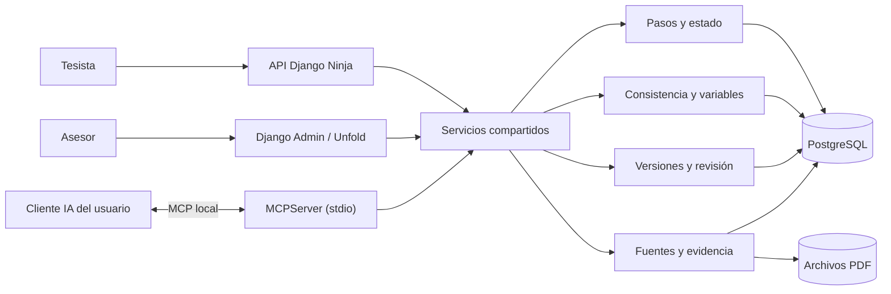

# Arquitectura global de TesisMCP

TesisMCP conserva dos entradas para un mismo núcleo: la API Django Ninja y los clientes de IA del usuario mediante el servidor `MCPServer`. El panel Django Admin/Unfold atiende al asesor; no existe una web propia del tesista. Ambas llaman a servicios de dominio que comprueban permisos, estado y versiones antes de guardar. Para una explicación intuitiva y didáctica de cada componente, consultar la [Guía de arquitectura con manzanitas](./guia_arquitectura_con_manzanitas.md). La [especificación de implementación](./arquitectura_detallada_componentes.md) define contratos, secuencias y pruebas; el [modelo de datos físico](./modelo_datos_fisico.md) fija las entidades y migraciones del sistema.

Los [recorridos implementados](../../backend/README.md) y la suite actual de 59 pruebas cubren: autenticación por token MCP, proyectos, pasos P01–P32, contratos Pydantic, guardado atómico, `lock_version`, revisión del asesor, trabajador documental, búsquedas externas, extracción PDF/OCR, pgvector, GROBID, cotejo DOI, manuscritos DOCX y exportación de borrador Word. Las pruebas verifican reglas de software; todavía faltan validación con usuarios, datos de campo reproducibles, formato institucional completo y despliegue público.

**Límite de responsabilidad:** el modelo propone texto; el tesista confirma; el servidor valida reglas y pertenencia al proyecto; el asesor asignado decide si aprueba. La interfaz web no se conecta directamente a la base de datos. Las herramientas MCP no aceptan un `user_id` elegido por el modelo.

**Estado actual frente al MVP de semana 12:** el primer corte cubría P01–P08. La versión presente ya implementa P01–P32, variables, indicadores, instrumentos, búsqueda de fuentes, comentarios anclados y borrador Word. PostgreSQL está verificado en desarrollo local; el despliegue público sigue pendiente.
