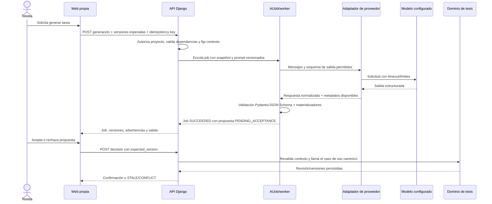

# Especificación backend: generación de tareas con IA y destino de resultados

**Estado verificado:** ciclo de jobs, API, validación, worker, aceptación y adaptador Gemini de B5.1 implementados. El proveedor sigue `DISABLED` por defecto; no se verificó una llamada real porque faltan credenciales disponibles en el entorno. `DEVELOPMENT_MOCK` solo funciona en `DEBUG`. Este documento conserva el contrato y los límites de la vertical. **Relación:** complementa [recorrido y prompts configurables](./contrato_recorrido_y_prompts_configurables.md), [contratos de API](./contratos_api_backend.md), [contratos de dominio](./contratos_dominio_backend.md) y [criterio backend listo para frontend](./criterio_backend_listo_para_frontend.md).

> **Vigencia para implementación:** B5.1 tiene job, servicio, worker, validación, operaciones HTTP y adaptador Gemini implementados. El proveedor sigue deshabilitado por defecto; la llamada real requiere credenciales de servidor y continúa sin verificarse. No recrear estos componentes. El [paquete Gemini B5.1](./implementacion_adaptador_gemini_b5_1.md) conserva el alcance del adaptador. B1.1–B1.3 cubren snapshots, revisión/aprobación y exportación DOCX aprobada. B1+B2.2 incorpora documento canónico; B1+B2.3 implementa preview/diff y aceptación versionada para P05/P29. Falta integrar y probar ese contrato con el editor frontend, según el [plan de entregas](./plan_entregas_backend.md).

## 1. Alcance de esta especificación: vía B5.1 server-side opcional

El recorrido de esta sección describe B5.1: el backend autoriza al actor, fija el prompt y el contexto vigentes, encola un job y el worker llama a un proveedor configurado en el servidor. Valida la respuesta y la guarda como propuesta versionada. El usuario consulta el estado y puede aceptar o rechazar. Esta vía existe en código, permanece deshabilitada por defecto y es **opcional**; no define el flujo BYOA principal. Aceptar usa servicios de dominio para guardar una revisión y no sobrescribe silenciosamente contenido aceptado ni revisión aprobada por asesor.

El recorrido previsto es:



## 1.1 BYOA para la web: objetivo e implementación actual

En el flujo principal objetivo, la web crea la tarea mediante la API de TesisMCP y el backend la coordina. Un conector entrega el job al agente/runtime que el usuario vinculó. El agente ejecuta el modelo disponible en ese runtime y llama herramientas del servidor MCP para consultar recursos autorizados. El conector devuelve avances y el resultado al backend; la web muestra el estado y la propuesta mediante la API.

La API de TesisMCP resuelve el ciclo de aplicación (crear job, estado, eventos, cancelación y resultado). MCP resuelve el acceso del agente a herramientas y datos de TesisMCP. La API comercial del proveedor de IA, si el runtime la usa, es una tercera interfaz y no se confunde con ninguna de las anteriores. El backend comparte servicios de dominio y controles de permisos entre API y MCP.

La vinculación BYOA y el despacho local ya están implementados en backend: conexión por proyecto, secreto de conector y token MCP vinculados, jobs BYOA, claim/heartbeat/eventos/resultados, validación y adaptador local de Antigravity CLI. No está integrada la UI de conexión y no hay evidencia de una ejecución real Antigravity autenticada. El detalle vigente está en [arquitectura BYOA, API y MCP](./arquitectura_byoa_api_mcp.md) y el [contrato del conector](./contrato_conector_byoa.md).

La generación y la aceptación son operaciones distintas. `HTTP 200`, `SUCCEEDED` o una salida JSON válida significan que se obtuvo una propuesta; **no** significan que el tesista la aceptó, que el asesor la aprobó, que la evidencia sea correcta ni que la tesis esté terminada.

## 2. Estado real que Antigravity debe conservar como punto de partida

Antes de editar, comprobar de nuevo estos símbolos en el árbol. Este inventario describe el corte revisado, no impide que el código cambie después:

| Código actual | Qué hace | Qué no hace |
|---|---|---|
| `backend/thesis/services/steps.py::save_step` | Valida salidas P01–P32 con `CONTRACTS`, corre materializadores y persiste `ChapterRevision`/`StepProgress`. | No invoca un LLM. Recibe `output_data` ya preparado por quien llama. |
| `backend/thesis/services/workflows.py::get_effective_prompt` | Devuelve el prompt efectivo de una tarea publicada. | No arma la solicitud al proveedor ni garantiza por sí solo un resultado estructurado. |
| `execute_custom_workflow_task` y `WorkflowTaskExecution` | Persisten la entrada/salida JSON que entrega el cliente para una tarea `USR_...`, con prompt y versiones registrados. | No generan texto, no validan una salida con esquema semántico propio y no la insertan automáticamente en el manuscrito o DOCX. |
| `backend/thesis/services/document_jobs.py::DocumentJob` | Ejecuta procesamiento documental para una fuente o manuscrito. | No es una cola genérica de IA: sus FK, `CheckConstraint`, enum y deduplicación están diseñados para esos documentos. No agregar generación LLM como un `kind` sin rediseño y migración justificados. |
| `backend/thesis/services/exports.py::export_draft_docx` | Ensambla las revisiones de paso guardadas según su implementación vigente. | No incorpora automáticamente outputs arbitrarios de tareas `USR_...` ni congela un snapshot aprobado completo. |
| `mcp_server/prompts/` | Expone plantillas y herramientas para que un agente cliente MCP las use. | No es un proveedor de IA, el canal genérico de despacho web→agente ni el almacén de ejecuciones de la web. |

No declarar “integración IA backend” porque existan prompts, contratos Pydantic, herramientas MCP o una columna `output_json`. La evidencia requerida es una ejecución real desde la API/worker del servidor hasta un adaptador configurado y de vuelta a una propuesta trazable.

## 3. Alcance funcional y estado de implementación

El objetivo funcional es conectar una tarea P01–P32 y una tarea personalizada `USR_...` de extremo a extremo. El ciclo server-side y el adaptador Gemini están implementados y cubiertos con pruebas simuladas; **la llamada real al proveedor no se verificó**. El dominio no debe quedar acoplado a un único SDK o modelo.

Incluye:

1. Interfaz backend, adaptador Gemini, autenticación de servidor, timeout y salida estructurada implementados. La llamada real depende de credenciales/modelo configurados y debe verificarse aparte.
2. Job de IA separado del trabajo documental, salvo que una inspección demuestre que el modelo `DocumentJob` puede extenderse sin romper invariantes, clientes ni datos existentes.
3. Snapshot de prompt, recorrido, tarea, contrato, entradas y referencias de contexto utilizado en cada job.
4. Validación estricta de salida; rechazo de JSON malformado, campos extra, códigos de tarea ajenos, output excesivo y resultados que fallen los materializadores actuales.
5. Respuesta del job consultable y con estado de aceptación independiente.
6. Aceptación que vuelve a validar permisos, versión y salida guardada, y llama a un servicio de dominio canónico; nunca acepta una versión de salida reescrita por el navegador.
7. Pruebas con proveedor simulado para fallas/consistencia implementadas. La llamada real queda pendiente hasta contar con credenciales; la prueba simulada no se reporta como llamada real.

Fuera de esta entrega: multiagentes paralelos, selección libre de modelo por el estudiante, entrenamiento/fine-tuning, carga automática de tesis completa al proveedor, generación de resultados empíricos, actualización silenciosa del manuscrito, aprobación automática del asesor, construcción del editor web y exportación final institucional. Esos trabajos requieren sus propias decisiones y contratos.

## 4. Componentes y límites

### 4.1 Caso de uso de generación existente

El servicio de dominio ya implementado es `backend/thesis/services/ai_jobs.py`. El agente debe inspeccionarlo y conservar su flujo; estos puntos describen las invariantes que el adaptador no puede saltarse:

1. `require_project(actor, project_id)` y autorización de capacidad. Para la primera entrega solo el titular solicita o acepta generación; la lectura del estado puede permitir al asesor asignado según matriz de permisos.
2. Bloquear o leer consistentemente el proyecto y obtener el `active_workflow` publicado. Rechazar workflow ausente, tarea inactiva, tarea retirada, `task_id` de otro proyecto o versión obsoleta.
3. Resolver dependencias desde el grafo publicado. Comprobar estado y campos requeridos del output, sin aceptar `StepProgress` de otra versión.
4. Resolver contexto mínimo desde entidades autorizadas en el servidor: perfil pertinente, outputs previos de dependencias, IDs/versiones de fuentes y revisión aprobada si aplica. El cliente envía referencias/selección permitida, no reemplaza la verdad del dominio con un objeto arbitrario.
5. Fijar texto exacto del prompt, `prompt_version`, `workflow_version_no`, `task_id`, contrato de salida y hash/manifest de contexto. Registrar solo datos necesarios y no incluir secretos.
6. Crear un job idempotente y responder `202 Accepted` si queda en cola. No sostener una petición HTTP abierta mientras se hace una generación larga.

### 4.2 Adaptador de proveedor

La interfaz agnóstica está definida en `backend/thesis/integrations/llm/base.py` y el adaptador Gemini ya la implementa en `backend/thesis/integrations/llm/gemini.py`. Cualquier cambio futuro a proveedores debe preservar estas invariantes:

- Lee proveedor, nombre de modelo, URL opcional y secretos de configuración del servidor/secret manager. El navegador nunca envía ni recibe API keys.
- Acepta una lista de mensajes diferenciando instrucción del sistema, prompt de la tarea, contexto autorizado y datos no confiables. Texto extraído de PDFs, archivos, web y usuario se trata como **dato**, no como instrucción capaz de cambiar permisos o políticas.
- Solicita salida JSON/estructurada cuando el proveedor lo permita. La respuesta del proveedor siempre se vuelve a validar localmente; “modo JSON” del proveedor no sustituye `Pydantic`/JSON Schema.
- Define timeout, tope de tokens/salida, concurrencia, rate limit por actor/proyecto y máximo de intentos. No reintenta automáticamente un job completado ni crea cobros repetidos al repetir la misma clave.
- Traduce fallas a códigos internos estables: `PROVIDER_UNAVAILABLE`, `PROVIDER_TIMEOUT`, `PROVIDER_RATE_LIMITED`, `PROVIDER_REJECTED`, `OUTPUT_INVALID`, `CONTEXT_STALE`. No persiste stack trace ni mensajes secretos como detalle público.
- Guarda proveedor/modelo realmente usados y uso/costo solo si el adaptador lo reporta. No inventa tokens, costo, latencia ni identificador de solicitud.

El SDK Gemini y su configuración se especifican en el [paquete de implementación Gemini B5.1](./implementacion_adaptador_gemini_b5_1.md). El dominio continúa dependiendo únicamente de la interfaz local; las pruebas automatizadas no requieren credenciales reales.

### 4.3 Job e historial existentes

El job de IA implementado es `AIGenerationJob`, separado de `DocumentJob`. No crear `AIExecutionJob` ni generalizar la cola como parte del adaptador. Al integrar Gemini, conservar estos datos existentes y no duplicar el historial:

- ID UUID, proyecto, solicitante, `task_id`, tarea/workflow publicados y sus versiones.
- estado `QUEUED`, `RUNNING`, `SUCCEEDED`, `FAILED`, `CANCELLED` y, si se detecta obsolescencia, `STALE`. Las transiciones legales se declaran en el servicio.
- `idempotency_key`, fechas, número de intentos y error normalizado.
- proveedor/modelo efectivos; nunca secreto, token o cabecera de autenticación.
- prompt exacto o snapshot protegido más hash; versión de prompt; hash del contexto y referencias versionadas que lo componen.
- esquema de salida y versión; salida original validada o referencia a `WorkflowTaskExecution`/`ChapterRevision`; estado `PENDING_ACCEPTANCE`, `ACCEPTED` o `REJECTED`.
- usage/costo solo si existe dato del proveedor y retención aprobada.

No dupliques sin motivo el mismo output en job, `WorkflowTaskExecution`, `StepProgress` y `ChapterRevision`. Define cuál es la propuesta original y cuáles son las revisiones canónicas aceptadas. Conserva la propuesta rechazada según política de retención y sin incluirla en exportaciones aprobadas.

## 5. Contratos de salida por clase de tarea

### P01–P32

- La tarea se identifica por el código del catálogo y valida con el `CONTRACTS[step_code]` vigente. No crear un segundo contrato paralelo para esquivar campos requeridos.
- El adaptador debe devolver el objeto que valida el contrato completo (`extra="forbid"`). Si el proveedor añade texto alrededor y no es recuperable con un parse estricto, marcar `OUTPUT_INVALID`; no intentar “arreglarlo” silenciosamente con regex/otro LLM.
- Ejecutar los materializadores existentes y dependencias reales bajo la versión de workflow/contexto fijada. No persistir `COMPLETED` antes de validación/materialización.
- Para revisión, el output P debe convertirse a una propuesta que el tesista pueda inspeccionar. Aceptarlo llama al mismo caso de uso transaccional de `save_step` o a un servicio común extraído de este; no duplicar reglas Pydantic, idempotencia y seguridad en el worker.
- `content_md`/bloques de manuscrito no se infieren del JSON sin un contrato explícito. Si la revisión necesita ambos, el resultado del generador debe distinguir `output_data` estructurado y `draft_content` destinado al editor.

### Tareas personalizadas `USR_...`

- `parameters_schema` actual describe parámetros del prompt; no basta como contrato de **salida**. Añadir una definición versionada de salida independiente (por ejemplo `output_schema` en la tarea/prompt) o justificar un modelo equivalente.
- Limitar el esquema a un subconjunto seguro de JSON Schema validado por servidor: tipos JSON, campos requeridos, tamaños, profundidad y número máximo de elementos. Rechazar `$ref` remoto, ejecución de código, clases arbitrarias y esquemas recursivos no controlados.
- Las tareas de redacción asignadas a un capítulo deben declarar una salida compatible con el documento canónico (bloques/Markdown y referencias estructuradas), sección destino y versión del documento. No convertir un JSON arbitrario en texto del DOCX.
- Una tarea sin destino de capítulo puede guardar resultado como artefacto auxiliar y consultarlo en su historial; no se presenta como capítulo escrito.
- Una tarea que usa fuentes debe referenciar `SourceDocument`/extractos existentes por ID/versión; el modelo no puede inventar IDs o elevar una fuente a “verificada”.

## 6. Aceptación, obsolescencia y conexión con capítulos

### Aceptación explícita

Un resultado completado queda `PENDING_ACCEPTANCE`. El endpoint de aceptar toma `job_id`/propuesta y `expected_version`, identifica actor en sesión y no admite `output_json` nuevo desde el cliente. El servicio:

1. Confirma que el solicitante/titular tiene permiso para esta acción y que el job pertenece al proyecto.
2. Comprueba que el job está `SUCCEEDED` y pendiente; una repetición igual es idempotente, una decisión incompatible devuelve conflicto.
3. Vuelve a validar el esquema/contrato, dependencias, materializadores y hash/contexto.
4. Si el contexto está obsoleto, marca o devuelve `STALE`; no altera contenido y ofrece regenerar/revisar.
5. Para P01–P32, llama la persistencia canónica e incorpora el ID de revisión creada al job.
6. Para tarea custom, crea/referencia la ejecución aceptada de esa versión. Si debe poblar el manuscrito, usa el contrato del editor/snapshot B1; sin él, mantiene el output como artefacto revisable y no lo incluye en exportación.
7. Emite evento de auditoría con actor, job, revisión anterior/nueva y decisión.

Rechazar guarda quién/cuándo y motivo opcional con límites, no modifica `StepProgress`, texto canónico, citas, datos o figuras. Aprobación de asesor sigue siendo una transición aparte sobre la instantánea de capítulo y nunca la produce un job IA.

### Contexto obsoleto

El job guarda un manifest determinista con IDs/versiones/hashes de los insumos usados. Antes de aceptar, comparar al menos:

- `workflow_id`/`version_no`, task ID y prompt ID/`prompt_version`;
- `ResearchProfile.lock_version` o versiones de los campos incluidos;
- IDs y hashes de fuentes/extractos usados; revisión aprobada/documento si estaba en contexto;
- outputs de tareas dependientes y su versión;
- contrato/esquema de salida.

Si algún elemento cambió, la API responde estado claro y lista de campos/insumos obsoletos sin filtrar contenido de otros proyectos. Nunca retocar una propuesta para que parezca generada con el contexto nuevo.

### Enlace con manuscrito y exportación

El backend conserva `ChapterRevision` por paso y la exportación de borrador que concatena revisiones. B1+B2.2 incorpora `ChapterDocument`/`ChapterDocumentRevision` con árbol JSON v1, snapshots v2 fijan esa revisión y el DOCX aprobado renderiza los bloques congelados. B1+B2.3 crea un diff `REPLACE_DOCUMENT` para P05/P29 y requiere aceptación de versión/hash antes de guardar; otras tareas no se incorporan al árbol. Aún faltan citas estructuradas, tablas/figuras, comentarios por bloque y probar ida/vuelta del frontend. La aceptación no comprueba veracidad académica ni aprobación del asesor.

La aceptación de P05 y P29 proyecta exclusivamente su campo contractual `contenido_markdown` a `ChapterRevision.content_md`; las demás tareas P conservan el JSON estructurado y no se interpretan como prosa. La salida de tarea personalizada no se agrega con `str(output_json)`, no se concatena automáticamente y no altera el DOCX por campo `chapter_no` únicamente. Hace falta un mapping de salida tipado a bloque/sección y aceptación del tesista. Citas IEEE se enlazan a referencias/ocurrencias estructuradas; una cadena `[4]` en Markdown no se convierte en cita verificada.

## 7. API B5.1: rutas existentes y límites actuales

Conservar `/api/v1/`. Las rutas siguientes existen en `backend/thesis/api/projects.py` y están conectadas a los servicios de dominio. La creación queda encolada por defecto; el proveedor debe habilitarse aparte. Consultar `contratos_api_backend.md` para las rutas absolutas bajo `/api/v1`.

### Solicitar generación

`POST /projects/{project_id}/workflow/tasks/{task_id}/generate` (autenticada; normalmente `202 Accepted`, o `200` si se activa el modo síncrono de desarrollo).

Entrada conceptual:

```json
{
  "workflow_version_no": 4,
  "expected_state_version": 18,
  "input_data": {"pregunta_usuario": "..."},
  "context_refs": [{"kind": "source_excerpt", "id": "uuid"}],
  "idempotency_key": "uuid"
}
```

- `workflow_version_no` y `expected_state_version` detectan cliente obsoleto; el servidor los contrasta con el estado actual y guarda `state_version_at_request` para volver a comprobarlo al ejecutar y aceptar.
- `input_data` son datos acotados para esa tarea; la API ignora/rechaza `user_id`, `provider_secret`, `system_prompt`, `is_protected`, `contract_name`, `output_data` y cualquier intento de cambiar permisos o contrato.
- `context_refs` actualmente solo permite extractos `source_excerpt` dentro del proyecto; el servidor resuelve y fija su texto, página e hash. No se acepta texto libre ni una versión/ID de otro tenant por referencia.
- El cliente no manda `provider`/`model` libre. Si en el futuro hay selección, será una opción allowlisted por servidor/organización, nunca un nombre arbitrario ni URL SSRF.
- Éxito `202`: `{job_id, status:"QUEUED", task_id, workflow_version_no, prompt_version, created_at}`. Un reintento con igual idempotency key y mismo payload devuelve el mismo job; otro payload con la clave da `409 VERSION_CONFLICT`.

### Consultar/cancelar

- `GET /projects/{project_id}/ai-jobs/{job_id}`: retorna estado, tarea/versiones, errores normalizados, timestamps, salida solo cuando `SUCCEEDED`, estado de aceptación y usage solo si el proveedor lo devolvió.
- `POST /projects/{project_id}/ai-jobs/{job_id}/cancel`: solo permite cancelar jobs en cola; cancelar no borra insumos ni una propuesta ya aceptada.
- Reutilizar `/jobs/{job_id}` actual solo tras resolver colisión semántica y restricciones de `DocumentJob`; preferir una ruta explícita de IA si los dos modelos siguen separados.

### Aceptar/rechazar propuesta

- `POST /projects/{project_id}/ai-jobs/{job_id}/accept`: `{expected_state_version, decision_key}`; no recibe output modificado. La salida procede del job y se contrasta con el estado fijado al solicitarlo.
- `POST /projects/{project_id}/ai-jobs/{job_id}/reject`: `{reason?, decision_key}`; estado `REJECTED`, sin mutación canónica.
- `GET /projects/{project_id}/workflow/tasks/{task_id}/executions` ya existe para recuperar el historial de tareas personalizadas; mantenerla para resultados aceptados y documentar diferencias frente al historial de jobs/propuestas.

### Errores mínimos

Usar los códigos existentes donde corresponda y mapearlos en `backend/config/api.py` sin romper clientes. Casos mínimos: `NOT_FOUND` (aislamiento), `PERMISSION_DENIED`, `VERSION_CONFLICT`, `PREREQUISITE_LOCKED`, `PROMPT_NOT_CONFIGURED`, `OUTPUT_INVALID`, `PROVIDER_UNAVAILABLE`, `PROVIDER_TIMEOUT`, `PROVIDER_RATE_LIMITED`, `CONTEXT_STALE`, `JOB_NOT_CANCELLABLE`, `IDEMPOTENCY_CONFLICT`. Mensaje legible; no devolver secreto, prompt oculto ni trazas del proveedor.

## 8. Seguridad, privacidad y límites académicos

- Las API keys se cargan en el proceso backend/worker desde secret store o variables de entorno locales no versionadas. Ninguna clave en React, storage del browser, base de datos de prompts, excepciones, logs, fixtures públicos ni respuestas API.
- Antes de enviar contenido a un proveedor externo, política de proyecto debe señalar qué datos se transmiten y a quién. El backend envía el mínimo necesario; corpus/contexto se limita por proyecto, permisos y referencias autorizadas.
- PII, datos de participantes, consentimientos, tesis privadas y muestras de estilo no se envían por defecto. Antes de admitirlos, documentar consentimiento, minimización, retención y opción de proveedor local/privado. No inventar garantía de “no entrenamiento” o residencia de datos sin fuente contractual.
- Texto de usuario/PDF/web se delimita como material no confiable. Una instrucción incrustada no puede cambiar sistema, prompt protegido, actor, permisos, esquema, filtros de fuentes o política de aceptación.
- El proveedor no puede escribir directamente al ORM, crear usuarios, aprobar capítulos, certificar evidencia, producir datos de muestra como reales ni activar herramientas fuera de un registro allowlisted. Toda operación posterior pasa por el servicio y actor autorizados.
- Loguear IDs, estados y duraciones; evitar registrar texto completo de tesis por defecto. Retención y eliminación deben ser políticas explícitas.
- Proveedor/modelo pueden fallar, limitar tasa, truncar o responder malformado. No degradar en silencio a un modelo distinto ni simular salida exitosa. El job permite retry consciente si no hay cobro/efecto duplicado y muestra motivo legible.

## 9. Secuencia histórica de implementación para Antigravity

> **No seguir como plan de trabajo actual.** Esta secuencia se redactó antes de completar B5.1 y contiene tareas ya implementadas. Se conserva solo como contexto histórico del diseño. Para el trabajo actual, consultar el [plan de entregas](./plan_entregas_backend.md); B1+B2 es el siguiente bloque previsto. El paquete Gemini B5.1 documenta una implementación ya realizada y no debe repetirse.

### Paso 0: reconocimiento obligatorio

1. Leer `AGENTS.md`, `GUIA_AGENTE.md`, este documento, el contrato de workflow, `criterio_backend_listo_para_frontend.md`, `contratos_api_backend.md` y `plan_entregas_backend.md`.
2. Verificar `pwd`; debe ser la raíz `ProyectoCI` del workspace. Anotar commit/estado del árbol si Git existe; no deducir cambios solo por el chat.
3. Leer en disco, al menos: `backend/thesis/models/workflows.py`, `chapters.py`, `documents.py`, `services/workflows.py`, `steps.py`, `document_jobs.py`, `step_contracts.py`, `step_materializers/`, `api/projects.py`, `config/api.py`, worker y dependencias/compose.
4. Escribir tabla corta símbolo actual→reutilización/extensión/nueva pieza. Las cinco rutas y el adaptador Gemini ya están implementados; verificar su contrato y pruebas existentes antes de cualquier cambio. La llamada real con credenciales es una verificación operativa pendiente, no una tarea de implementación del adaptador. No recrear rutas ni duplicar el job.

### Paso 1: congelar contratos y decisión reversible

1. Añadir `output_schema` versionado para tareas `USR_...`; no reutilizar `parameters_schema` con otro sentido.
2. Elegir y documentar job separado o migración general; explicar por qué `DocumentJob` actual sí/no sirve usando sus constraints reales.
3. Definir interfaz del proveedor, setting de proveedor/modelo y formato de secreto local; no seleccionar proveedor de producción por intuición.
4. Definir mapping de aceptación P01/P32 a `save_step` y de task custom a `WorkflowTaskExecution`; identificar dependencia de B1 para outputs a capítulo.
5. Crear ejemplos JSON de request/response/error y una matriz de estados/transiciones antes del endpoint.

### Paso 2: infraestructura de proveedor y job

1. Implementar interfaz + adapter único de desarrollo elegido; aislar SDK y timeout.
2. Implementar esquema/migración/job, reclamación de worker, límites, idempotencia y recuperación. Los registros fallidos conservan error sin filtrar el contenido sensible.
3. El worker carga el job, verifica que contexto y versión siguen vigentes antes de llamar al proveedor, ejecuta y guarda salida propuesta con estado pendiente de aceptación.
4. Validar siempre localmente: contrato Pydantic P-code y esquema JSON custom. Ejecutar materializadores en la aceptación canónica o una prevalidación segura que no escriba dos veces.

### Paso 3: API mínima de la vertical

1. Añadir create generation y GET status/result con autenticación de proyecto.
2. Añadir cancel solo si el worker/proveedor permite una semántica race-safe demostrable; de lo contrario no anunciarlo.
3. Añadir accept/reject con revalidación y control de versión. Resolver idempotencia doble (solicitud y decisión).
4. Registrar rutas, esquemas estrictos, errores HTTP y ejemplos en OpenAPI y `contratos_api_backend.md`.

### Paso 4: integrar una tarea por clase

1. Elegir un P-code representativo cuyo contrato y materializador se conozcan; no usar evidencia/P16 como primera demo si exige fuentes aún sin preparar. Usar fixture claramente sintético para test, no dato empírico.
2. Demostrar solicitud autenticada, job `QUEUED → RUNNING → SUCCEEDED`, contrato válido, aceptación y `ChapterRevision`/`StepProgress` vinculados a versiones.
3. Crear una tarea `USR_...` con prompt, esquema JSON propio, input permitido, llamada al proveedor, salida validada, aceptar/rechazar, y recuperar historial.
4. Si output custom debe aparecer en un capítulo, esperar o implementar el contrato B1 de contenido/snapshot; hasta entonces demostrarla como output auxiliar, no como escritura/exportación de tesis.

### Paso 5: abuso, fallas y Definition of Done

Probar al menos: actor no miembro; asesor intentando aceptar sin permiso; proyecto/ID cruzado; prompt/tarea inactive; tarea sin dependencia; dependencia obsoleta; job duplicado con payload igual/distinto; proveedor timeout/429/500; JSON truncado/malformado/campo extra; salida que falla materializador; cambio de prompt/perfil/fuente después de generar; aceptación repetida/conflictiva; cancel race; salida demasiado grande; prompt injection en pasaje; log/API sin secretos.

Actualizar estado del producto con exactitud, no declarar capacidad real de proveedor si solo corrieron fakes, aplicar migraciones y ejecutar `python3 scripts/verify_project.py` desde el runtime configurado por proyecto. Reportar comandos, tiempos, códigos y bloqueos reales. Si la prueba requiere secreto no instalado, dejar el adapter/configuración como `DEPENDIENTE_DE_CONFIGURACIÓN` y no afirmar llamada real.

## 10. Condiciones para cerrar este bloque

- Solicitud de generación real entra por API, requiere sesión y scope; el job ejecuta solo en servidor usando configuración privada.
- Una prueba de integración con proveedor simulado cubre el flujo entero y nunca se presenta como prueba de proveedor real. Una prueba manual/entorno seguro registra proveedor/modelo efectivos sin revelar key.
- El prompt, `prompt_version`, `workflow_version`, contrato, contexto/hash, actor y resultado se reconstruyen desde historial después de publicar/restaurar otros recorridos.
- Salida P-code solo se acepta si valida contrato y materializador; output custom solo con JSON Schema local vigente.
- Aceptación es explícita, transaccional, idempotente, verifica contexto fresco y referencia revisión aceptada. Rechazo/falla/timeout no altera el manuscrito.
- No se afirma inserción en el documento hasta que B1/B2 tengan modelo de contenido/snapshot y exporten la revisión aceptada concreta.
- Ningún secreto/PII se filtra; proyecto ajeno y peticiones obsoletas fallan cerradamente; jobs pueden observarse y errores recuperables se muestran.
- OpenAPI, pruebas, README, inventario, este contrato y estado del producto describen la misma superficie real.

## 11. Decisiones abiertas explícitas

1. Proveedor/modelo para desarrollo y despliegue, retención, región, tratamiento para entrenamiento y datos permitidos. Por defecto, el adapter es configurable; producción queda deshabilitada hasta configuración/consentimiento.
2. Generación de borrador en pasos P-code: sincronizar una petición corta o siempre en cola. Recomendación: job uniforme asíncrono para no bloquear HTTP y un estado observable incluso para UI.
3. Cuota/costo y política de reintentos por usuario/proyecto.
4. Qué tareas P01–P32 pueden mandar fuentes/contexto fuera del servidor y cuáles requieren confirmación adicional.
5. Contenido canónico, formato de secciones y política para que outputs `USR_...` se incorporen a capítulos: resolver con B1/B2, no inferir de `chapter_no`.

Hasta cerrar estas decisiones, implementar interfaz y controles de forma reversible, usar adaptador de prueba sin datos reales y mostrar como pendientes las acciones que requieren proveedor/configuración.
