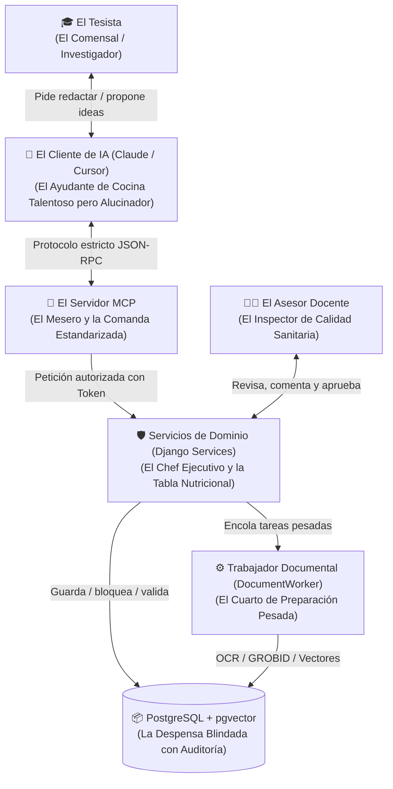
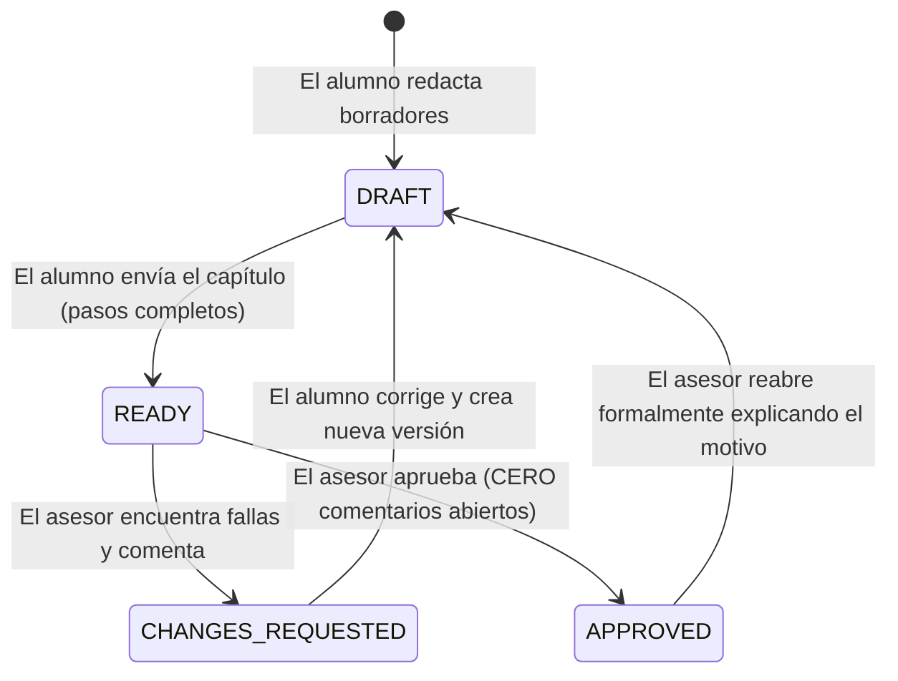

# Guía de Arquitectura de TesisMCP Explicada "Con Manzanitas"
## El Porqué, el Para Qué y el Cómo de Cada Pieza del Backend y Servidor MCP

**Estado:** Documento pedagógico oficial que explica la implementación operativa del backend y servidor MCP de TesisMCP.  
**Código fuente de referencia:** [`backend/`](../../backend/) y [`mcp_server/`](../../mcp_server/).

---

## 1. La Gran Analogía: ¿Cómo Funciona TesisMCP en la Vida Real?

Para entender el sistema sin marearse con términos de ingeniería, imaginemos que redactar una tesis universitaria es como **operar un restaurante de alta cocina con auditoría sanitaria permanente**:



* **El Tesista:** Es quien toma las decisiones, elige su tema y confirma el texto final.
* **El LLM (Claude / Cursor):** Es un cocinero brillante y rápido, pero con un gran defecto: si no tiene una receta estricta enfrente, se inventa ingredientes inexistentes (citas bibliográficas falsas, variables incongruentes).
* **El Servidor MCP:** Es el sistema de comandas. No deja que el cocinero hable directamente con la despensa; le dice exactamente qué receta toca hoy (`P01`, `P04`, etc.) y qué datos faltan.
* **Los Servicios de Django (`services/`):** Es el Chef Ejecutivo. Revisa que el plato cumpla todas las normas universitarias antes de que toque la mesa. Si el título tiene 21 palabras, lo rechaza. Si la versión cambió, detiene la comanda.
* **El Trabajador Documental (`run_document_worker`):** Es el cuarto de atrás donde se hacen las tareas que toman tiempo y ruido (moler café, hornear a fuego lento: OCR, extraer PDFs de 200 páginas, generar vectores). Así el restaurante principal nunca se congela.
* **PostgreSQL:** La despensa con candado. Nadie puede borrar una página aprobada ni cambiar de lugar los ingredientes sin que quede una firma inmutable.
* **El Asesor:** Es el inspector que lee el borrador final, ancla observaciones y decide con un clic si la sección está lista para publicarse.

---

## 2. El "Porqué" y el "Para Qué" de Cada Módulo Implementado

A continuación se explica, componente por componente, por qué se programó así, qué problema soluciona y para qué sirve en la práctica:

---

### Módulo 1: La Base de Datos Relacional y sus Migraciones
* **Ubicación:** [`backend/thesis/models/__init__.py`](../../backend/thesis/models/__init__.py) y [`backend/thesis/migrations/`](../../backend/thesis/migrations).
* **¿Qué es con manzanitas?**  
  Son los cimientos y los planos numerados de un edificio. En lugar de construir las paredes a ojo, cada migración levanta una parte en el orden correcto para que el techo no se caiga. El corte B1.2 llega a `0024`.
* **¿Por qué se hizo así?**  
  Porque en una base de datos de tesis, las cosas dependen unas de otras. Un extracto de PDF no puede existir sin su documento padre; un ítem de cuestionario (`InstrumentItem`) no puede existir sin su indicador (`Indicator`) ni su dimensión (`VariableDimension`); una observación docente no puede existir sin una versión escrita previa. Además, Django escribe estos archivos automáticamente en Python, evitando que los programadores cometan errores al tipear sentencias SQL a mano.
* **¿Para qué sirve?**  
  Permite que cualquier miembro del equipo o servidor en la nube levante la base de datos con los modelos de dominio migrados. El número de **27 modelos** corresponde al corte base; el código B3.6 llega a 40 modelos y 30 migraciones e incluye procedencia bibliográfica multi-proveedor, estrategias versionadas, vínculos de fuentes con ejecuciones y decisiones humanas versionadas sobre posibles duplicados. B3.5 pasó su puerta 7/7; la evidencia integral de B3.6 se presenta en el reporte de este corte. La base incorpora llaves foráneas y reglas al ejecutar `python manage.py migrate`.
* **Regla de oro aplicada:** Cero borrados destructivos en cascada (`on_delete=models.PROTECT`). Si alguien intenta borrar un proyecto o una fuente citada, el sistema lo bloquea para no destruir evidencia académica.

---

### Módulo 2: El Servidor MCP y la Seguridad por Token
* **Ubicación:** [`mcp_server/server.py`](../../mcp_server/server.py), [`project_tools.py`](../../mcp_server/project_tools.py) y [`django_bridge.py`](../../mcp_server/django_bridge.py).
* **¿Qué es con manzanitas?**  
  Es la **llave magnética de una habitación de hotel**.
* **¿Por qué se hizo así?**  
  Los Modelos de Inteligencia Artificial cometen errores. Si una herramienta MCP aceptara un parámetro que diga `usuario_id: int`, el modelo podría equivocarse, inventar el número `4` y borrar o modificar la tesis de otro alumno o del propio profesor.
* **¿Para qué sirve?**  
  El servidor MCP lee la identidad del usuario **únicamente desde la variable de entorno local `TESISMCP_MCP_TOKEN`** (un hash criptográfico emitido por la universidad). La IA jamás decide quién es el usuario; solo propone texto y el servidor sabe automáticamente a qué proyecto tiene permiso.

---

### Módulo 3: Concurrencia Optimista y Bloqueo Transaccional (`lock_version`)
* **Ubicación:** [`backend/thesis/services/steps.py`](../../backend/thesis/services/steps.py).
* **¿Qué es con manzanitas?**  
  Es como **comprar boletos de cine por internet**. Si tú y otra persona hacen clic en el asiento 5A al mismo segundo, el sistema no puede venderle el asiento a los dos; el primero que confirmó se lo queda, y al segundo le avisa: *"El estado cambió, por favor refresca la pantalla"*.
* **¿Por qué se hizo así?**  
  Un tesista puede tener abierta la pestaña web y a la vez estar ejecutando prompts en Cursor o Claude Desktop. Si ambos intentan guardar un borrador a la vez, sin este bloqueo uno destruiría silenciosamente el trabajo del otro.
* **¿Para qué sirve?**  
  Cada vez que se guarda un cambio, el sistema ejecuta:
  ```python
  with transaction.atomic():
      profile = ResearchProfile.objects.select_for_update().get(project=project)
  ```
  Comprueba que `expected_version == profile.lock_version`. Si coinciden, guarda e incrementa el contador a `lock_version + 1`. Si no coinciden, aborta la operación de forma segura sin corromper nada.

---

### Módulo 4: Contratos Metodológicos Estrictos y Patrón Strategy Registry (`P01` a `P32`)
* **Ubicación:** [`backend/thesis/services/step_contracts.py`](../../backend/thesis/services/step_contracts.py), [`step_materializers/__init__.py`](../../backend/thesis/services/step_materializers/__init__.py) y [`steps.py`](../../backend/thesis/services/steps.py).
* **¿Qué es con manzanitas?**  
  Es un **juego de encajar figuras geométricas de madera conectado a un jurado metodológico automático**. No solo revisa la forma de cada paso (`P01` a `P32`), sino que verifica que lo que escribes en el Capítulo 3, 4, 6 y 7 coincida con lo que prometiste en el Capítulo 1 y 2.
* **Diseño Senior (Patrón Strategy + Handler Registry):**  
  En lugar de un archivo gigante con 32 `if/else`, cada paso tiene su propia estrategia registrada con `@register_step_handler("Pxx")`. La orquestación transaccional (`steps.py`) delega en el handler correspondiente pasándole un contexto inmutable (`StepExecutionContext`). Si mañana la universidad crea el paso `P33`, solo se crea su handler sin tocar el código existente (Principio Abierto/Cerrado).
* **¿Por qué se hizo así?**  
  La universidad tiene rúbricas inflexibles a lo largo de los **7 capítulos**:
  * **Capítulos 1 y 2 (`P01`–`P08`):** `P02` verifica puntajes de factibilidad; `P04` exige máximo 20 palabras e incluye variables, unidad, lugar y periodo; `P06` exige signos `¿?` y presencia de las variables confirmadas en `P04`.
  * **Capítulo 3 (`P09`–`P12` — Matriz de Consistencia y Operacionalización):** `P09` exige verbos de la taxonomía de Bloom y el mismo número de objetivos específicos que preguntas específicas en `P06`; `P10` y `P11` mantienen correspondencia biunívoca (`ConsistencyRow`) y registran variables (`ResearchVariable`); `P12` desglosa exactamente esas variables en dimensiones (`VariableDimension`) e indicadores (`Indicator`).
  * **Capítulo 4 (`P13`–`P20` — Revisión de Literatura):** `P15` valida que el embudo PRISMA sea decreciente; `P16` exige que cada artículo de la matriz exista como `SourceDocument` real y verificado en el proyecto (bloqueando papers inventados con `UNVERIFIED_SOURCE`).
  * **Capítulos 5 y 6 (`P21`–`P29` — Marco Teórico y Metodología):** `P22` exige definir como constructos las variables de `P11`; `P25` valida coherencia de alcance y actualiza `ResearchProfile.approach`.
  * **Capítulo 7 (`P30`–`P32` — Instrumentos):** `P30` y `P31` crean los registros en `Instrument`, `InstrumentItem` e `InstrumentItemIndicator`, verificando que cada pregunta del cuestionario mida una dimensión e indicador reales de `P12`; `P32` impide declarar un instrumento como `CALIBRADO` si su confiabilidad piloto es menor a `0.70`.

---

### Módulo 5: Cola de Trabajos en Segundo Plano (`DocumentJob` y Worker)
* **Ubicación:** [`backend/thesis/services/document_jobs.py`](../../backend/thesis/services/document_jobs.py) y [`run_document_worker.py`](../../backend/thesis/management/commands/run_document_worker.py).
* **¿Qué es con manzanitas?**  
  Es como **la ventanilla de un banco**. Si vas a hacer un depósito rápido de 10 segundos, te atienden de inmediato en ventanilla. Pero si llevas una caja fuerte para tasar joyas (lo que equivale a procesar OCR de 200 páginas o analizar un PDF con GROBID que tarda 45 segundos), no te dejan parado en la ventanilla congelando la fila de todo el banco: te dan un ticket numerado (`job_id`), te sientas, y el especialista de atrás procesa tu caso.
* **¿Por qué se hizo así?**  
  Las peticiones HTTP y los comandos MCP tienen límites de tiempo estrictos (*timeouts*). Si el backend intentara procesar un OCR pesado dentro de la llamada web, la conexión se caería y el usuario vería un error 504 Gateway Timeout.
* **¿Para qué sirve?**  
  La API o MCP devuelve `202 Aceptado` con un `job_id` en estado `QUEUED`. Un proceso independiente (`run_document_worker`) toma los trabajos uno a uno usando un candado PostgreSQL (`pg_try_advisory_lock`). Esto evita ejecutar la tarea pesada dentro de la petición, aunque la capacidad y latencia reales dependen del entorno.

---

### Módulo 6: Integraciones Reales con Fuentes Científicas y Doble Vía de Ingestión
* **Ubicación:** [`backend/thesis/integrations/`](../../backend/thesis/integrations) y [`backend/thesis/services/sources.py`](../../backend/thesis/services/sources.py).
* **¿Qué es con manzanitas?**  
  Es un **perito judicial de documentos**. Si alguien dice: *"este artículo científico de Harvard demuestra mi tesis"*, el perito responde: *"muéstrame el documento físico sellado, la página exacta y el párrafo, no me cuentes de memoria"*.
* **Las Dos Vías de Incorporación de Fuentes:**
  1. **Vía 1: Fuentes Oficiales en Línea (APIs Abiertas):**
     * Con `explorar_idea(project_id)`, el sistema consulta **OpenAlex** (catálogo de 250M de obras).
     * Con `incorporar_fuente_openalex(project_id, openalex_id)`, descarga el PDF Open Access de forma segura (con blindaje SSRF) y extrae su texto página por página.
     * Con `cotejar_doi(project_id, source_id)`, valida el registro oficial en **Crossref**.
     * Modelo: `SourceDocument(kind=EXTERNAL, openalex_id=...)`.
  2. **Vía 2: Material Propio Aportado (PDFs Locales del Tesista):**
     * Con el endpoint REST `POST /api/v1/projects/{project_id}/sources/upload`, el alumno sube sus propios PDFs de repositorios locales (UTP, UDEP, UNP, etc.).
     * Se calcula su hash SHA-256 para prevenir duplicados.
     * Si el PDF es un escaneo antiguo sin texto seleccionable, `procesar_ocr` ejecuta **OCRmyPDF / Tesseract** en segundo plano.
     * Con `analizar_fuente_grobid`, el motor analiza la estructura académica (resumen, metodología, referencias).
     * Modelo: `SourceDocument(kind=UPLOAD, storage_key=..., sha256=...)`.
* **Confluencia Anti-Alucinaciones:**
  Sin importar la vía de entrada, toda fuente pasa por el mismo pipeline: se fragmenta por página física en `SourceExcerpt` y su estado pasa a `TEXT_CHECKED`. **Solo las fuentes en `TEXT_CHECKED` pueden ser citadas en el paso `P16`**. Si el tesista o la IA intentan citar un paper que no pasó por ninguna de estas vías, el servidor bloquea la operación con `UNVERIFIED_SOURCE`.

---

### Módulo 7: Búsqueda Semántica con `pgvector` y FastEmbed
* **Ubicación:** [`backend/thesis/integrations/embeddings.py`](../../backend/thesis/integrations/embeddings.py) y [`services/search.py`](../../backend/thesis/services/search.py).
* **¿Qué es con manzanitas?**  
  Es un **traductor de significados, no de palabras sueltas**. Si buscas *"fuga de talento"*, una búsqueda tradicional busca exactamente la palabra "fuga". La búsqueda semántica entiende que *"renuncia masiva de ingenieros"* y *"rotación voluntaria de personal"* significan lo mismo conceptualmente.
* **¿Por qué se hizo así?**  
  Porque pagar la API de embeddings de OpenAI por cada párrafo de cada tesis costaría dinero a los estudiantes.
* **¿Para qué sirve?**  
  Utiliza `paraphrase-multilingual-MiniLM-L12-v2` mediante FastEmbed. La inferencia de embeddings corre localmente y almacena vectores de 384 dimensiones en PostgreSQL con `pgvector`; el costo operativo del equipo o servidor no está medido.

---

### Módulo 8: Análisis de Manuscritos DOCX y Citas de Zotero
* **Ubicación:** [`backend/thesis/integrations/docx.py`](../../backend/thesis/integrations/docx.py) y [`services/manuscripts.py`](../../backend/thesis/services/manuscripts.py).
* **¿Qué es con manzanitas?**  
  Es un **escáner de rayos X para documentos de Word**.
* **¿Por qué se hizo así?**  
  Los tesistas redactan en Microsoft Word y usan gestores bibliográficos como Zotero o el gestor nativo de Word. Un texto que dice `(Pérez, 2024)` puede ser inventado a mano por el alumno, o puede ser un campo formal de Zotero conectado a una biblioteca verificada.
* **¿Para qué sirve?**  
  Abre el archivo `.docx` como un paquete ZIP seguro (protegido contra ataques de descompresión o *Zip-Bombs*) y analiza el XML interno (`w:fldSimple`, `w:fldChar`). Si encuentra una cita de Zotero (`CSL_CITATION`), extrae el ID del registro, el prefijo y el localizador de página real.

---

### Módulo 9: El Ciclo de Revisión del Asesor (FSM)
* **Ubicación:** [`backend/thesis/services/reviews.py`](../../backend/thesis/services/reviews.py) y modelo `Chapter`.
* **¿Qué es con manzanitas?**  
  Es un **semáforo de tránsito inteligente**:



* **¿Por qué se hizo así?**  
  En las universidades, los asesores suelen perder el hilo de qué versión corrigieron y los alumnos a veces ignoran observaciones incómodas.
* **¿Para qué sirve?**  
  * **Regla estricta:** Un asesor **no puede aprobar** un capítulo si tiene al menos una observación en estado `OPEN`.
  * **Inmutabilidad:** Cuando el alumno corrige, crea una versión nueva (`revision_no + 1`). El comentario conserva la referencia a la revisión original, de acuerdo con las restricciones y servicios actuales.

---

## 3. Resumen de Flujo: De la Idea a la Aprobación (Capítulos 1 a 7)

```text
1. El Tesista conecta su cliente de IA usando su Token personal.
2. La IA consulta al Servidor MCP: "¿Qué toca hacer?" -> Servidor responde con el paso actual (P01..P32).
3. La IA propone el avance según los 32 contratos de Pydantic.
4. El Tesista confirma en pantalla -> El backend valida consistencia cruzada y guarda con lock_version atómico.
5. Avanzan por los 7 capítulos: Cap. 1-2 (Problema), Cap. 3 (Matriz y Variables), Cap. 4 (Antecedentes verificados), Cap. 5-6 (Teoría y Metodología) y Cap. 7 (Instrumentos conectados a Indicadores).
6. Al completar cada capítulo, el Tesista lo envía a revisión (`submit`).
7. El Asesor entra vía Web o Admin, lee el texto inmutable y ancla observaciones con puntos Unicode.
8. Una vez subsanadas todas las dudas, el Asesor aprueba formalmente (`approve`).
```

La suite automatizada pasó **59 pruebas en pytest** en el entorno local con PostgreSQL. Esto comprueba reglas de software, pero no la calidad científica de una tesis ni la aceptación de los usuarios.
