# Modelo de datos físico implementado para TesisMCP

> **Corte original verificado al 18/10/2026; esquema parcial posterior a B5.** La fuente ejecutable es `backend/thesis/models/` y el historial físico completo está en `backend/thesis/migrations/`. Para el estado actual de workflow, ver [estado de producto](../07_desarrollo_prototipo/estado_version_producto.md). Este diccionario aún no reemplaza una auditoría línea por línea de las migraciones posteriores.

> **Cambio posterior registrado (0020):** se añadió `WorkflowTaskExecution` y `ChapterRevision.prompt_version_used`. La tabla conserva input/output JSON, prompt exacto/versión, revisión, hash de salida, autor, workflow e idempotency key de ejecuciones personalizadas `USR_...`. No es un job de generación LLM: el backend persiste el resultado que recibe del cliente. Consultar `backend/thesis/models/workflows.py` y `backend/thesis/migrations/0020_custom_workflow_task_executions.py` antes de modificarlo.

> **Corte integral B8 verificado (26/10/2026):** 58 modelos y 44 migraciones (`0001`–`0044`), puerta 7/7, 479.66 s, exit code 0; pytest 457.26 s. Los capítulos sin documento canónico se presentan mediante una proyección legada de solo lectura. Los estados y límites vigentes están en la [guía de continuidad](./guia_continuidad_backend.md).

## Resumen verificable

- **Base histórica de este diccionario:** 27 modelos y 18 migraciones (`0001` a `0018`).
- **Corte previo B6:** 51 modelos y 37 migraciones (`0001` a `0037`). B7 agregó 1 modelo y 3 migraciones, con 52/40 verificados. B8.1 agrega `ResearchDataset` y `ResearchDatasetVersion` en `0041`, con 54/41 verificados. B8.2 agrega dos modelos y `0042` (56/42 verificados). El corte previo a B6.1 tenía 45 modelos y 35 migraciones. El diccionario base que sigue a continuación se escribió para cortes anteriores; las tablas agregadas de B6/B7/B8 se resumen al final y el código/migraciones vigentes prevalecen ante discrepancias.
- **Motor previsto y probado:** PostgreSQL 16 con `pgvector`.
- **Catálogo metodológico:** P01–P32; vive en código y no como tabla.
- **Alcance de UI:** MCP y API para el tesista; Django Admin/Unfold o API para el asesor.

Los PNG, SVG y el visor HTML de esta carpeta sirven como apoyo visual. Si discrepan con esta referencia o con los modelos, prevalecen los modelos y las migraciones.

## Dominios y tablas

| Dominio | Tablas implementadas |
| :--- | :--- |
| Identidad y acceso MCP | `user`, `mcp_access_token` |
| Proyectos y participantes | `project`, `project_participant` |
| Perfil, consistencia y variables | `research_profile`, `consistency_row`, `research_variable`, `consistency_row_variable`, `variable_dimension`, `indicator` |
| Instrumentos | `instrument`, `instrument_item`, `instrument_item_indicator` |
| Pasos, capítulos y revisión | `step_progress`, `chapter`, `chapter_revision`, `chapter_snapshot`, `chapter_document`, `chapter_document_revision`, `review_comment`, `review_event` |
| Fuentes y evidencia | `source_document`, `source_excerpt`, `source_passage`, `source_grobid_analysis`, `source_metadata_check`, `evidence_link`, `search_strategy`, `search_execution`, `search_execution_source`, `chapter_citation_occurrence`, `citation_evidence_review`, `citation_replacement_proposal`, `citation_replacement_decision`, `zotero_connection` |
| Trabajos documentales y manuscritos | `document_job`, `manuscript_document`, `manuscript_citation` |
| Datos de investigación (B8.1–B8.3) | `research_dataset`, `research_dataset_version`, `research_table_recipe`, `research_table_recipe_version`, `research_figure`, `research_figure_version` |
| Generación IA y colaboración B6 | `ai_generation_job`, `ai_generation_batch`, `ai_generation_batch_item`, `ai_generation_batch_synthesis`, `project_support_invitation`, `support_invitation_source`, `support_contribution` |

## Relaciones principales

```mermaid
erDiagram
    USER ||--o{ MCP_ACCESS_TOKEN : user
    PROJECT ||--o{ PROJECT_PARTICIPANT : project
    USER ||--o{ PROJECT_PARTICIPANT : user
    PROJECT ||--o| RESEARCH_PROFILE : project
    PROJECT ||--o{ CONSISTENCY_ROW : project
    PROJECT ||--o{ RESEARCH_VARIABLE : project
    CONSISTENCY_ROW ||--o{ CONSISTENCY_ROW_VARIABLE : consistency_row
    RESEARCH_VARIABLE ||--o{ CONSISTENCY_ROW_VARIABLE : variable
    RESEARCH_VARIABLE ||--o{ VARIABLE_DIMENSION : variable
    VARIABLE_DIMENSION ||--o{ INDICATOR : dimension
    PROJECT ||--o{ INSTRUMENT : project
    USER ||--o{ INSTRUMENT : approved_by
    INSTRUMENT ||--o{ INSTRUMENT_ITEM : instrument
    VARIABLE_DIMENSION ||--o{ INSTRUMENT_ITEM : dimension
    INSTRUMENT_ITEM ||--o{ INSTRUMENT_ITEM_INDICATOR : instrument_item
    INDICATOR ||--o{ INSTRUMENT_ITEM_INDICATOR : indicator
    PROJECT ||--o{ STEP_PROGRESS : project
    PROJECT ||--o{ CHAPTER : project
    CHAPTER_REVISION ||--o{ CHAPTER : approved_revision
    CHAPTER_SNAPSHOT ||--o{ CHAPTER : submitted_snapshot
    CHAPTER_SNAPSHOT ||--o{ CHAPTER : approved_snapshot
    CHAPTER ||--o{ CHAPTER_REVISION : chapter
    CHAPTER ||--o{ CHAPTER_SNAPSHOT : chapter
    PROJECT_WORKFLOW ||--o{ CHAPTER_SNAPSHOT : workflow
    USER ||--o{ CHAPTER_REVISION : created_by
    CHAPTER_REVISION ||--o{ REVIEW_COMMENT : revision
    CHAPTER_SNAPSHOT ||--o{ REVIEW_COMMENT : snapshot
    USER ||--o{ REVIEW_COMMENT : author
    USER ||--o{ REVIEW_COMMENT : resolved_by
    CHAPTER ||--o{ REVIEW_EVENT : chapter
    CHAPTER_REVISION ||--o{ REVIEW_EVENT : revision
    CHAPTER_SNAPSHOT ||--o{ REVIEW_EVENT : snapshot
    USER ||--o{ REVIEW_EVENT : actor
    PROJECT ||--o{ SOURCE_DOCUMENT : project
    PROJECT ||--o{ SEARCH_STRATEGY : project
    USER ||--o{ SEARCH_STRATEGY : created_by
    SEARCH_STRATEGY ||--o{ SEARCH_STRATEGY : supersedes_chain
    SEARCH_STRATEGY ||--o{ SEARCH_EXECUTION : manual_executions
    USER ||--o{ SEARCH_EXECUTION : executed_by
    SEARCH_EXECUTION ||--o{ SEARCH_EXECUTION_SOURCE : has_source
    SOURCE_DOCUMENT ||--o{ SEARCH_EXECUTION_SOURCE : linked_source
    USER ||--o{ SEARCH_EXECUTION_SOURCE : created_by
    SOURCE_DOCUMENT ||--o{ SOURCE_EXCERPT : source
    SOURCE_EXCERPT ||--o{ SOURCE_PASSAGE : excerpt
    SOURCE_DOCUMENT ||--o| SOURCE_GROBID_ANALYSIS : source
    SOURCE_DOCUMENT ||--o| SOURCE_METADATA_CHECK : source
    PROJECT ||--o{ EVIDENCE_LINK : project
    CHAPTER_REVISION ||--o{ EVIDENCE_LINK : revision
    SOURCE_EXCERPT ||--o{ EVIDENCE_LINK : excerpt
    USER ||--o{ EVIDENCE_LINK : created_by
    USER ||--o{ EVIDENCE_LINK : reviewed_by
    PROJECT ||--o{ DOCUMENT_JOB : project
    SOURCE_DOCUMENT ||--o{ DOCUMENT_JOB : source
    MANUSCRIPT_DOCUMENT ||--o{ DOCUMENT_JOB : manuscript
    USER ||--o{ DOCUMENT_JOB : requested_by
    PROJECT ||--o{ MANUSCRIPT_DOCUMENT : project
    MANUSCRIPT_DOCUMENT ||--o{ MANUSCRIPT_CITATION : manuscript
    PROJECT ||--o{ AI_GENERATION_BATCH : groups
    AI_GENERATION_BATCH ||--o{ AI_GENERATION_BATCH_ITEM : contains
    AI_GENERATION_JOB ||--o| AI_GENERATION_BATCH_ITEM : queued_job
    AI_GENERATION_BATCH ||--o{ AI_GENERATION_BATCH_SYNTHESIS : summarizes
    PROJECT ||--o{ PROJECT_SUPPORT_INVITATION : scopes
    PROJECT_WORKFLOW ||--o{ PROJECT_SUPPORT_INVITATION : workflow
    WORKFLOW_TASK ||--o{ PROJECT_SUPPORT_INVITATION : task
    PROJECT_SUPPORT_INVITATION ||--o{ SUPPORT_INVITATION_SOURCE : grants
    SOURCE_DOCUMENT ||--o{ SUPPORT_INVITATION_SOURCE : shared_source
    PROJECT_SUPPORT_INVITATION ||--o{ SUPPORT_CONTRIBUTION : receives
```



## Tablas del corte B4 (migraciones 0031–0035)

El diccionario histórico detallado de los dominios anteriores continúa a continuación. Estas cinco tablas se describen aquí para evitar que los cortes viejos se interpreten como esquema vigente; para restricciones/servicios/endpoints véase [implementación B4](./implementacion_b4_citas_ieee_zotero.md).

| Tabla / modelo | Función y claves relevantes | Inmutabilidad / integridad |
|---|---|---|
| `chapter_citation_occurrence` / `ChapterCitationOccurrence` | Una fuente de una marca de cita en revisión `ChapterDocumentRevision`; grupo/orden, bloque/offset, `SourceDocument`, localizador y metadatos congelados/hash. | Append-only; fuente y bloque deben pertenecer al documento/proyecto correcto. Una marca admite varias fuentes ordenadas. |
| `citation_evidence_review` / `CitationEvidenceReview` | Pasaje exacto `SourceExcerpt`, texto/rango de afirmación, página, hashes y cadena versionada de estados. | Append-only, versiones y claves idempotentes únicas. |
| `citation_replacement_proposal` / `CitationReplacementProposal` | Fuente reemplazante, revisión esperada, motivo y ambas referencias congeladas/hash. | Inmutable; integra solo datos del mismo proyecto. |
| `citation_replacement_decision` / `CitationReplacementDecision` | Aceptación/rechazo única; revisión resultante solo cuando se acepta. | Append-only; constraint enlaza estado aceptado con revisión no nula y rechazo con revisión nula. |
| `zotero_connection` / `ZoteroConnection` | Conexión de cuenta individual, scopes, fechas y API key cifrada. | Un registro por usuario; secreto cifrado en aplicación. |

`ChapterDocumentRevision.citation_manifest_sha256` también se añadió para ligar idempotencia y snapshot al manifest estructurado de citas; no es una tabla nueva.

## Diccionario físico por dominio

### Identidad y acceso MCP

#### `user` — `User`

| Campo | Tipo / relación | Nulo | Único | Default | Borrado FK |
| :--- | :--- | :---: | :---: | :--- | :--- |
| `id` | BigAutoField | No | Sí | `—` | — |
| `password` | CharField (max=128) | No | No | `—` | — |
| `last_login` | DateTimeField | Sí | No | `—` | — |
| `is_superuser` | BooleanField | No | No | `False` | — |
| `first_name` | CharField (max=150) | No | No | `—` | — |
| `last_name` | CharField (max=150) | No | No | `—` | — |
| `is_staff` | BooleanField | No | No | `False` | — |
| `is_active` | BooleanField | No | No | `True` | — |
| `date_joined` | DateTimeField | No | No | `now` | — |
| `email` | CharField (max=254) | No | Sí | `—` | — |
| `display_name` | CharField (max=150) | No | No | `—` | — |
| `created_at` | DateTimeField | No | No | `—` | — |

**Restricciones declaradas:**

- `user_email_lower_unique` · UniqueConstraint

#### `mcp_access_token` — `McpAccessToken`

| Campo | Tipo / relación | Nulo | Único | Default | Borrado FK |
| :--- | :--- | :---: | :---: | :--- | :--- |
| `id` | BigAutoField | No | Sí | `—` | — |
| `token_hash` | CharField (max=64) | No | Sí | `—` | — |
| `user_id` | FK → user | No | No | `—` | CASCADE |
| `expires_at` | DateTimeField | No | No | `—` | — |
| `revoked_at` | DateTimeField | Sí | No | `—` | — |
| `created_at` | DateTimeField | No | No | `—` | — |

**Índices declarados:**

- `mcp_token_user_expiry_idx`: `user`, `expires_at`

### Proyectos y participantes

#### `project` — `Project`

| Campo | Tipo / relación | Nulo | Único | Default | Borrado FK |
| :--- | :--- | :---: | :---: | :--- | :--- |
| `id` | UUIDField (max=32) | No | Sí | `uuid4` | — |
| `name` | CharField (max=160) | No | No | `—` | — |
| `title` | CharField (max=300) | No | No | `—` | — |
| `status` | CharField (max=12) | No | No | `Project.Status.ACTIVE` | — |
| `created_at` | DateTimeField | No | No | `—` | — |
| `updated_at` | DateTimeField | No | No | `—` | — |

**Índices declarados:**

- `project_status_updated_idx`: `status`, `-updated_at`

#### `project_participant` — `ProjectParticipant`

| Campo | Tipo / relación | Nulo | Único | Default | Borrado FK |
| :--- | :--- | :---: | :---: | :--- | :--- |
| `id` | BigAutoField | No | Sí | `—` | — |
| `project_id` | FK → project | No | No | `—` | PROTECT |
| `user_id` | FK → user | No | No | `—` | PROTECT |
| `role` | CharField (max=10) | No | No | `—` | — |
| `active` | BooleanField | No | No | `True` | — |
| `joined_at` | DateTimeField | No | No | `—` | — |
| `left_at` | DateTimeField | Sí | No | `—` | — |

**Restricciones declaradas:**

- `participant_project_user_unique` · UniqueConstraint · campos: `project`, `user`
- `participant_one_active_owner` · UniqueConstraint · campos: `project` · condición: `(AND: ('active', True), ('role', 'OWNER'))`
- `participant_one_active_advisor` · UniqueConstraint · campos: `project` · condición: `(AND: ('active', True), ('role', 'ADVISOR'))`
- `participant_active_dates_match` · CheckConstraint · condición: `(OR: (AND: ('active', True), ('left_at__isnull', True)), (AND: ('active', False), ('left_at__isnull', False)))`

**Índices declarados:**

- `participant_user_role_idx`: `user`, `active`, `role`

### Perfil, consistencia y variables

#### `research_profile` — `ResearchProfile`

| Campo | Tipo / relación | Nulo | Único | Default | Borrado FK |
| :--- | :--- | :---: | :---: | :--- | :--- |
| `project_id` | OneToOne → project | No | Sí | `—` | PROTECT |
| `approach` | CharField (max=16) | Sí | No | `—` | — |
| `topic` | TextField | Sí | No | `—` | — |
| `ods_code` | CharField (max=20) | Sí | No | `—` | — |
| `unit_of_analysis` | TextField | Sí | No | `—` | — |
| `place` | TextField | Sí | No | `—` | — |
| `period_text` | CharField (max=120) | Sí | No | `—` | — |
| `problem_statement` | TextField | Sí | No | `—` | — |
| `schema_version` | PositiveSmallIntegerField | No | No | `1` | — |
| `lock_version` | PositiveIntegerField | No | No | `0` | — |
| `updated_at` | DateTimeField | No | No | `—` | — |

**Restricciones declaradas:**

- `research_profile_schema_version_positive` · CheckConstraint · condición: `(AND: ('schema_version__gte', 1))`
- `research_profile_valid_approach` · CheckConstraint · condición: `(OR: ('approach__isnull', True), ('approach__in', ['QUANTITATIVE', 'QUALITATIVE', 'MIXED']))`

#### `consistency_row` — `ConsistencyRow`

| Campo | Tipo / relación | Nulo | Único | Default | Borrado FK |
| :--- | :--- | :---: | :---: | :--- | :--- |
| `id` | BigAutoField | No | Sí | `—` | — |
| `project_id` | FK → project | No | No | `—` | PROTECT |
| `ordinal` | PositiveSmallIntegerField | No | No | `—` | — |
| `question_text` | TextField | Sí | No | `—` | — |
| `objective_text` | TextField | Sí | No | `—` | — |
| `hypothesis_text` | TextField | Sí | No | `—` | — |
| `created_at` | DateTimeField | No | No | `—` | — |
| `updated_at` | DateTimeField | No | No | `—` | — |

**Restricciones declaradas:**

- `consistency_row_project_ordinal_unique` · UniqueConstraint · campos: `project`, `ordinal`

#### `research_variable` — `ResearchVariable`

| Campo | Tipo / relación | Nulo | Único | Default | Borrado FK |
| :--- | :--- | :---: | :---: | :--- | :--- |
| `id` | BigAutoField | No | Sí | `—` | — |
| `project_id` | FK → project | No | No | `—` | PROTECT |
| `role` | CharField (max=16) | No | No | `—` | — |
| `name` | CharField (max=200) | No | No | `—` | — |
| `conceptual_definition` | TextField | Sí | No | `—` | — |
| `operational_definition` | TextField | Sí | No | `—` | — |
| `ordinal` | PositiveSmallIntegerField | No | No | `—` | — |
| `created_at` | DateTimeField | No | No | `—` | — |
| `updated_at` | DateTimeField | No | No | `—` | — |

**Restricciones declaradas:**

- `research_variable_project_ordinal_unique` · UniqueConstraint · campos: `project`, `ordinal`
- `research_variable_ordinal_positive` · CheckConstraint · condición: `(AND: ('ordinal__gte', 1))`
- `research_variable_valid_role` · CheckConstraint · condición: `(AND: ('role__in', ['INDEPENDENT', 'DEPENDENT', 'OTHER']))`

**Índices declarados:**

- `research_var_project_role_idx`: `project`, `role`

#### `consistency_row_variable` — `ConsistencyRowVariable`

| Campo | Tipo / relación | Nulo | Único | Default | Borrado FK |
| :--- | :--- | :---: | :---: | :--- | :--- |
| `id` | BigAutoField | No | Sí | `—` | — |
| `consistency_row_id` | FK → consistency_row | No | No | `—` | PROTECT |
| `variable_id` | FK → research_variable | No | No | `—` | PROTECT |
| `created_at` | DateTimeField | No | No | `—` | — |

**Restricciones declaradas:**

- `consistency_row_variable_unique` · UniqueConstraint · campos: `consistency_row`, `variable`

#### `variable_dimension` — `VariableDimension`

| Campo | Tipo / relación | Nulo | Único | Default | Borrado FK |
| :--- | :--- | :---: | :---: | :--- | :--- |
| `id` | BigAutoField | No | Sí | `—` | — |
| `variable_id` | FK → research_variable | No | No | `—` | PROTECT |
| `ordinal` | PositiveSmallIntegerField | No | No | `—` | — |
| `name` | CharField (max=200) | No | No | `—` | — |
| `definition` | TextField | Sí | No | `—` | — |

**Restricciones declaradas:**

- `variable_dimension_var_ordinal_unique` · UniqueConstraint · campos: `variable`, `ordinal`
- `variable_dimension_ordinal_positive` · CheckConstraint · condición: `(AND: ('ordinal__gte', 1))`

#### `indicator` — `Indicator`

| Campo | Tipo / relación | Nulo | Único | Default | Borrado FK |
| :--- | :--- | :---: | :---: | :--- | :--- |
| `id` | BigAutoField | No | Sí | `—` | — |
| `dimension_id` | FK → variable_dimension | No | No | `—` | PROTECT |
| `ordinal` | PositiveSmallIntegerField | No | No | `—` | — |
| `name` | CharField (max=200) | No | No | `—` | — |
| `measurement_scale` | CharField (max=30) | Sí | No | `—` | — |
| `technique` | CharField (max=120) | Sí | No | `—` | — |
| `operational_rule` | TextField | Sí | No | `—` | — |

**Restricciones declaradas:**

- `indicator_dim_ordinal_unique` · UniqueConstraint · campos: `dimension`, `ordinal`
- `indicator_ordinal_positive` · CheckConstraint · condición: `(AND: ('ordinal__gte', 1))`

### Instrumentos

#### `instrument` — `Instrument`

| Campo | Tipo / relación | Nulo | Único | Default | Borrado FK |
| :--- | :--- | :---: | :---: | :--- | :--- |
| `id` | UUIDField (max=32) | No | Sí | `uuid4` | — |
| `project_id` | FK → project | No | No | `—` | PROTECT |
| `lineage_key` | UUIDField (max=32) | No | No | `uuid4` | — |
| `version_no` | PositiveIntegerField | No | No | `1` | — |
| `name` | CharField (max=200) | No | No | `—` | — |
| `kind` | CharField (max=16) | No | No | `—` | — |
| `target_population` | TextField | Sí | No | `—` | — |
| `status` | CharField (max=12) | No | No | `Instrument.Status.DRAFT` | — |
| `approved_by_id` | FK → user | Sí | No | `—` | PROTECT |
| `approved_at` | DateTimeField | Sí | No | `—` | — |
| `created_at` | DateTimeField | No | No | `—` | — |

**Restricciones declaradas:**

- `instrument_proj_lineage_ver_uk` · UniqueConstraint · campos: `project`, `lineage_key`, `version_no`
- `instrument_version_positive` · CheckConstraint · condición: `(AND: ('version_no__gt', 0))`
- `instrument_valid_kind` · CheckConstraint · condición: `(AND: ('kind__in', ['QUESTIONNAIRE', 'INTERVIEW', 'FOCUS_GROUP']))`
- `instrument_approval_fields` · CheckConstraint · condición: `(OR: (AND: ('approved_at__isnull', True), ('approved_by__isnull', True), ('status', 'DRAFT')), (AND: ('approved_at__isnull', False), ('approved_by__isnull', False), ('status', 'APPROVED')))`

#### `instrument_item` — `InstrumentItem`

| Campo | Tipo / relación | Nulo | Único | Default | Borrado FK |
| :--- | :--- | :---: | :---: | :--- | :--- |
| `id` | BigAutoField | No | Sí | `—` | — |
| `instrument_id` | FK → instrument | No | No | `—` | PROTECT |
| `dimension_id` | FK → variable_dimension | Sí | No | `—` | PROTECT |
| `ordinal` | PositiveSmallIntegerField | No | No | `—` | — |
| `prompt_text` | TextField | No | No | `—` | — |
| `response_scale` | CharField (max=120) | Sí | No | `—` | — |
| `probe_text` | TextField | Sí | No | `—` | — |
| `created_at` | DateTimeField | No | No | `—` | — |

**Restricciones declaradas:**

- `instrument_item_inst_ord_uk` · UniqueConstraint · campos: `instrument`, `ordinal`
- `instrument_item_valid` · CheckConstraint · condición: `(AND: ('ordinal__gte', 1), (NOT (AND: ('prompt_text', ''))))`

#### `instrument_item_indicator` — `InstrumentItemIndicator`

| Campo | Tipo / relación | Nulo | Único | Default | Borrado FK |
| :--- | :--- | :---: | :---: | :--- | :--- |
| `id` | BigAutoField | No | Sí | `—` | — |
| `instrument_item_id` | FK → instrument_item | No | No | `—` | PROTECT |
| `indicator_id` | FK → indicator | No | No | `—` | PROTECT |
| `created_at` | DateTimeField | No | No | `—` | — |

**Restricciones declaradas:**

- `inst_item_indicator_unique` · UniqueConstraint · campos: `instrument_item`, `indicator`

### Pasos, capítulos y revisión

#### `step_progress` — `StepProgress`

| Campo | Tipo / relación | Nulo | Único | Default | Borrado FK |
| :--- | :--- | :---: | :---: | :--- | :--- |
| `id` | BigAutoField | No | Sí | `—` | — |
| `project_id` | FK → project | No | No | `—` | PROTECT |
| `step_code` | CharField (max=3) | No | No | `—` | — |
| `status` | CharField (max=16) | No | No | `StepProgress.Status.IN_PROGRESS` | — |
| `output_json` | JSONField | No | No | `dict` | — |
| `completed_at` | DateTimeField | Sí | No | `—` | — |
| `updated_at` | DateTimeField | No | No | `—` | — |

**Restricciones declaradas:**

- `step_project_code_unique` · UniqueConstraint · campos: `project`, `step_code`

#### `chapter` — `Chapter`

| Campo | Tipo / relación | Nulo | Único | Default | Borrado FK |
| :--- | :--- | :---: | :---: | :--- | :--- |
| `id` | BigAutoField | No | Sí | `—` | — |
| `project_id` | FK → project | No | No | `—` | PROTECT |
| `number` | PositiveSmallIntegerField | No | No | `—` | — |
| `status` | CharField (max=50) | No | No | `Chapter.Status.DRAFT` | — |
| `approved_revision_id` | FK → chapter_revision | Sí | No | `—` | PROTECT |
| `approved_snapshot_id` | FK → chapter_snapshot | Sí | No | `—` | PROTECT |
| `approved_at` | DateTimeField | Sí | No | `—` | — |
| `submitted_snapshot_id` | FK → chapter_snapshot | Sí | No | `—` | PROTECT |
| `created_at` | DateTimeField | No | No | `—` | — |
| `updated_at` | DateTimeField | No | No | `—` | — |

**Restricciones declaradas:**

- `chapter_project_number_unique` · UniqueConstraint · campos: `project`, `number`
- `chapter_number_range` · CheckConstraint · condición: `(AND: ('number__gte', 1), ('number__lte', 7))`

#### `chapter_revision` — `ChapterRevision`

| Campo | Tipo / relación | Nulo | Único | Default | Borrado FK |
| :--- | :--- | :---: | :---: | :--- | :--- |
| `id` | BigAutoField | No | Sí | `—` | — |
| `chapter_id` | FK → chapter | No | No | `—` | PROTECT |
| `revision_no` | PositiveIntegerField | No | No | `—` | — |
| `step_code` | CharField (max=3) | No | No | `—` | — |
| `idempotency_key` | UUIDField (max=32) | No | No | `—` | — |
| `content_md` | TextField | No | No | `—` | — |
| `content_sha256` | CharField (max=64) | No | No | `—` | — |
| `created_by_id` | FK → user | No | No | `—` | PROTECT |
| `created_at` | DateTimeField | No | No | `—` | — |

**Restricciones declaradas:**

- `revision_chapter_number_unique` · UniqueConstraint · campos: `chapter`, `revision_no`
- `revision_chapter_key_unique` · UniqueConstraint · campos: `chapter`, `idempotency_key`
- `revision_positive_number` · CheckConstraint · condición: `(AND: ('revision_no__gt', 0))`
- `revision_nonempty_content` · CheckConstraint · condición: `(NOT (AND: ('content_md', '')))`

#### `review_comment` — `ReviewComment`

| Campo | Tipo / relación | Nulo | Único | Default | Borrado FK |
| :--- | :--- | :---: | :---: | :--- | :--- |
| `id` | BigAutoField | No | Sí | `—` | — |
| `revision_id` | FK → chapter_revision | Sí | No | `—` | PROTECT |
| `snapshot_id` | FK → chapter_snapshot | Sí | No | `—` | PROTECT |
| `author_id` | FK → user | No | No | `—` | PROTECT |
| `start_cp` | PositiveIntegerField | No | No | `—` | — |
| `end_cp` | PositiveIntegerField | No | No | `—` | — |
| `selected_text` | TextField | No | No | `—` | — |
| `body` | TextField | No | No | `—` | — |
| `status` | CharField (max=10) | No | No | `ReviewComment.Status.OPEN` | — |
| `resolved_by_id` | FK → user | Sí | No | `—` | PROTECT |
| `resolved_at` | DateTimeField | Sí | No | `—` | — |
| `created_at` | DateTimeField | No | No | `—` | — |

**Restricciones declaradas:**

- `comment_positive_range` · CheckConstraint · condición: `(AND: ('end_cp__gt', F(start_cp)))`
- `review_comment_exactly_one_anchor` · CheckConstraint: exactamente uno entre `revision_id` y `snapshot_id` debe estar definido.

**Índices declarados:**

- `review_comment_status_idx`: `revision`, `status`, `created_at`
- `review_comment_snap_status_idx`: `snapshot`, `status`, `created_at`

#### `review_event` — `ReviewEvent`

| Campo | Tipo / relación | Nulo | Único | Default | Borrado FK |
| :--- | :--- | :---: | :---: | :--- | :--- |
| `id` | BigAutoField | No | Sí | `—` | — |
| `chapter_id` | FK → chapter | No | No | `—` | PROTECT |
| `revision_id` | FK → chapter_revision | Sí | No | `—` | PROTECT |
| `snapshot_id` | FK → chapter_snapshot | Sí | No | `—` | PROTECT |
| `actor_id` | FK → user | No | No | `—` | PROTECT |
| `action` | CharField (max=20) | No | No | `—` | — |
| `reason` | TextField | No | No | `—` | — |
| `created_at` | DateTimeField | No | No | `—` | — |

**Índices declarados:**

- `review_event_chapter_idx`: `chapter`, `created_at`

#### `chapter_snapshot` — `ChapterSnapshot` (B1.1, migración 0023)

| Campo | Tipo / relación | Nulo | Único | Default | Borrado FK |
| :--- | :--- | :---: | :---: | :--- | :--- |
| `id` | UUIDField | No | Sí | `uuid4` | — |
| `chapter_id` | FK → chapter | No | No | `—` | PROTECT |
| `document_revision_id` | FK → chapter_document_revision | Sí | No | `—` | PROTECT |
| `snapshot_no` | PositiveIntegerField | No | No | `—` | — |
| `format_version` | PositiveSmallIntegerField | No | No | `1` | — |
| `project_title` | CharField (max=300) | No | No | `""` | — |
| `state_version` | PositiveIntegerField | Sí | No | `—` | — |
| `workflow_id` | FK → thesis_project_workflow | Sí | No | `—` | PROTECT |
| `workflow_version_no` | PositiveIntegerField | Sí | No | `—` | — |
| `content_md` | TextField | No | No | `""` | — |
| `sections_manifest` | JSONField | No | No | `list` | — |
| `payload_sha256` | CharField (max=64) | No | No | `—` | — |
| `created_by_id` | FK → user | No | No | `—` | PROTECT |
| `created_at` | DateTimeField | No | No | `auto_now_add` | — |

**Restricciones e índices:**

- `chapter_snapshot_chapter_number_unique`: único por `chapter`, `snapshot_no`.
- `chapter_snapshot_positive_number`: `snapshot_no > 0`.
- `chapter_snapshot_ordering_idx`: `chapter`, `-snapshot_no`.
- Trigger PostgreSQL `chapter_snapshot_append_only`: bloquea `UPDATE` y `DELETE` en esta tabla.

`content_md` es una proyección textual de las revisiones disponibles; `sections_manifest` conserva estados, outputs estructurados y procedencia. Los resultados `USR_...` se conservan como datos estructurados y no se convierten automáticamente en prosa. El snapshot no representa una aprobación del asesor.

### B1.2 — Anclas de revisión y decisión

Los comentarios creados para capítulos con snapshot apuntan a esa fila y se validan contra su `content_md`; el comentario histórico conserva su FK a `chapter_revision`. `Chapter.approved_snapshot` identifica la versión aprobada en el flujo nuevo, mientras `approved_revision` permanece para aprobaciones anteriores o capítulos históricos sin snapshot. Los eventos B1.2 usan `ReviewEvent.snapshot`; los eventos históricos no se reescriben. Ver [paquete B1.2](./paquete_b1_2_revision_anclada_snapshot.md).

### B1+B2.2 — Documento canónico editable

#### `chapter_document` — `ChapterDocument`

| Campo | Tipo / relación | Nulo | Único | Default | Borrado FK |
| :--- | :--- | :---: | :---: | :--- | :--- |
| `id` | BigAutoField | No | Sí | `—` | — |
| `chapter_id` | OneToOne → chapter | No | Sí | `—` | PROTECT |
| `current_revision_id` | FK → chapter_document_revision | Sí | No | `—` | PROTECT |
| `lock_version` | PositiveIntegerField | No | No | `0` | — |
| `updated_by_id` | FK → user | No | No | `—` | PROTECT |
| `updated_at` | DateTimeField | No | No | `auto_now` | — |

El documento es el agregado mutable que señala la revisión vigente. El contenido histórico no reside aquí, sino en `chapter_document_revision`.

#### `chapter_document_revision` — `ChapterDocumentRevision`

| Campo | Tipo / relación | Nulo | Único | Default | Borrado FK |
| :--- | :--- | :---: | :---: | :--- | :--- |
| `id` | UUIDField | No | Sí | `uuid4` | — |
| `document_id` | FK → chapter_document | No | No | `—` | PROTECT |
| `revision_no` | PositiveIntegerField | No | No | — | — |
| `schema_version` | PositiveSmallIntegerField | No | No | `1` | — |
| `content_tree` | JSONField | No | No | `{}` | — |
| `content_md` | TextField | No | No | `""` | — |
| `content_sha256` | CharField (max=64) | No | No | — | — |
| `state_version` | PositiveIntegerField | No | No | — | — |
| `idempotency_key` | UUIDField | No | No | — | — |
| `source` | CharField (max=16) | No | No | `USER_EDIT` | — |
| `created_by_id` | FK → user | No | No | — | PROTECT |
| `created_at` | DateTimeField | No | No | `auto_now_add` | — |

Restricciones: `revision_no > 0`, unicidad de `document/revision_no` y `document/idempotency_key`, `schema_version=1`; índice por documento y `-revision_no`. Trigger `chapter_document_revision_append_only` impide UPDATE/DELETE. El hash cubre el árbol normalizado, no su proyección Markdown.

El árbol v1 admite encabezado, párrafo, cita en bloque, código y listas numeradas/no numeradas. No representa todavía citas estructuradas, tablas, figuras ni anclas de comentario por bloque. Los límites de payload y el contrato exacto se describen en el [paquete B1+B2.2](./paquete_b1_b2_2_documento_canonico.md).

En B1+B2.3, `ChapterDocumentRevision.source` admite `AI_PROPOSAL` para una revisión aceptada por el titular; `AIGenerationJob.result_document_revision_id` referencia el destino creado. `0026` incorpora esa FK nullable y la elección de origen; no agrega tablas.

### Fuentes y evidencia

#### `search_strategy` — `SearchStrategy` (migración 0028)

Una fila representa una versión inmutable de una estrategia. Las revisiones crean otra fila en la misma serie y apuntan a la versión anterior mediante `supersedes`; no se actualiza la fila previa. `content_sha256` identifica el contenido normalizado. `idempotency_key` evita crear dos veces la misma operación dentro del proyecto.

| Campo | Tipo / relación | Nulo | Único | Default | Borrado FK |
| :--- | :--- | :---: | :---: | :--- | :--- |
| `id` | UUIDField | No | Sí | `uuid4` | — |
| `project_id` | FK → project | No | No | — | PROTECT |
| `series_id` | UUIDField | No | No | `uuid4` | — |
| `version_no` | PositiveIntegerField | No | No | — | — |
| `supersedes_id` | FK → search_strategy | Sí | No | — | PROTECT |
| `provider` | CharField (max=24) | No | No | — | — |
| `title` | CharField (max=160) | No | No | — | — |
| `topic` | TextField | No | No | — | — |
| `query_text` | TextField | No | No | — | — |
| `search_equation` | TextField | No | No | `""` | — |
| `concepts_json` | JSONField | No | No | `list` | — |
| `filters_json` | JSONField | No | No | `dict` | — |
| `search_url` | URLField (max=2048) | No | No | `""` | — |
| `content_sha256` | CharField (max=64) | No | No | — | — |
| `idempotency_key` | UUIDField | No | No | — | — |
| `created_by_id` | FK → user | No | No | — | PROTECT |
| `created_at` | DateTimeField | No | No | `auto_now_add` | — |

Restricciones: unicidad de `(project, series_id, version_no)` y `(project, idempotency_key)`; número de versión positivo; versión 1 sin predecesora y versiones posteriores con predecesora. Índice por proyecto/serie/versión descendente. Trigger PostgreSQL impide `UPDATE` y `DELETE`.

#### `search_execution` — `SearchExecution` (migración 0028)

Una fila conserva que una persona titular declaró haber ejecutado manualmente una versión concreta. No es evidencia técnica de acceso a una base, no almacena un comprobante ni importa automáticamente la exportación. La serialización etiqueta el modo `MANUAL_USER_DECLARED` para evitar confundirlo con una ejecución de proveedor desde el sistema.

| Campo | Tipo / relación | Nulo | Único | Default | Borrado FK |
| :--- | :--- | :---: | :---: | :--- | :--- |
| `id` | UUIDField | No | Sí | `uuid4` | — |
| `strategy_id` | FK → search_strategy | No | No | — | PROTECT |
| `executed_by_id` | FK → user | No | No | — | PROTECT |
| `execution_date` | DateField | No | No | — | — |
| `reported_result_count` | PositiveIntegerField | Sí | No | `NULL` | — |
| `notes` | TextField | No | No | `""` | — |
| `idempotency_key` | UUIDField | No | No | — | — |
| `recorded_at` | DateTimeField | No | No | `auto_now_add` | — |

Restricciones: unicidad de `(strategy, idempotency_key)` y límite superior de 1 000 000 para el conteo declarado. Índice por estrategia/fecha descendente. Trigger PostgreSQL impide `UPDATE` y `DELETE`. Las filas de ejecución quedan vinculadas a la versión exacta de estrategia.

#### `search_execution_source` — `SearchExecutionSource` (migración 0029)

Relaciona una fuente con una declaración de ejecución sin editar la ejecución ni la fuente. Una misma fuente puede vincularse a más de una ejecución; cada importación conserva el hash del archivo. La fila solo registra procedencia declarada: no comprueba la autenticidad de la exportación ni que el metadato remitido por el cliente coincida con el proveedor.

| Campo | Tipo / relación | Nulo | Único | Default | Borrado FK |
| :--- | :--- | :---: | :---: | :--- | :--- |
| `id` | UUIDField | No | Sí | `uuid4` | — |
| `execution_id` | FK → search_execution | No | No | — | PROTECT |
| `source_id` | FK → source_document | No | No | — | PROTECT |
| `link_kind` | CharField (max=24) | No | No | — | — |
| `imported_file_sha256` | CharField (max=64) | No | No | `""` | — |
| `created_by_id` | FK → user | No | No | — | PROTECT |
| `created_at` | DateTimeField | No | No | `auto_now_add` | — |

Restricciones: unicidad de `(execution, source, link_kind, imported_file_sha256)`; una importación bibliográfica exige hash hexadecimal SHA-256 de 64 caracteres y una selección individual exige hash vacío. Índice por ejecución y tipo de vínculo. Trigger PostgreSQL impide `UPDATE` y `DELETE`.

#### `source_duplicate_decision` — `SourceDuplicateDecision` (migración 0030)

Guarda un historial inmutable de decisiones del titular del proyecto sobre pares que coinciden por DOI o título normalizado. La coincidencia es un indicio para revisión, no una fusión automática. Cada nueva decisión incrementa `decision_no`; la última fila de cada par expresa la decisión vigente. `SET_PRIMARY` identifica explícitamente `primary_source_id`, que debe ser uno de los dos registros.

| Campo | Tipo / relación | Nulo | Único | Default | Borrado FK |
| :--- | :--- | :---: | :---: | :--- | :--- |
| `id` | UUIDField | No | Sí | `uuid4` | — |
| `project_id` | FK → project | No | No | — | PROTECT |
| `source_a_id`, `source_b_id` | FK → source_document, par ordenado | No | No | — | PROTECT |
| `decision_no` | PositiveIntegerField | No | No | — | — |
| `match_basis` | CharField (max=14) | No | No | — | — |
| `decision` | CharField (max=24) | No | No | — | — |
| `primary_source_id` | FK → source_document | Sí | No | `NULL` | PROTECT |
| `note` | CharField (max=2000) | No | No | `""` | — |
| `created_by_id` | FK → user | No | No | — | PROTECT |
| `idempotency_key` | UUIDField | No | No | — | — |
| `created_at` | DateTimeField | No | No | `auto_now_add` | — |

Restricciones: unicidad de `(project, source_a, source_b, decision_no)` y `(project, idempotency_key)`; decisión y registro preferido deben ser compatibles; el par queda ordenado y su versión es positiva. Trigger PostgreSQL comprueba proyecto y tipo `EXTERNAL` de ambas fuentes e impide `UPDATE` y `DELETE`. No borra/fusiona fuentes, no migra relaciones/citas y no altera su procedencia.

#### `source_document` — `SourceDocument`

| Campo | Tipo / relación | Nulo | Único | Default | Borrado FK |
| :--- | :--- | :---: | :---: | :--- | :--- |
| `id` | UUIDField (max=32) | No | Sí | `uuid4` | — |
| `project_id` | FK → project | No | No | `—` | PROTECT |
| `kind` | CharField (max=10) | No | No | `SourceDocument.Kind.EXTERNAL` | — |
| `openalex_id` | URLField (max=255) | Sí | No | `—` | — |
| `record_provider` | CharField (max=24) | No | No | `OPENALEX` | — |
| `metadata_origin` | CharField (max=32) | No | No | `PROVIDER_API` | — |
| `provider_record_id` | CharField (max=512) | Sí | No | `—` | — |
| `imported_file_sha256` | CharField (max=64) | Sí | No | `—` | — |
| `imported_by_id` | FK → user | Sí | No | `—` | PROTECT |
| `title` | TextField | No | No | `—` | — |
| `authors_json` | JSONField | No | No | `list` | — |
| `publication_year` | PositiveSmallIntegerField | Sí | No | `—` | — |
| `doi` | CharField (max=255) | Sí | No | `—` | — |
| `abstract` | TextField | No | No | `""` | — |
| `publication_venue` | TextField | No | No | `""` | — |
| `url` | CharField (max=2048) | Sí | No | `—` | — |
| `pdf_url` | CharField (max=2048) | Sí | No | `—` | — |
| `openalex_retracted` | BooleanField | Sí | No | `—` | — |
| `storage_key` | CharField (max=500) | Sí | No | `—` | — |
| `original_filename` | CharField (max=255) | No | Sí | `""` | Nombre base aportado al cargar; no conserva rutas locales. Migración `0040`. |
| `sha256` | CharField (max=64) | Sí | No | `—` | — |
| `derived_storage_key` | CharField (max=500) | Sí | No | `—` | — |
| `derived_sha256` | CharField (max=64) | Sí | No | `—` | — |
| `extraction_method` | CharField (max=16 desde B7) | Sí | No | `—` | PDF: POPPLER/OCR; Office: PYTHON_DOCX/PYTHON_PPTX/OPENPYXL. |
| `mime_type` | CharField (max=100) | Sí | No | `—` | — |
| `page_count` | PositiveIntegerField | Sí | No | `—` | — |
| `verification_status` | CharField (max=20) | No | No | `SourceDocument.Status.METADATA_CHECKED` | — |
| `created_at` | DateTimeField | No | No | `—` | — |

**Restricciones declaradas:**

- `source_project_openalex_unique` · UniqueConstraint · campos: `project`, `openalex_id` · condición: `(AND: ('openalex_id__isnull', False))`
- `source_project_provider_record_unique` · UniqueConstraint · campos: `project`, `record_provider`, `provider_record_id` · condición: `provider_record_id IS NOT NULL`
- `source_project_sha_unique` · UniqueConstraint · campos: `project`, `sha256` · condición: `(AND: ('sha256__isnull', False))`
- `source_positive_pages` · CheckConstraint · condición: `(OR: ('page_count__isnull', True), ('page_count__gt', 0))`
- `source_kind_payload` · CheckConstraint: fuente externa con proveedor bibliográfico no vacío o archivo aportado con `storage_key` y `sha256`.

**Índices declarados:**

- `source_project_status_idx`: `project`, `verification_status`

#### `source_excerpt` — `SourceExcerpt`

| Campo | Tipo / relación | Nulo | Único | Default | Borrado FK |
| :--- | :--- | :---: | :---: | :--- | :--- |
| `id` | BigAutoField | No | Sí | `—` | — |
| `source_id` | FK → source_document | No | No | `—` | CASCADE |
| `chunk_no` | PositiveIntegerField | No | No | `—` | — |
| `page_no` | PositiveIntegerField | No | No | `—` | — |
| `text` | TextField | No | No | `—` | — |
| `text_sha256` | CharField (max=64) | No | No | `—` | — |
| `created_at` | DateTimeField | No | No | `—` | — |

**Restricciones declaradas:**

- `excerpt_source_chunk_unique` · UniqueConstraint · campos: `source`, `chunk_no`
- `excerpt_positive_location` · CheckConstraint · condición: `(AND: ('chunk_no__gt', 0), ('page_no__gt', 0))`
- `excerpt_nonempty_text` · CheckConstraint · condición: `(NOT (AND: ('text', '')))`

**Índices declarados:**

- `excerpt_source_page_idx`: `source`, `page_no`, `chunk_no`

#### `source_passage` — `SourcePassage`

| Campo | Tipo / relación | Nulo | Único | Default | Borrado FK |
| :--- | :--- | :---: | :---: | :--- | :--- |
| `id` | BigAutoField | No | Sí | `—` | — |
| `excerpt_id` | FK → source_excerpt | No | No | `—` | CASCADE |
| `start_char` | PositiveIntegerField | No | No | `—` | — |
| `text` | TextField | No | No | `—` | — |
| `text_sha256` | CharField (max=64) | No | No | `—` | — |
| `embedding` | VectorField (dim=384) | No | No | `—` | — |
| `embedding_model` | CharField (max=160) | No | No | `—` | — |
| `created_at` | DateTimeField | No | No | `—` | — |

**Restricciones declaradas:**

- `passage_excerpt_start_unique` · UniqueConstraint · campos: `excerpt`, `start_char`

#### `source_grobid_analysis` — `SourceGrobidAnalysis`

| Campo | Tipo / relación | Nulo | Único | Default | Borrado FK |
| :--- | :--- | :---: | :---: | :--- | :--- |
| `id` | BigAutoField | No | Sí | `—` | — |
| `source_id` | OneToOne → source_document | No | Sí | `—` | CASCADE |
| `input_sha256` | CharField (max=64) | No | No | `—` | — |
| `tei_sha256` | CharField (max=64) | No | No | `—` | — |
| `tei_xml` | TextField | No | No | `—` | — |
| `extracted_title` | TextField | No | No | `—` | — |
| `extracted_authors_json` | JSONField | No | No | `list` | — |
| `references_json` | JSONField | No | No | `list` | — |
| `created_at` | DateTimeField | No | No | `—` | — |

#### `source_metadata_check` — `SourceMetadataCheck`

| Campo | Tipo / relación | Nulo | Único | Default | Borrado FK |
| :--- | :--- | :---: | :---: | :--- | :--- |
| `id` | BigAutoField | No | Sí | `—` | — |
| `source_id` | OneToOne → source_document | No | Sí | `—` | PROTECT |
| `doi` | CharField (max=255) | No | No | `—` | — |
| `registry` | CharField (max=20) | No | No | `'CROSSREF'` | — |
| `registered_title` | TextField | No | No | `—` | — |
| `registered_authors_json` | JSONField | No | No | `list` | — |
| `title_similarity` | FloatField | Sí | No | `—` | — |
| `registry_record_json` | JSONField | No | No | `dict` | — |
| `checked_at` | DateTimeField | No | No | `—` | — |

#### `evidence_link` — `EvidenceLink`

| Campo | Tipo / relación | Nulo | Único | Default | Borrado FK |
| :--- | :--- | :---: | :---: | :--- | :--- |
| `id` | BigAutoField | No | Sí | `—` | — |
| `project_id` | FK → project | No | No | `—` | PROTECT |
| `revision_id` | FK → chapter_revision | Sí | No | `—` | PROTECT |
| `excerpt_id` | FK → source_excerpt | No | No | `—` | PROTECT |
| `claim_text` | TextField | No | No | `—` | — |
| `start_char` | PositiveIntegerField | No | No | `—` | — |
| `end_char` | PositiveIntegerField | No | No | `—` | — |
| `matched_text` | TextField | No | No | `—` | — |
| `excerpt_sha256` | CharField (max=64) | No | No | `—` | — |
| `status` | CharField (max=10) | No | No | `EvidenceLink.Status.CANDIDATE` | — |
| `created_by_id` | FK → user | No | No | `—` | PROTECT |
| `reviewed_by_id` | FK → user | Sí | No | `—` | PROTECT |
| `review_note` | TextField | No | No | `—` | — |
| `reviewed_at` | DateTimeField | Sí | No | `—` | — |
| `created_at` | DateTimeField | No | No | `—` | — |

**Restricciones declaradas:**

- `evidence_positive_range` · CheckConstraint · condición: `(AND: ('end_char__gt', F(start_char)))`

**Índices declarados:**

- `evidence_project_status_idx`: `project`, `status`

### Trabajos documentales y manuscritos

#### `document_job` — `DocumentJob`

| Campo | Tipo / relación | Nulo | Único | Default | Borrado FK |
| :--- | :--- | :---: | :---: | :--- | :--- |
| `id` | UUIDField (max=32) | No | Sí | `uuid4` | — |
| `project_id` | FK → project | No | No | `—` | PROTECT |
| `source_id` | FK → source_document | Sí | No | `—` | PROTECT |
| `manuscript_id` | FK → manuscript_document | Sí | No | `—` | PROTECT |
| `requested_by_id` | FK → user | No | No | `—` | PROTECT |
| `kind` | CharField (max=16) | No | No | `—` | — |
| `status` | CharField (max=10) | No | No | `DocumentJob.Status.QUEUED` | — |
| `attempts` | PositiveSmallIntegerField | No | No | `0` | — |
| `result_json` | JSONField | Sí | No | `—` | — |
| `error_code` | CharField (max=40) | No | No | `—` | — |
| `error_message` | TextField | No | No | `—` | — |
| `created_at` | DateTimeField | No | No | `—` | — |
| `started_at` | DateTimeField | Sí | No | `—` | — |
| `finished_at` | DateTimeField | Sí | No | `—` | — |

**Restricciones declaradas:**

- `document_job_one_active_source_kind` · UniqueConstraint · campos: `source`, `kind` · condición: `(AND: ('source__isnull', False), ('status__in', ['QUEUED', 'RUNNING']))`
- `document_job_one_active_manuscript` · UniqueConstraint · campos: `manuscript`, `kind` · condición: `(AND: ('manuscript__isnull', False), ('status__in', ['QUEUED', 'RUNNING']))`
- `document_job_single_target` · CheckConstraint · condición: `(OR: (AND: ('manuscript__isnull', True), ('source__isnull', False)), (AND: ('manuscript__isnull', False), ('source__isnull', True)))`

**Índices declarados:**

- `document_job_queue_idx`: `status`, `created_at`

#### `manuscript_document` — `ManuscriptDocument`

| Campo | Tipo / relación | Nulo | Único | Default | Borrado FK |
| :--- | :--- | :---: | :---: | :--- | :--- |
| `id` | UUIDField (max=32) | No | Sí | `uuid4` | — |
| `project_id` | FK → project | No | No | `—` | PROTECT |
| `label` | CharField (max=300) | No | No | `—` | — |
| `storage_key` | CharField (max=500) | No | No | `—` | — |
| `sha256` | CharField (max=64) | No | No | `—` | — |
| `markdown` | TextField | No | No | `—` | — |
| `processing_status` | CharField (max=10) | No | No | `ManuscriptDocument.ProcessingStatus.READY` | — |
| `created_at` | DateTimeField | No | No | `—` | — |

**Restricciones declaradas:**

- `manuscript_project_sha_unique` · UniqueConstraint · campos: `project`, `sha256`

#### `manuscript_citation` — `ManuscriptCitation`

| Campo | Tipo / relación | Nulo | Único | Default | Borrado FK |
| :--- | :--- | :---: | :---: | :--- | :--- |
| `id` | BigAutoField | No | Sí | `—` | — |
| `manuscript_id` | FK → manuscript_document | No | No | `—` | CASCADE |
| `kind` | CharField (max=10) | No | No | `—` | — |
| `part_name` | CharField (max=100) | No | No | `—` | — |
| `paragraph_index` | PositiveIntegerField | No | No | `—` | — |
| `display_text` | TextField | No | No | `—` | — |
| `field_code` | TextField | No | No | `—` | — |
| `citation_items` | JSONField | No | No | `list` | — |

**Índices declarados:**

- `citation_manuscript_loc_idx`: `manuscript`, `part_name`, `paragraph_index`

## Invariantes aplicadas en servicios

- La pertenencia al proyecto se valida antes de leer o mutar datos.
- El guardado de pasos bloquea el perfil, compara `expected_version` con `lock_version` y crea una revisión inmutable.
- Una clave de idempotencia repetida solo se acepta cuando el contenido coincide.
- El capítulo no se aprueba con comentarios abiertos.
- P16 exige fuente `TEXT_CHECKED`, conteo físico, archivo y hash, además de citas localizadas; devuelve `TEXT_EXTRACTED_WITH_QUOTES`.
- P20 acepta `IEEE` y `APA_7`; el estilo no se almacena como perfil en `Project`.
- P32 conserva valores declarados por el cliente. El modelo no almacena respuestas crudas ni recalcula el coeficiente.

## Migraciones

La secuencia histórica comienza en `0001_initial.py`; el corte actual llega a `0037_projectsupportinvitation_supportcontribution_and_more.py`. Esta vista de diccionario conserva secciones históricas que no se han regenerado íntegramente después de cada migración: para columnas/constraints vigentes consultar los modelos Django y migraciones. La puerta integral comprueba el conteo de modelos y migraciones, no regenera los diagramas antiguos.

```bash
DJANGO_DEBUG=1 .venv/bin/python backend/manage.py makemigrations --check --dry-run
```


## Tablas de orquestación y apoyo B6 (migraciones 0036–0037)

| Modelo | Tabla | Propósito y restricciones |
|---|---|---|
| `AIGenerationBatch` | `thesis_ai_generation_batch` | Registra proyecto, solicitante, workflow/versiones, JSON canónico de solicitud, SHA-256 e idempotencia única por proyecto. Append-only en PostgreSQL. |
| `AIGenerationBatchItem` | `thesis_ai_generation_batch_item` | Vincula cada posición/tarea del lote con un único `AIGenerationJob`; impone unicidad de tarea y posición dentro del lote y conserva hash de entradas. Append-only. |
| `AIGenerationBatchSynthesis` | `thesis_ai_generation_batch_synthesis` | Congela 2–8 outputs exitosos con hashes, prompt/esquema, referencias y resultado de síntesis estructurada. Worker compartido; estado de job y decisión del titular separados; no modifica el manuscrito. PostgreSQL protege procedencia, salida final y decisión. |
| `ProjectSupportInvitation` | `thesis_project_support_invitation` | Invitación temporal a cuenta activa existente, ligada a proyecto, workflow, tarea, instrucciones, email y SHA-256 del token. Aceptación/revocación/expiración; no crea membresía de proyecto. Alcance y procedencia protegidos por trigger. |
| `SupportInvitationSource` | `thesis_support_invitation_source` | Grant inmutable entre invitación y una fuente explícitamente compartida. Unique por invitación/fuente; append-only en PostgreSQL. |
| `SupportContribution` | `thesis_support_contribution` | Respuesta de texto con referencias a extractos concedidos, hash e idempotency key. Unique por invitación/clave y append-only; no es revisión ni escritura canónica. |

El estado agregado del lote se deriva de los jobs vinculados. La síntesis es otra clase de trabajo en la misma cola de B6.2; no se reintenta silenciosamente tras interrupción. Una invitación solo concede recursos enumerados y el aporte del invitado no se integra automáticamente a documentos. Ver [B6 completo](./paquete_b6_completo.md), [paquete B6.3](./paquete_b6_3_sintesis_trazable.md) y [paquete B6.4](./paquete_b6_4_invitaciones_apoyo.md).

## B7 — segmentos estructurales del corpus (migraciones 0038–0040)

`SourceSegment` agrega texto extraído de DOCX/PPTX/XLSX con secuencia, tipo, localizador nativo JSON, SHA-256, extractor/versión y metadatos estructurales. Los segmentos visuales son referencias de imagen no OCR y se excluyen de la indexación textual. `SourceDocument.extraction_state` registra `NOT_STARTED`, `QUEUED`, `EXTRACTED`, `OCR_REQUIRED`, `PARTIAL`, `NO_TEXT` o `FAILED`; sus detalles separan extractor, capacidades y hashes del estado bibliográfico.

Campos actuales adicionales de `SourceDocument`: `original_filename` (nombre base sin rutas), `extraction_state` (CharField con `ExtractionState.choices`) y `extraction_details_json` (JSON de procedimiento, páginas/segmentos y errores). `extraction_method` pasó a max 16 para admitir los extractores Office.

`SourcePassage` conserva `excerpt` para los pasajes PDF legados o `segment` para los segmentos Office; una restricción PostgreSQL exige exactamente un localizador. Los resultados para Office llevan localizador JSON y no inventan `physical_page`. Ver [contrato B7](./paquete_b7_multiformato.md). Este apéndice resume el cambio B7; el diccionario histórico de campos anterior no se ha regenerado automáticamente.

## B8.1 — datasets originales versionados (migración 0041)

`ResearchDataset` es el contenedor nombrado dentro del proyecto. `ResearchDatasetVersion` conserva un original CSV/XLSX inmutable, nombre de archivo base, formato, `storage_key` relativo a `MEDIA_ROOT`, SHA-256, bytes, filas/columnas, esquema observado, metadatos de importación, actor y fecha. La base de datos impide actualizar/eliminar versiones mediante `research_dataset_version_append_only`. B8.1 no calcula estadísticas ni crea tablas/figuras; ver [paquete B8](./paquete_b8_datos_figuras.md).

## B8.2 — recetas declarativas y tabla derivada (migración 0042)

`ResearchTableRecipe` identifica una receta por nombre y versión de dataset de entrada. `ResearchTableRecipeVersion` conserva especificación allowlist, hash de entrada/spec/salida, JSON de tabla, versión del motor, dimensiones, idempotencia y procedencia. Cada edición agrega versión inmutable; las recetas no ejecutan código, recalculan fórmulas ni hacen inferencia. Ver [paquete B8](./paquete_b8_datos_figuras.md).

## B8.3 — figura reproducible (migración 0043)

`ResearchFigure` identifica una figura dentro de una versión exacta de tabla. `ResearchFigureVersion` congela el hash de entrada, spec/hash, ruta de salida, hash y tamaño PNG, dimensiones, MIME, renderer/Pillow, descripción accesible, actor y fecha. Cada versión agrega fila; `research_figure_version_append_only` impide UPDATE/DELETE. El PNG permanece en `MEDIA_ROOT` y el endpoint comprueba hash y tamaño antes de servirlo. B8.3 admite BAR, LINE y SCATTER bajo restricciones declaradas en el paquete. No declara validez estadística.

## B8.4 — manifiesto de artefactos en snapshot (migración 0044)

`ChapterSnapshot.document_artifacts_manifest` agrega una lista congelada con IDs de bloque/versión, hash, caption y metadatos de figuras. El hash canónico del snapshot incluye ese manifest. `ChapterDocumentRevision.schema_version` admite 1 o 2; schema v2 habilita nodos tipados de tabla y figura sin cambiar el contenido de documentos v1. El guardado y el envío validan proyecto y hashes. El DOCX aprobado resuelve únicamente los IDs/versiones del manifest, revalida los bytes y renderiza tabla o PNG; no ejecuta recetas ni vuelve a dibujar. `GET /export/draft.docx` conserva su flujo anterior. Ver [paquete B8](./paquete_b8_datos_figuras.md); el corte actual todavía espera puerta integral.
