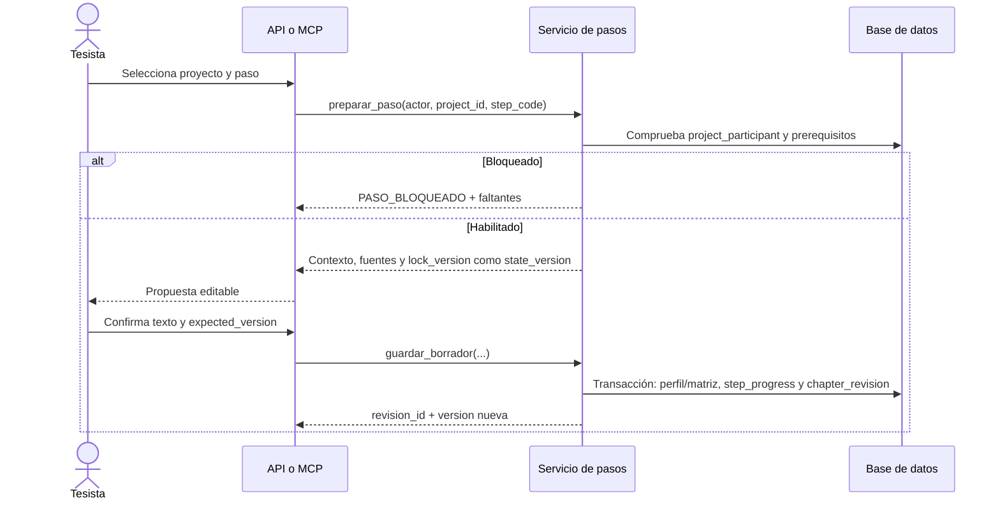

# Secuencia del sistema

La [especificación de implementación](./arquitectura_detallada_componentes.md) es la referencia para programar este flujo y el [modelo físico](./modelo_datos_fisico.md) define sus tablas. Cada paso tiene identificador `P01` a `P32`; el árbol del problema forma parte de `P06`.

## Preparación y guardado



El cliente de IA puede redactar, pero el guardado solo ocurre después de la confirmación del tesista. `expected_version` se compara con `research_profile.lock_version`; un conflicto de versión o una fuente ajena al proyecto devuelve un error sin modificar la base de datos. La revisión actual guarda el Markdown entregado en un guardado de paso y no se edita en sitio; `step_code` identifica ese paso. El código todavía no garantiza que esa revisión contenga el capítulo completo que el asesor aprueba; ver la [guía de backend completo](./guia_backend_version_completa_para_agentes.md).

## Revisión del asesor

```mermaid
sequenceDiagram
    actor Tesista
    actor Asesor
    participant Servicio as Servicio de revisión
    participant DB as Base de datos
    Tesista->>Servicio: Enviar revisión vigente
    Servicio->>DB: DRAFT a READY + review_event SUBMIT
    Asesor->>Servicio: Comentar revisión y solicitar cambios
    Servicio->>DB: review_comment + evento REQUEST_CHANGES
    Tesista->>Servicio: Guardar nueva revisión
    Servicio->>DB: Nueva chapter_revision; estado DRAFT
    Tesista->>Servicio: Reenviar
    Servicio->>DB: Estado READY + evento SUBMIT
    Asesor->>Servicio: Aprobar revisión vigente
    Servicio->>DB: approved_revision_id + evento APPROVE
```

La aprobación exige un asesor activo, la revisión vigente y ausencia de comentarios abiertos. `chapter.approved_revision_id` señala la versión aprobada; `review_event` conserva la decisión incluso si el capítulo se reabre. Un comentario mantiene su ancla en la revisión original. El endpoint actual exporta un borrador y no exige que todos los capítulos estén aprobados.
