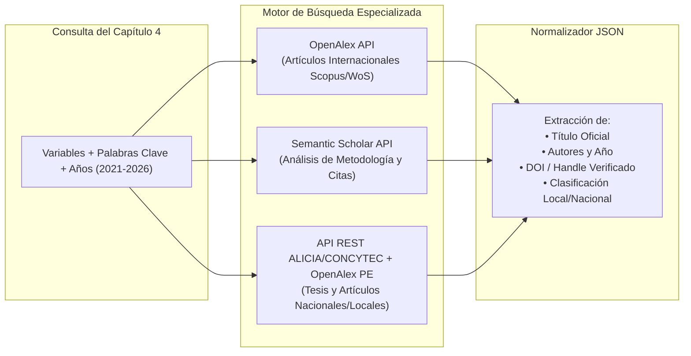

# Estrategia de Búsqueda Científica y Conexión de Antecedentes

Para erradicar la alucinación de referencias y DOIs inventados por los LLMs comerciales, el sistema implementa una arquitectura de recuperación científica dual.

---

## 1. El Problema de la Búsqueda General en LLMs
Las búsquedas web estándar de ChatGPT o Claude rastrean la web abierta indexada por Google/Bing. En el contexto de tesis de pregrado peruanas, esto genera tres problemas:
1. **Contenido no indexado:** La mayoría de tesis de universidades peruanas están alojadas en repositorios institucionales cerrados (DSpace) que los crawlers comunes no parsean adecuadamente.
2. **Alucinación de referencias:** Los LLMs tienden a combinar apellidos de investigadores reales con títulos inventados o DOIs de otros artículos.
3. **Falta de cumplimiento temporal:** Las universidades exigen antecedentes con un límite de antigüedad (máximo 5 años).

---

## 2. Arquitectura de Búsqueda Científica Dual



---

## 3. Fuentes Integradas

### 3.1 OpenAlex API y Semantic Scholar (Ámbito Internacional)
* **Descripción:** Más de 250 millones de obras científicas indexadas y análisis de grafos académicos.
* **Uso en el sistema:** Recuperar artículos indexados en revistas Q1-Q4 de Scopus y Web of Science con sus enlaces abiertos a PDF.
* **Etiquetado:** Toda consulta devuelve `verification_level="METADATA_ONLY"` y `full_text_inspected=False`.

### 3.2 API REST ALICIA CONCYTEC + OpenAlex PE (Ámbito Nacional y Local)
* **Descripción:** Acceso a la API REST nativa abierta de ALICIA (`https://alicia.concytec.gob.pe/vufind/api/v1/search`) que unifica la producción de más de 140 universidades licenciadas del Perú, complementado con artículos revisados por pares con filiación peruana (`country_code:PE`).
* **Resolución Técnica:** Supera los bloqueos HTTP 403 derivados de protecciones Cloudflare en repositorios DSpace individuales, consultando el catálogo central en formato JSON.
* **Motor Geográfico Dinámico (`geography.py`):** Resuelve el alcance local según el lugar configurado en el proyecto (`profile.place`, ej. Piura, Arequipa, etc.), asociando provincias, distritos e instituciones regionales (`UDEP`, `UNP`, etc.).
* **Clasificación Explicable:** Cada resultado es catalogado de forma determinista como `LOCAL_POR_INSTITUCION`, `LOCAL_POR_OBJETO_ESTUDIO` o `NACIONAL`.

---

## 4. Herramientas MCP Operativas: `buscar_semantic_scholar` y `buscar_antecedentes_peru`

```python
# Herramienta MCP de Ámbito Nacional y Local
@app.tool()
def buscar_antecedentes_peru(
    project_id: str,
    query: str,
    scope_filter: str = "todos",  # "todos" | "locales" | "nacionales"
    include_articles: bool = True,
    limit: int = 5
) -> dict[str, Any]:
    """
    Retorna publicaciones y tesis peruanas reales verificadas contra ALICIA y OpenAlex PE.
    Incluye:
    - title: str
    - authors: list[str]
    - publication_year: int
    - institution: str
    - handle_url: str (Handle oficial del repositorio institucional)
    - es_local: bool
    - justificacion_local: str ("LOCAL_POR_INSTITUCION", "LOCAL_POR_OBJETO_ESTUDIO", "NACIONAL")
    - verification_level: "METADATA_ONLY"
    """
```

---

## 5. Integración con el Flujo de Redacción
1. La herramienta entrega los antecedentes reales al estudiante.
2. El estudiante revisa la lista y selecciona cuáles desea incluir (ej. 3 internacionales y 2 nacionales).
3. El **Agente Generador** redacta los antecedentes respetando la fórmula metodológica:
   * Autor y año.
   * Objetivo del estudio.
   * Metodología y muestra empleada.
   * Conclusiones principales.
   * Aporte específico y relación con la tesis del alumno.
