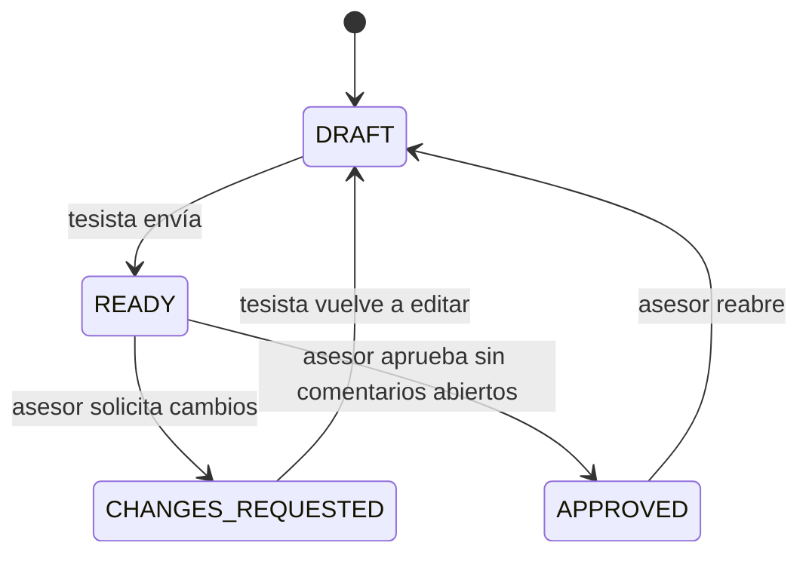

# Revisión y comentarios del asesor

> **Estado verificado al 18/10/2026.** El flujo está implementado en `backend/thesis/services/reviews.py`, `backend/thesis/admin.py` y `backend/thesis/api/projects.py`.

## Ciclo de vida

Cada envío referencia la última `ChapterRevision`. Las revisiones y `ReviewEvent` no se reescriben; una corrección crea una revisión nueva.

## Comentarios anclados

`ReviewComment` conserva revisión, autor, posiciones `start_cp` y `end_cp`, texto seleccionado, cuerpo, estado y datos de resolución. El servicio comprueba que el rango corresponda exactamente al texto de la revisión. Un asesor no puede aprobar mientras existan comentarios `OPEN`.

## Acceso

- El titular guarda pasos y envía capítulos.
- El asesor activo consulta el panel, añade comentarios y decide.
- La pertenencia se valida en los servicios; la interfaz no sustituye el control de autorización.
- El panel actual es Django Admin/Unfold. No existe un visor propio tipo Google Docs.

## API implementada

| Operación | Ruta |
| :--- | :--- |
| Asignar asesor | `POST /api/v1/projects/{project_id}/advisor` |
| Ver panel del asesor | `GET /api/v1/projects/advisor/dashboard` |
| Enviar capítulo | `POST /api/v1/projects/{project_id}/chapters/{chapter_no}/submit` |
| Crear comentario | `POST /api/v1/projects/{project_id}/chapters/{chapter_no}/comments` |
| Listar comentarios | `GET /api/v1/projects/{project_id}/chapters/{chapter_no}/comments` |
| Resolver comentario | `POST /api/v1/projects/{project_id}/comments/{comment_id}/resolve` |
| Decidir capítulo | `POST /api/v1/projects/{project_id}/chapters/{chapter_no}/decision` |

## Exportador de borrador Word

`GET /api/v1/projects/{project_id}/export/draft.docx` ensambla las revisiones guardadas en un DOCX editable. Aplica A4, Arial 11, interlineado doble y márgenes basados en el Anexo 15 de la Guía del Egresado UTP v14.

El archivo no incorpora todavía la carátula institucional completa, el reporte de similitud ni una validación exhaustiva de APA 7. P20 acepta `IEEE` y `APA_7`, pero el formato de cada referencia requiere revisión humana.

## Pruebas

El flujo se cubre en `backend/thesis/tests/test_academic_flow.py`: revisión inmutable, comentario anclado, bloqueo de aprobación y control de pertenencia.
