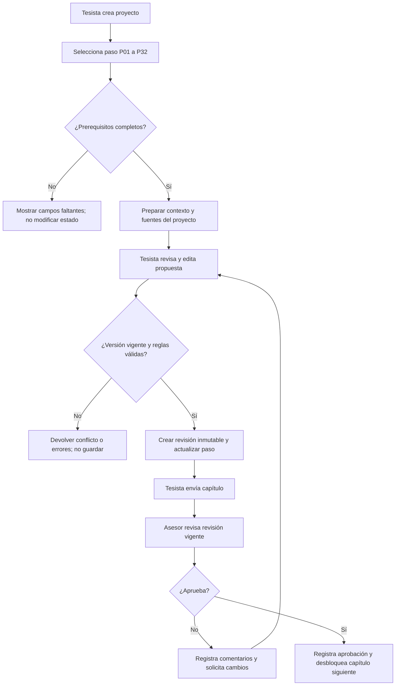
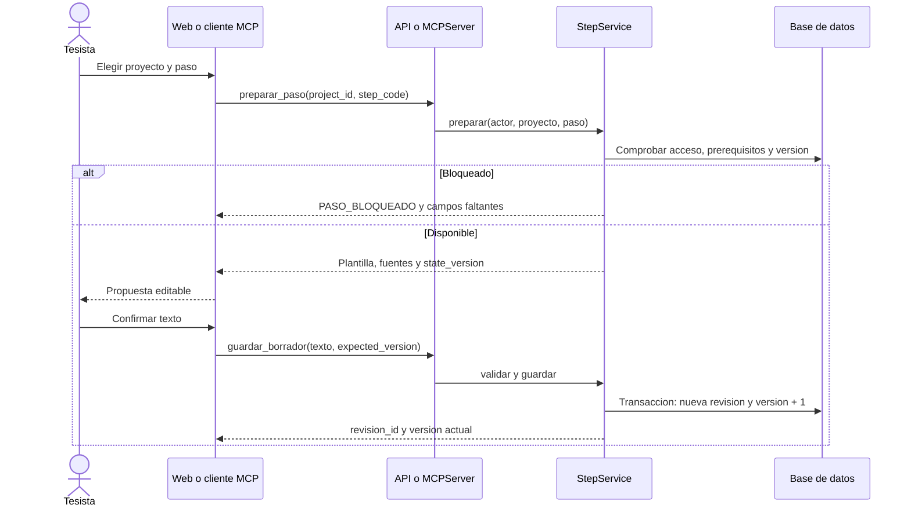
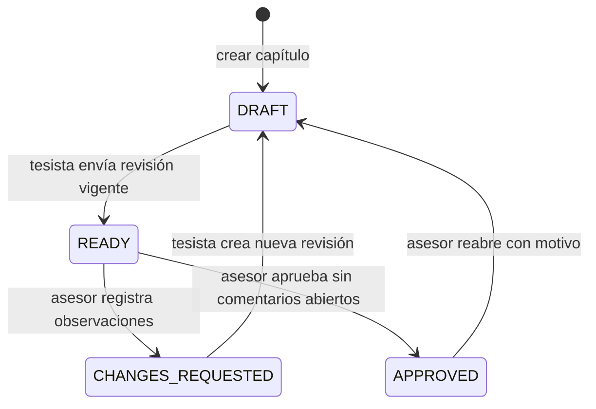
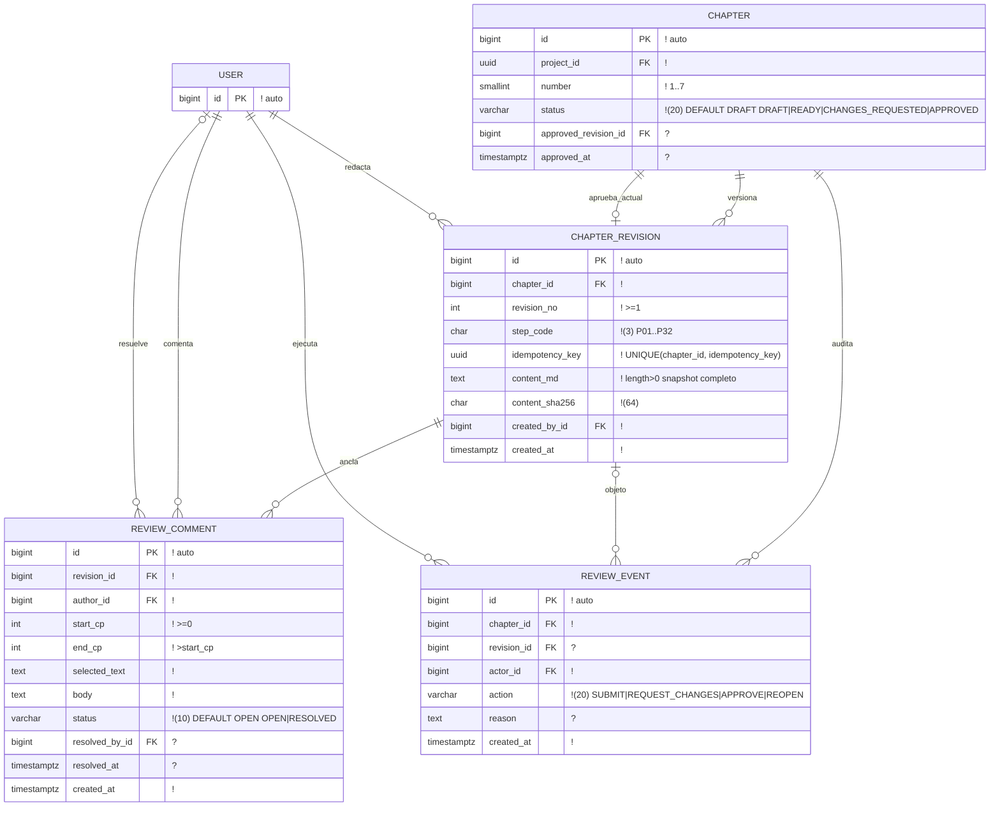
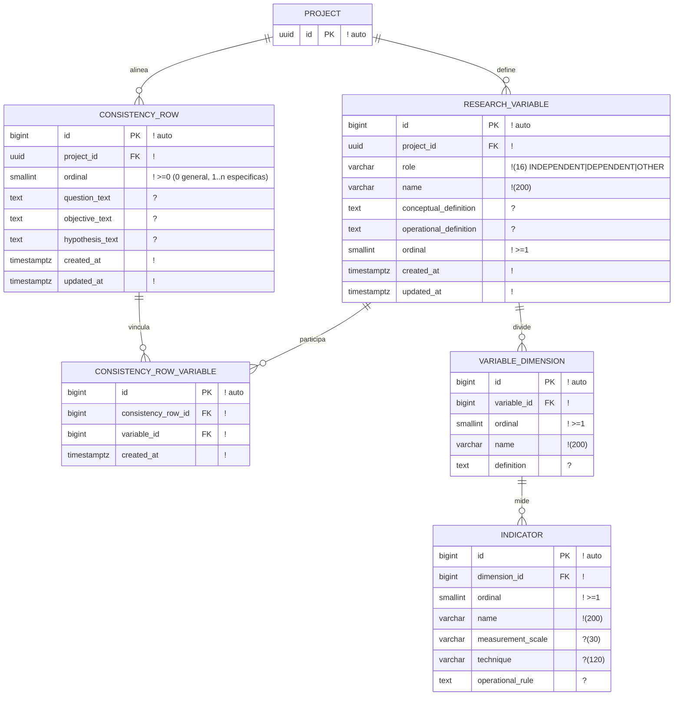
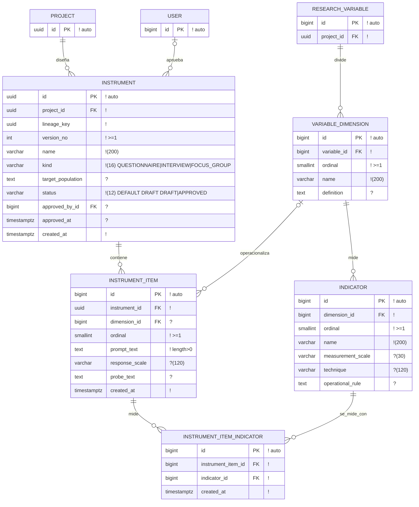
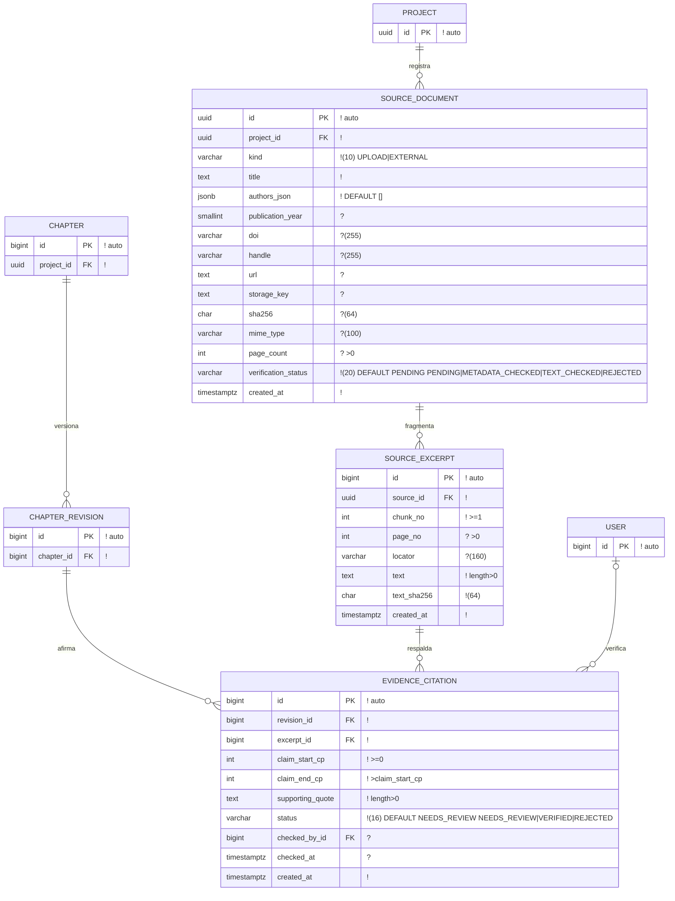

# INFORME DEL PROYECTO: CURSO INTEGRADOR I
## ESCUELA PROFESIONAL DE INGENIERÍA DE SISTEMAS E INFORMÁTICA

---

> **Estado técnico verificado al 18/10/2026:** el backend cuenta con los 32 pasos (`P01`–`P32`), 27 modelos, 18 migraciones y 59 pruebas automatizadas. El tesista trabaja por medio de MCP o de la API y el asesor usa el panel de Django Admin/Unfold. Todavía no hay una web propia para el tesista, despliegue en un servidor público, pruebas con usuarios ni exportación completa de la tesis en formato institucional.

### TÍTULO DEL PROYECTO:
**"Desarrollo de una Plataforma Colaborativa basada en Protocolo MCP, Roles Secuenciales y Validación Determinista para la Asistencia Metodológica y Supervisión de Tesis Universitarias"**

* **Autor / Líder de Proyecto:** Josué Carrasco García  
* **Institución:** Universidad Tecnológica del Perú (UTP) - Sede Piura  
* **Carrera:** Ingeniería de Sistemas e Informática  
* **Ciclo:** 7mo Ciclo  
* **Curso:** Curso Integrador I: Sistemas - Software  
* **Fecha:** Octubre 2026  
* **Entrega:** Avance de Proyecto Final 2 (APF2)  

---

## ÍNDICE DEL INFORME

* [CAPÍTULO I: DESCRIPCIÓN DE LA SITUACIÓN PROBLEMA DEL PROYECTO](#capítulo-i-descripción-de-la-situación-problema-del-proyecto)
  * [1.1 Contexto de la Organización (5 Aspectos Institucionales)](#11-contexto-de-la-organización-5-aspectos-institucionales)
  * [1.2 Descripción del Problema](#12-descripción-del-problema)
  * [1.3 Formulación del Problema (General y Específicos)](#13-formulación-del-problema)
  * [1.4 Alcance del Proyecto y Delimitación Ética](#14-alcance-del-proyecto-y-delimitación-ética)
* [CAPÍTULO II: MARCO TEÓRICO Y ANTECEDENTES](#capítulo-ii-marco-teórico-y-antecedentes)
  * [2.1 Marco Teórico de Programación Orientada a Objetos](#21-marco-teórico-de-programación-orientada-a-objetos)
  * [2.2 Marco Teórico del Sistema](#22-marco-teórico-del-sistema)
    * [2.2.1 Breve Reseña Histórica de la Empresa](#221-breve-reseña-histórica-de-la-empresa)
    * [2.2.2 Definición del Sistema](#222-definición-del-sistema)
    * [2.2.3 Descripción de la Secuencia de Pasos del Proceso Actual (Manual)](#223-descripción-de-la-secuencia-de-pasos-del-proceso-actual-del-sistema-manual)
    * [2.2.4 Gráficos de la Secuencia de Pasos del Sistema Manual](#224-gráficos-de-la-secuencia-de-pasos-del-sistema-manual)
  * [2.3 Antecedentes de la Investigación](#23-antecedentes-de-la-investigación)
    * [2.3.1 Antecedentes Internacionales](#231-antecedentes-internacionales)
    * [2.3.2 Antecedentes Nacionales](#232-antecedentes-nacionales)
    * [2.3.3 Antecedente Local (Departamento de Piura)](#233-antecedente-local-departamento-de-piura)
    * [2.3.4 Matriz Comparativa y Brecha de Investigación](#234-matriz-comparativa-y-brecha-de-investigación)
    * [2.3.5 Contraste Tecnológico y Arquitectural: Antecedentes frente a TesisMCP](#235-contraste-tecnológico-y-arquitectural-antecedentes-frente-a-tesismcp)
* [CAPÍTULO III: OBJETIVOS Y JUSTIFICACIÓN](#capítulo-iii-objetivos-y-justificación)
  * [3.1 Objetivo General](#31-objetivo-general)
  * [3.2 Objetivos Específicos](#32-objetivos-específicos)
  * [3.3 Justificación (Social, Práctica y Técnica)](#33-justificación)
* [CAPÍTULO IV: PLANIFICACIÓN DEL PROYECTO](#capítulo-iv-planificación-del-proyecto)
  * [4.1 Lienzo Lean Canvas (9 Bloques Oficiales)](#41-lienzo-lean-canvas)
  * [4.2 Acta de Constitución del Proyecto (Project Charter)](#42-acta-de-constitución-del-proyecto-project-charter)
  * [4.3 Cronograma de Actividades (Diagrama de Gantt)](#43-cronograma-de-actividades-diagrama-de-gantt)
  * [4.4 Presupuesto Estimado del Proyecto](#44-presupuesto-estimado-del-proyecto)
* [CAPÍTULO V: TÉCNICAS E INSTRUMENTOS DE RECOLECCIÓN DE DATOS](#capítulo-v-técnicas-e-instrumentos-de-recolección-de-datos)
  * [5.1 Técnicas de Recolección de Datos](#51-técnicas-de-recolección-de-datos)
  * [5.2 Instrumentos de Recolección de Datos](#52-instrumentos-de-recolección-de-datos)
* [CAPÍTULO VI: METODOLOGÍA DEL PROYECTO](#capítulo-vi-metodología-del-proyecto)
  * [6.1 Fase 01: Diagnóstico (FODA, Ishikawa y Causa-Efecto)](#61-fase-01-diagnóstico)
  * [6.2 Fase 02: Análisis de Riesgos de TI](#62-fase-02-análisis-de-riesgos-de-ti)
  * [6.3 Fase 03: Especificación de Requerimientos (RF y RNF)](#63-fase-03-especificación-de-requerimientos)
  * [6.4 Fase 04: Flujo operativo y secuencia de casos de uso](#64-fase-04-flujo-operativo-y-secuencia-de-casos-de-uso)
  * [6.5 Fase 05: Estados, datos y contratos de implementación](#65-fase-05-estados-datos-y-contratos-de-implementación)
  * [6.6 Fase 06: Planteamiento de 3 Alternativas de Solución (5 Pantallas c/u)](#66-fase-06-planteamiento-de-3-alternativas-de-solución)
  * [6.7 Fase 07: Diseño del Prototipo Funcional](#67-fase-07-diseño-del-prototipo-funcional)
* [REFERENCIAS BIBLIOGRÁFICAS](#referencias-bibliográficas)

---

## CAPÍTULO I: DESCRIPCIÓN DE LA SITUACIÓN PROBLEMA DEL PROYECTO

### 1.1 Contexto de la Organización (5 Aspectos Institucionales)

El proyecto se ubica en la **Universidad Tecnológica del Perú (UTP), sede Piura**, dentro de la carrera de Ingeniería de Sistemas e Informática. A continuación se presentan los cinco aspectos institucionales, separando lo publicado por la universidad de lo que propone este proyecto:

1. **Visión:** Ser la primera opción para estudiantes con afán de superación que contribuyan a un Perú mejor (Universidad Tecnológica del Perú, s. f.-a).
2. **Misión:** Dar acceso a educación superior de calidad que permita a los peruanos alcanzar una vida mejor (Universidad Tecnológica del Perú, s. f.-a).
3. **Entorno:** La UTP regula los trámites de grado y título mediante su Reglamento de Grados y Títulos (Universidad Tecnológica del Perú, s. f.-b). Dentro de ese proceso, definir la metodología, guardar los avances y coordinar con el asesor son tareas que pueden apoyarse con herramientas digitales, sin asumir que la tesis sea la única forma de titularse.
4. **Estrategias propuestas en el proyecto:** 
   * Ordenar el avance metodológico en los cursos integradores mediante pasos cortos y verificables.
   * Guardar las versiones del documento y las correcciones del asesor en un solo lugar.
   * Comprobar las fuentes bibliográficas y mantener la revisión del docente cuando el alumno usa inteligencia artificial.
5. **Planes de la Organización:** TesisMCP se plantea como una propuesta académica acorde con el trabajo de investigación aplicada en la carrera. Este informe no atribuye a la UTP planes internos ni metas de titulación que no estén publicados oficialmente.

---

### 1.2 Descripción del Problema

Redactar los primeros capítulos de una tesis exige que el problema, las preguntas, los objetivos y las variables coincidan entre sí. Si el estudio lleva hipótesis, estas también deben responder a las preguntas y objetivos. Cuando el estudiante cambia una parte, tiene que corregir las demás secciones relacionadas sin perder el registro de lo que ya había acordado con su asesor.

En la práctica, usar chats de inteligencia artificial sueltos e intercambiar archivos por correo o mensajería genera tres problemas frecuentes:
1. **Se pierde la continuidad entre secciones:** En un chat común no queda guardado qué título, variables o alcance ya fueron aprobados, por lo que en nuevas sesiones el texto suele contradecirse con lo anterior.
2. **Aparecen citas sin comprobar:** Un modelo de lenguaje puede inventar autores, años o títulos que parecen reales pero no existen. Además, que un artículo tenga enlace o DOI no garantiza por sí solo que diga lo que el párrafo afirma.
3. **Las revisiones quedan dispersas:** Cuando los borradores y comentarios van y vienen en distintos archivos de Word o correos, cuesta saber cuál es la última versión revisada por el asesor y qué observaciones siguen sin corregirse. El impacto real de estas dificultades se medirá con las encuestas y entrevistas planteadas en el Capítulo V.

---

### 1.3 Formulación del Problema

#### Problema General
¿De qué manera una plataforma colaborativa basada en el protocolo MCP, roles por turnos y reglas de validación fijas puede ayudar a redactar y supervisar los capítulos 1 al 7 de una tesis universitaria?

#### Problemas Específicos
* **PE1:** ¿Cómo guardar el título, el problema, las variables y los objetivos para reutilizarlos sin contradicciones a lo largo del trabajo?
* **PE2:** ¿Cómo disminuir las referencias falsas o mal citadas apoyándose en los PDFs del propio estudiante y en buscadores científicos abiertos?
* **PE3:** ¿De qué forma facilitar que el asesor revise una versión clara del capítulo, deje observaciones puntuales y registre su aprobación?

---

### 1.4 Alcance del Proyecto y Delimitación Ética

* **Alcance Funcional:** El sistema cubre desde el **Capítulo 1 (Selección del tema y delimitación)** hasta el **Capítulo 7 (Diseño de instrumentos: encuestas y entrevistas)**.
* **Límite Ético del Software:** El sistema incluye reglas para rechazar pedidos de inventar respuestas de encuestas, simular encuestados o calcular estadísticas sin datos reales. El trabajo de campo (aplicar las encuestas o entrevistas reales) le corresponde al estudiante y está fuera de lo que hacen los capítulos 1 al 7.

---

## CAPÍTULO II: MARCO TEÓRICO Y ANTECEDENTES

### 2.1 Marco Teórico de Programación Orientada a Objetos

El backend de TesisMCP está organizado usando **Programación Orientada a Objetos (POO)**. Este enfoque ayuda a dividir el sistema en partes claras y fáciles de mantener (Booch et al., 2007). A continuación se explican los cuatro conceptos básicos y cómo se usan en el código del proyecto:

1. **Definición de Programación Orientada a Objetos:**  
   Es una forma de programar basada en *clases* y *objetos*. Una clase funciona como un molde que agrupa datos (atributos) y acciones (métodos), y los objetos se comunican entre sí mediante funciones definidas (Booch et al., 2007). En TesisMCP, esto sirve para separar las reglas del proyecto en archivos de servicio como `steps.py`, `reviews.py` y `evidence.py`. Así, la lógica que guarda revisiones y valida permisos queda separada de la interfaz web y del servidor MCP.

2. **Herencia (*Inheritance*):**  
   Permite que una clase nueva (clase hija) tome la estructura y las funciones de una clase base (clase padre) para adaptarlas sin repetir código (Booch et al., 2007). En TesisMCP, la clase base `BaseStepMaterializer` define las funciones que todo paso necesita (`materialize`, `validate_inputs` y `compute_diff`), y de ella heredan las clases encargadas de cada capítulo (`Capitulo1ProblemMaterializer`, `Capitulo2AntecedentsMaterializer`, `Capitulo3ObjectivesMaterializer`, entre otras) para atender los 32 pasos metodológicos.

3. **Polimorfismo (*Polymorphism*):**  
   Permite que distintas clases respondan al mismo nombre de método, pero ejecutando cada una su propia tarea según el caso (Booch et al., 2007). En TesisMCP se usa un registro de pasos (`StepRegistry`). Cuando el sistema recibe la orden `preparar_paso(project_id, step_code)`, llama a `registry.get(step_code).materialize(...)`. El programa usa la misma llamada para cualquiera de los 32 pasos (`P01` a `P32`), y cada clase aplica las reglas que le tocan sin usar largas listas de condicionales `if/else`.

4. **Arrays (Arreglos y Colecciones de Datos):**  
   Un arreglo o lista es una estructura que guarda varios elementos en orden para recorrerlos o consultarlos por su posición. En TesisMCP se usan listas tipadas en tres lugares:
   * *En la validación de datos (Pydantic y Python):* Listas como `List[str]` o `List[SourceReference]` para guardar los problemas específicos, objetivos secundarios, variables y referencias.
   * *En la base de datos (PostgreSQL):* Columnas de tipo `ARRAY` y `JSONB` donde se guardan palabras clave, listas de autores y el orden de los 32 pasos.
   * *En la matriz de consistencia:* Tablas y listas que relacionan cada problema específico $i$ con su objetivo específico $i$ y su hipótesis correspondiente.

---

### 2.2 Marco Teórico del Sistema

#### 2.2.1 Breve Reseña Histórica de la Empresa (Organización)

El proyecto toma como referencia el contexto de la **Universidad Tecnológica del Perú (UTP) - Sede Piura**, en la Escuela Profesional de Ingeniería de Sistemas e Informática.

La UTP fue fundada en 1997 con enfoque en carreras de ingeniería y tecnología. En 2012 pasó a formar parte del Grupo Intercorp, con lo cual renovó sus laboratorios de cómputo y abrió nuevos campus en distintas regiones del país (Universidad Tecnológica del Perú, s. f.-a).

Dentro de esa expansión se inauguró la **Sede Piura**, ubicada en el distrito de Veintiséis de Octubre (Av. Sánchez Cerro con Av. Prolongación Chulucanas). En junio de 2019, la universidad obtuvo el licenciamiento institucional de la SUNEDU mediante la **Resolución del Consejo Directivo N° 081-2019-SUNEDU/CD** (SUNEDU, 2019), tras verificarse las Condiciones Básicas de Calidad en sus locales y programas.

En la carrera de Ingeniería de Sistemas e Informática, los estudiantes avanzan su trabajo de investigación a lo largo de cursos como Curso Integrador I, Curso Integrador II y Taller de Tesis. En la práctica diaria, el seguimiento de estos avances suele hacerse intercambiando documentos de Word y mensajes por separado (Universidad Tecnológica del Perú, s. f.-b), lo que motiva proponer una herramienta que ordene las entregas y revisiones en un solo sistema.

#### 2.2.2 Definición del Sistema

**TesisMCP** es un sistema de apoyo para redactar y revisar avances de tesis universitaria. Se divide en dos partes principales:

* **Módulo para el estudiante tesista (Asistencia y Formulación Metodológica):**  
  Guía el desarrollo de los Capítulos 1 al 7 divididos en 32 pasos cortos. Entrega plantillas para cada paso, comprueba que el problema, los objetivos y las variables coincidan en la matriz de consistencia, rechaza intentos de inventar datos de encuestas y permite buscar fuentes científicas guardando el número de página de donde sale cada cita.
* **Módulo para el docente asesor (Supervisión y Control de Revisiones):**  
  Permite al profesor ver el avance de sus estudiantes en un panel, revisar versiones fijas de cada capítulo (que no se sobrescriben mientras las corrige), dejar comentarios sobre partes exactas del texto, comprobar las fuentes usadas por el alumno y aprobar o pedir correcciones siguiendo estados claros (`DRAFT`, `READY`, `CHANGES_REQUESTED`, `APPROVED`).

El sistema se apoya en cinco elementos técnicos:

1. **Protocolo MCP (*Model Context Protocol*):**  
   Es un estándar abierto creado por Anthropic (2024) para conectar asistentes de inteligencia artificial con servidores de datos o herramientas. Gracias a esto, el estudiante puede conectarse al sistema desde cualquier cliente compatible.
2. **Roles por turnos en el asistente:**  
   El mismo asistente de IA toma tres papeles según el momento: orientar la redacción, buscar fragmentos en las fuentes y revisar si el borrador cumple el formato pedido. La decisión final de guardar en la base de datos no la toma la IA, sino las validaciones en Python del backend.
3. **Búsqueda en documentos propios (RAG):**  
   Permite extraer fragmentos de los PDFs que sube el estudiante para respaldar lo que escribe, reduciendo el riesgo de citar textos de memoria o inventados.
4. **Buscadores científicos abiertos (OpenAlex y ALICIA CONCYTEC):**  
   Se usan para buscar artículos y tesis reales. OpenAlex sirve para búsquedas internacionales y para artículos con filiación peruana; la API de ALICIA (`/vufind/api/v1/search`) se usa para tesis nacionales y locales de Perú, ya que la consulta directa por protocolo OAI-PMH a varios repositorios universitarios devolvió bloqueos HTTP 403 durante las pruebas. Todo resultado externo se marca primero como "solo metadatos" (`METADATA_ONLY`) hasta que se revise su PDF completo.
5. **Formatos de citación (IEEE y APA 7ª):**  
   El sistema permite elegir cualquiera de los dos estilos bibliográficos usados en la universidad al momento de armar el documento.

#### 2.2.3 Descripción de la Secuencia de Pasos del Proceso Actual del Sistema (Manual)

Hoy en día, el avance y la revisión de tesis suelen manejarse por separado usando Word (`.docx`), visores de PDF y correo electrónico. A continuación se listan los pasos habituales del alumno y del asesor con tiempos estimados. *Nota: estos tiempos son estimaciones de planificación para el curso y no provienen de una medición estadística con usuarios.*

##### Proceso 1: Trabajo del Tesista (Manual)
1. **(a) Paso 1 - Búsqueda de artículos y tesis:** El alumno busca por su cuenta en navegadores web generales, muchas veces sin revisar si las fuentes están indexadas o tienen datos completos.  
   *Tiempo estimado:* **720 minutos (12.0 horas)**.
2. **(b) Paso 2 - Redacción en procesador de texto:** Escribe los capítulos en archivos de Word en su computadora, sin una guía que verifique al instante si el texto sigue alineado con sus variables.  
   *Tiempo estimado:* **1440 minutos (24.0 horas)**.
3. **(c) Paso 3 - Armado manual de citas y referencias:** Escribe a mano los autores, años y títulos, donde es común cometer errores de formato o arrastrar citas incompletas.  
   *Tiempo estimado:* **480 minutos (8.0 horas)**.
4. **(d) Paso 4 - Revisión visual de la matriz de consistencia:** Compara leyendo pantalla por pantalla si el problema, las preguntas y los objetivos dicen lo mismo.  
   *Tiempo estimado:* **360 minutos (6.0 horas)**.
5. **(e) Paso 5 - Envío del archivo por correo o aula virtual:** Guarda el archivo con nombres manuales (como `Borrador_Capitulo2_rev4.docx`) y lo envía por correo o Canvas.  
   *Tiempo estimado:* **60 minutos (1.0 hora)**.
6. **(f) Paso 6 - Espera de respuesta del asesor:** Tiempo de espera mientras el docente revisa los correos acumulados de sus distintos alumnos y cursos.  
   *Tiempo estimado:* **7200 minutos (120.0 horas / 5 días hábiles)**.
7. **(g) Paso 7 - Corrección de observaciones:** El alumno descarga el archivo con comentarios, interpreta las notas dejadas al margen y corrige los párrafos observados.  
   *Tiempo estimado:* **780 minutos (13.0 horas)**.

*Tiempo total estimado de trabajo activo del tesista por entrega:* **3840 minutos (64.0 horas netas)** + 120.0 horas de espera de respuesta.

##### Proceso 2: Revisión del Asesor Docente (Manual)
1. **(f) Paso 1 - Descarga del archivo recibido:** El docente busca el correo del alumno, descarga el adjunto y lo guarda en una carpeta de su computadora.  
   *Tiempo estimado:* **20 minutos**.
2. **(g) Paso 2 - Búsqueda de la versión anterior:** Revisa correos o carpetas pasadas para recordar qué versión había entregado antes el estudiante y qué correcciones tenía pendientes.  
   *Tiempo estimado:* **40 minutos**.
3. **(h) Paso 3 - Lectura y revisión metodológica:** Lee el documento para evaluar si el problema, el marco teórico y los objetivos tienen sentido entre sí.  
   *Tiempo estimado:* **180 minutos (3.0 horas)**.
4. **(i) Paso 4 - Comprobación de citas:** Busca en internet algunas de las referencias citadas para confirmar que existan y que correspondan al tema.  
   *Tiempo estimado:* **90 minutos (1.5 horas)**.
5. **(j) Paso 5 - Anotación de correcciones:** Escribe comentarios al margen en Word o redacta una lista de observaciones en el correo.  
   *Tiempo estimado:* **80 minutos (1.3 horas)**.
6. **(k) Paso 6 - Envío de respuesta y apunte en su registro:** Envía el archivo corregido al estudiante y anota el avance en su control personal.  
   *Tiempo estimado:* **30 minutos**.

*Tiempo total estimado de revisión docente por alumno en cada entrega:* **440 minutos (7.3 horas netas)**.

#### 2.2.4 Gráficos de la Secuencia de Pasos del Sistema Manual

Las siguientes tablas resumen los pasos, las herramientas usadas y los tiempos estimados del trabajo manual tanto del estudiante como del asesor:

| Paso del Proceso Manual del Tesista | Acción Realizada | Herramienta Empleada | Tiempo de Demora | Condición de Salida |
| :--- | :--- | :--- | :--- | :--- |
| **Paso 1: Búsqueda de fuentes** | Búsqueda abierta de artículos y tesis | Navegador web / Google | 720 min (12.0 h) | Fuentes sueltas |
| **Paso 2: Redacción del borrador** | Escritura manual de los capítulos | Microsoft Word | 1440 min (24.0 h) | Borrador inicial |
| **Paso 3: Formateo de citas** | Escritura manual de citas y bibliografía | Procesador de texto | 480 min (8.0 h) | Citas sin comprobar |
| **Paso 4: Cotejo de consistencia** | Comparación visual de problema y objetivos | Lectura manual | 360 min (6.0 h) | Borrador revisado |
| **Paso 5: Envío del entregable** | Guardado y envío por correo o Canvas | Correo electrónico | 60 min (1.0 h) | Archivo enviado |
| **Paso 6: Espera de respuesta** | Espera de revisión del docente | Bandeja de entrada | 7200 min (5 días) | Respuesta recibida |
| **Paso 7: Levantamiento de notas** | Corrección manual de párrafos observados | Microsoft Word | 780 min (13.0 h) | Versión corregida |

*Secuencia de flujo del tesista:*  
`Paso 1 (720 min) → Paso 2 (1440 min) → Paso 3 (480 min) → Paso 4 (360 min) → Paso 5 (60 min) → Paso 6 (Espera 7200 min) → Paso 7 (780 min) → [¿Aprobado?] → [No: Re-redacción] / [Sí: Capítulo Aprobado]`

| Paso del Proceso Manual del Asesor | Acción Realizada | Herramienta Empleada | Tiempo de Demora | Condición de Salida |
| :--- | :--- | :--- | :--- | :--- |
| **Paso 1: Recepción y descarga** | Búsqueda y descarga de archivos adjuntos | Correo / Canvas | 20 min | Archivo en disco |
| **Paso 2: Rastreo de historial** | Búsqueda de entregas previas del alumno | Carpetas locales | 40 min | Versión anterior ubicada |
| **Paso 3: Revisión metodológica** | Lectura de capítulos y coherencia | Word / Lector PDF | 180 min (3.0 h) | Revisión lista |
| **Paso 4: Comprobación de fuentes** | Búsqueda web para confirmar que las citas existen | Google Scholar | 90 min (1.5 h) | Fuentes revisadas |
| **Paso 5: Redacción de notas** | Escritura de comentarios y observaciones | Control de cambios Word | 80 min (1.3 h) | Observaciones listas |
| **Paso 6: Envío y registro** | Envío del archivo y apunte en hoja de control | Correo / Excel | 30 min | Registro actualizado |

*Secuencia de flujo del asesor:*  
`Paso 1 (20 min) → Paso 2 (40 min) → Paso 3 (180 min) → Paso 4 (90 min) → Paso 5 (80 min) → Paso 6 (30 min) → Entrega devuelta al estudiante`

---

### 2.3 Antecedentes de la Investigación

Se revisaron siete estudios base (tres internacionales, tres nacionales y uno local sobre Piura) junto con tres estudios adicionales revisados a texto completo en PDF. En cada caso se distingue qué resultados fueron medidos en los documentos y qué partes son solo propuestas.

#### 2.3.1 Antecedentes Internacionales

1. **Skarlinski et al. (PaperQA2, 2024):**  
   Crearon un agente que busca artículos científicos, compara sus resultados y responde mostrando las citas utilizadas. En una prueba para detectar contradicciones entre artículos de biología, especialistas confirmaron el 70 % de los casos señalados por el sistema. Para TesisMCP, este trabajo sirve de referencia sobre cómo enlazar cada afirmación con el documento de donde sale, aunque no elimina por completo el riesgo de respuestas equivocadas.

2. **Su et al. (VIRSCI, ACL 2025):**  
   Presentaron un sistema con varios agentes donde unos proponen ideas de investigación y otros las critican y refinan. En sus pruebas obtuvieron ideas con mayor puntaje de novedad que el método base con el que se compararon. Para TesisMCP aporta la idea de separar el momento de redactar del momento de revisar, aunque el estudio original no evalúa tesis universitarias.

3. **Wan et al. (CogWriter, 2025):**  
   Propusieron dividir la escritura de textos largos en un plan por partes, redactando y revisando cada sección por separado. En la prueba LongGenBench lograron un 22 % más de precisión que GPT-4o al seguir instrucciones largas y generaron textos de más de 10 000 palabras. Esto respalda la decisión de dividir TesisMCP en pasos cortos en vez de pedir un capítulo entero de una sola vez, tomando en cuenta que su prueba fue en un benchmark general y no con tesistas.

#### 2.3.2 Antecedentes Nacionales

4. **Córdova Carrascal y Paulini Pereyra (Universidad Ricardo Palma, 2020):**  
   Hicieron un sistema web para gestionar planes y borradores de tesis en la carrera de Ingeniería Informática. Su plataforma guarda versiones de documentos, registra asesorías y observaciones, y envía avisos cuando se aprueba un avance. Sirve como antecedente directo para el panel del asesor y el historial de revisiones en TesisMCP. En el resumen de su repositorio no se indica un porcentaje exacto de ahorro de tiempo.

5. **Espejo Franco y Condori Lopez (UNSAAC, 2026):**  
   Desarrollaron un sistema web para el seguimiento de proyectos de tesis en Ingeniería Informática y de Sistemas. Su trabajo describe las demoras de revisión, la falta de comunicación clara y la dependencia de trámites presenciales. Orienta el manejo de estados y entregas en TesisMCP; cabe aclarar que en el registro consultado no se reportan porcentajes de reducción de tiempo.

6. **Tuanama Rojas y Vasquez Torres (Universidad Nacional de la Amazonía Peruana, 2021):**  
   Evaluaron la calidad de uso de un sistema de seguimiento de anteproyectos e informes finales de tesis con seis usuarios de su facultad, reportando hasta un 87 % de aceptación en sus métricas. Este trabajo sirve de guía para planificar las pruebas de uso de TesisMCP, teniendo claro que su muestra fue pequeña (seis personas).

#### 2.3.3 Antecedente Local (Departamento de Piura)

7. **Rosales Rosas (trámite de tesis de la Universidad Nacional de Piura, 2020):**  
   Analizó los pasos, los actores y las trabas del trámite de tesis de pregrado en la Universidad Nacional de Piura (UNP), y diseñó una propuesta de plataforma para llevar el seguimiento por etapas con documentos digitales. Se toma como antecedente local porque estudia el problema en una universidad de Piura (la tesis fue sustentada en la USAT). El documento plantea el diseño del sistema, sin medir mejoras porcentuales tras una implantación.

---

### 2.3.4 Matriz Comparativa y Brecha de Investigación

| Ámbito | Autor(es) y Año | Función estudiada | Resultado o alcance comprobable | Aporte a TesisMCP |
| :--- | :--- | :--- | :--- | :--- |
| **Internacional** | Skarlinski et al. (PaperQA2, 2024) | Búsqueda y resumen científico con citas | 70 % de contradicciones detectadas validadas por especialistas en la muestra | Enlazar cada afirmación con su fuente original |
| **Internacional** | Su et al. (VIRSCI, ACL 2025) | Generación y revisión de ideas con agentes | Mayor novedad frente al método base en sus pruebas | Separar la redacción de la revisión |
| **Internacional** | Wan et al. (CogWriter, 2025) | Planificación y escritura de textos largos por partes | 22 % más precisión que GPT-4o en LongGenBench; textos >10 000 palabras | Dividir la redacción en pasos cortos |
| **Nacional** | Córdova Carrascal y Paulini Pereyra (URP, 2020) | Gestión de planes, borradores y asesorías | Historial de versiones, observaciones y avisos; sin porcentaje en el resumen | Panel del asesor y control de versiones |
| **Nacional** | Espejo Franco y Condori Lopez (UNSAAC, 2026) | Seguimiento de proyectos y trámites de tesis | Sistema web con Docker y Scrum; sin porcentaje de mejora en el registro | Estados de revisión y uso de contenedores |
| **Nacional** | Tuanama Rojas y Vasquez Torres (UNAP, 2021) | Evaluación de uso de un sistema de seguimiento | Hasta 87 % de aceptación en una muestra de seis usuarios | Referencia para las pruebas con usuarios |
| **Local (Piura)** | Rosales Rosas (UNP, 2020) | Trámite de tesis de pregrado en Piura | Propuesta técnica a partir del análisis del proceso; sin medición posterior | Contexto del problema en una universidad de Piura |

Además de los siete trabajos anteriores, se revisaron a texto completo tres estudios adicionales para respaldar con datos concretos las decisiones del sistema:

| Ámbito | Trabajo Complementario (Auditoría a Texto Completo) | Evidencia Empírica Demostrada | Pertinencia Específica para TesisMCP |
| :--- | :--- | :--- | :--- |
| **Nacional** | **Chauca Florian (UCV Lima, 2024)** (Tesis de Ingeniería de Sistemas, 243 págs) | Estudio preexperimental ($n=103$ tesis en 21 mediciones) con Scrum y MVC. El porcentaje de avance subió **19.00 puntos porcentuales** (de 44.80% a 63.80%, Tabla 7) y el de tesis terminadas subió **25.71 puntos porcentuales** (de 18.81% a 44.52%, Tabla 8). | Muestra con datos medidos que llevar el seguimiento en un sistema web mejora el control frente al uso de hojas de cálculo sueltas. |
| **Local (Piura)** | **Cáceres Saldaña & Osores Salgado (UDEP Piura, 2025)** (Tesis de Ing. Industrial y de Sistemas, 54 págs) | Desarrollo de un repositorio web con base de datos relacional para guardar lecciones aprendidas de proyectos en la UDEP Campus Piura. El estudio presenta el sistema construido y deja la medición de impacto para el futuro. | Confirma el problema de archivos dispersos y pérdida de información de proyectos académicos en universidades de Piura. |
| **Internacional** | **Yuan et al. (PaperOrchestrator, Springer 2026)** (Artículo Open Access, DOI: 10.1007/s44443-026-00708-4) | Flujo de 7 etapas con agentes para redactar artículos. Los propios autores midieron que el **68 % de las referencias BibTeX generadas por la IA tenían datos inventados** (*coherent fabrications*). | Demuestra con cifras por qué no se debe dejar que la IA escriba bibliografía libremente sin comprobar antes los documentos reales. |

**Vacío identificado:** Por un lado, los estudios de inteligencia artificial se enfocan en buscar artículos o redactar textos largos, pero no contemplan las reglas de una tesis universitaria ni la revisión de un profesor asesor. Por otro lado, las tesis peruanas revisadas ordenan la entrega de archivos y el seguimiento del asesor, pero no ayudan al alumno durante la redacción ni verifican las citas dentro del texto. TesisMCP busca unir ambas partes en una sola herramienta.

---

### 2.3.5 Contraste Tecnológico y Arquitectural: Antecedentes frente a TesisMCP

Al comparar los trabajos anteriores con lo que hace TesisMCP, se distinguen tres puntos prácticos:

#### 1. Qué toma de las tesis nacionales (Organización del software y base de datos)
Las tesis peruanas (Chauca Florian, 2024; Córdova Carrascal & Paulini Pereyra, 2020; Espejo Franco & Condori Lopez, 2026) coinciden en cómo ordenar el control de entregables:
* **Separación del código por capas:** Así como Chauca Florian (2024) usó el patrón MVC para separar datos y pantallas, TesisMCP organiza su backend en Django 5 separando las reglas en archivos de servicio (`StepService`, `AdvisorService`, `EvidenceService`) y un registro de pasos (`StepRegistry`).
* **Uso de contenedores y base de datos relacional:** Siguiendo el uso de Docker en la tesis de la UNSAAC (Espejo Franco & Condori Lopez, 2026) y el diseño relacional de la UDEP (Cáceres Saldaña & Osores Salgado, 2025), TesisMCP usa Docker Compose y PostgreSQL 16 (con `pgvector`), repartiendo la información en 27 tablas con control de versiones (`lock_version`) para evitar que un guardado pise a otro por error.
* **Estados fijos de revisión:** Igual que los sistemas de la URP (Córdova Carrascal & Paulini Pereyra, 2020) y la UNSAAC (Espejo Franco & Condori Lopez, 2026) manejan estados para cada trámite, TesisMCP controla los 7 capítulos con cuatro estados claros (`DRAFT` $\rightarrow$ `READY` $\rightarrow$ `CHANGES_REQUESTED` / `APPROVED`).

#### 2. Qué toma de los estudios de IA (Redacción por partes y control de citas)
Los estudios internacionales explican cómo evitar los fallos más comunes de los modelos de lenguaje:
* **Roles separados por turnos:** VirSci (Su et al., 2025) separa la tarea de proponer ideas de la tarea de evaluarlas. TesisMCP aplica una idea similar con tres roles que el cliente de IA asume por turnos: el *Asesor Metodológico* (ayuda a redactar el paso), el *Investigador Grounded* (busca datos en los PDFs y catálogos) y el *Revisor de Contratos* (revisa que no falten campos antes de enviar).
* **Avance en pasos cortos en vez de pedir todo de golpe:** CogWriter (Wan et al., 2025) y PaperOrchestrator (Yuan et al., 2026) muestran que pedirle a una IA un documento de más de 10 000 palabras en un solo mensaje hace que pierda el hilo y contradiga las instrucciones. Por eso TesisMCP divide los 7 capítulos en 32 pasos pequeños (`P01` a `P32`), donde cada paso resuelve una sola tarea concreta (como definir el lugar del estudio, armar las variables o escribir los objetivos).
* **Bloqueo de referencias inventadas:** En PaperOrchestrator (Yuan et al., 2026) se comprobó que el 68 % de las referencias creadas directamente por el modelo eran falsas. Para evitar esto, TesisMCP no acepta citas que no vengan de un PDF subido al proyecto o de un registro consultado en OpenAlex o ALICIA.

#### 3. Qué agrega este proyecto frente a los anteriores
TesisMCP incorpora tres decisiones técnicas que no aparecen juntas en los trabajos revisados:
1. **Conexión mediante el protocolo MCP (*Model Context Protocol*):** Ninguno de los estudios anteriores usa MCP (Anthropic, 2024). En TesisMCP, el servidor expone 34 herramientas y 35 plantillas de instrucciones (*prompts*) por medio de JSON-RPC sobre *stdio*, de modo que el alumno puede usar su propio editor o asistente compatible.
2. **Backend sin llamadas pagadas a IA (enfoque BYOA):** El servidor de TesisMCP no está conectado a una cuenta de OpenAI o Anthropic ni gasta saldo por su cuenta. Es el estudiante quien conecta su propio cliente (como Cursor, Claude Desktop o Antigravity) a las herramientas del servidor.
3. **Reglas fijas en Python para validar el formato universitario:** A diferencia de los artículos internacionales, que no revisan normas de tesis, TesisMCP tiene validadores escritos en Python que comprueban al instante si el objetivo general empieza con un verbo en infinitivo de la lista permitida (Taxonomía de Bloom), si el título tiene como máximo 20 palabras, si las preguntas tienen signos de interrogación y si las filas de la matriz de consistencia están completas antes de guardar.

---
---

## CAPÍTULO III: OBJETIVOS Y JUSTIFICACIÓN

### 3.1 Objetivo General
Desarrollar una plataforma colaborativa basada en MCP que separe las tareas de redactar y revisar, guíe la elaboración de los capítulos 1 al 7 y permita al asesor revisar versiones, dejar observaciones y aprobar avances guardando el historial de cambios.

### 3.2 Objetivos Específicos
* **OE1:** Diseñar una base de datos que guarde los datos principales de la tesis, las variables, el avance y las revisiones a lo largo de los 32 pasos del flujo.
* **OE2:** Construir un servidor MCP en Python que conecte las herramientas de redacción y consulta de datos con el asistente del estudiante.
* **OE3:** Conectar el sistema con los PDFs subidos por el alumno y con buscadores científicos abiertos para mostrar de qué documento y página sale cada cita.
* **OE4:** Programar reglas que revisen que el problema, los objetivos, las variables y las hipótesis coincidan en estructura, dejando los casos dudosos para revisión humana.
* **OE5:** Construir un panel web para el docente asesor donde pueda dejar comentarios sobre el texto, aprobar capítulos y descargar el avance en formato Word (`.docx`).

### 3.3 Justificación
* **Justificación Social:** Contar con una guía paso a paso y una lista clara de observaciones puede ayudar a que el estudiante se oriente mejor al armar su proyecto; saber si esto reduce el abandono o mejora las tasas de titulación requerirá medirlo más adelante.
* **Justificación Práctica:** Reunir las versiones y los comentarios en un solo lugar busca hacer más ordenado el trabajo del asesor. Cualquier ahorro de tiempo en las revisiones se plantea como una meta a evaluar con pruebas reales.
* **Justificación Técnica:** El proyecto sirve para poner a prueba una estructura de software con protocolo MCP, servicios en Python y base de datos relacional, controlando permisos de usuario, versiones de texto y registro de fuentes.

---

## CAPÍTULO IV: PLANIFICACIÓN DEL PROYECTO

### 4.1 Lienzo Lean Canvas

El siguiente cuadro resume la propuesta del proyecto en los 9 bloques trabajados en la Semana 1 del curso:

| Bloque | Descripción Aplicada al Proyecto TesisMCP |
| :--- | :--- |
| **1. Problema** | 1. Riesgo de incluir citas falsas o mal copiadas cuando se usa IA sin control. 2. Correcciones del asesor repartidas en varios archivos de Word o correos. 3. Contradicciones frecuentes entre el título, el problema y los objetivos. *Cómo se hace hoy:* Chats sueltos, envío de archivos por correo y asesorías sin un historial compartido. |
| **2. Segmento de Clientes** | **Usuarios principales:** Estudiantes de los últimos ciclos de Ingeniería de Sistemas (ciclos 7 al 10). **Primer grupo de prueba:** Estudiantes de Curso Integrador I de la UTP. **Otros usuarios:** Docentes asesores y revisores de proyectos de tesis. |
| **3. Propuesta de Valor Única** | "Herramienta que guía paso a paso el armado de los capítulos 1 al 7, muestra de qué documento sale cada cita y permite al asesor revisar versiones y anotar correcciones." |
| **4. Solución** | 1. Recorrido guiado de 32 pasos que recuerda las variables aprobadas del proyecto. 2. Servidor MCP conectado a los PDFs del alumno y a buscadores científicos abiertos. 3. Panel para el asesor con comentarios sobre el texto y aprobación por capítulos. |
| **5. Canales** | Aulas virtuales (Canvas), repositorio del proyecto en GitHub y sesiones prácticas del curso. |
| **6. Flujo de Ingresos** | 1. Uso institucional por facultad para el seguimiento de cursos de tesis. 2. Acceso gratuito para estudiantes en las funciones base. |
| **7. Estructura de Costos** | Trabajo en computadora local y uso de planes gratuitos de alojamiento; el gasto en modelos de IA corre por cuenta del cliente que use cada alumno. El gasto directo del curso se detalla en la sección 4.4. |
| **8. Métricas Clave** | 1. Porcentaje de citas aceptadas que tienen documento y página verificables (meta: 100 %). 2. Tiempo que pasa desde que el alumno envía un capítulo hasta que el asesor responde. 3. Cantidad de pasos que cumplen las reglas de estructura en el primer intento. |
| **9. Ventaja Especial** | Unión en un mismo flujo de herramientas MCP, 32 pasos guiados y bloqueo de pedidos para inventar encuestas; su resultado práctico se medirá en las pruebas del curso. |

---

### 4.2 Acta de Constitución del Proyecto (Project Charter)
*(Elaborado según la guía de la Semana 2)*

* **Nombre del Proyecto:** Plataforma Colaborativa TesisMCP.
* **Propósito:** Construir y probar una herramienta que ordene el avance de la tesis, facilite la revisión del docente y disminuya los errores de formato o las referencias sin comprobar.
* **Objetivos Medibles (Criterios SMART):**
  1. Tener listo el prototipo funcional con los Capítulos 1 y 2 en la Semana 12 del curso.
  2. Exigir como regla del sistema que el 100 % de las citas guardadas tenga un documento registrado y su número de página o identificador.
  3. Probar en el piloto si el tiempo entre el envío de un capítulo y la respuesta del asesor puede mantenerse en menos de 48 horas.
* **Cronograma de Hitos Principales:**
  * Hito 1 (Semana 8 - APF2): Definición de la estructura del sistema, requerimientos, alternativas y base de datos.
  * Hito 2 (Semana 12 - APF3): Prototipo conectado con el servidor MCP y el panel de revisión del asesor.
  * Hito 3 (Semana 15): Integración de búsqueda en repositorios peruanos y descarga en Word.
  * Hito 4 (Semana 18 - Entrega Final): Pruebas de uso, verificación completa del sistema y sustentación final.
* **Riesgos Principales:**
  1. Cambios en los requisitos de entrega del curso durante el ciclo.
  2. Límites de uso en las cuentas de inteligencia artificial o caídas de buscadores externos.
  3. Que el estudiante ignore las correcciones anotadas por el asesor.
* **Presupuesto Estimado:** El gasto directo para el curso es de S/ 60,00 para impresiones y empastado. Este monto asume que el software corre en equipo propio y dentro de cuotas gratuitas; no incluye suscripciones personales a herramientas de IA.
* **Interesados (*Stakeholders*):** Estudiantes de tesis, docentes del curso integrador, coordinación de carrera y jurado evaluador.

---

### 4.3 Cronograma de Actividades (Diagrama de Gantt)

El curso dura 18 semanas académicas. Debido a que en las primeras semanas se ajustó el enfoque del tema, **la construcción técnica de TesisMCP comienza formalmente en la Semana 9** junto con la entrega del informe APF2. A partir de ahí se organiza el trabajo por semana para llegar al prototipo de la Semana 12 (APF3) y a la entrega final en la Semana 18:

| Fase / Actividad Principal | S1-S8 (Ideación) | S9 (Arranque) | S10 | S11 | S12 (APF3) | S13 | S14 | S15 | S16 | S17 | S18 (PROY) |
| :--- | :---: | :---: | :---: | :---: | :---: | :---: | :---: | :---: | :---: | :---: | :---: |
| **0. Exploración inicial y cambio de tema** | ████ | | | | | | | | | | |
| **1. Arquitectura, Planificación y Entrega APF2** | | ████ | | | | | | | | | |
| **2. Modelos UML y configuración del servidor MCP** | | | ████ | | | | | | | | |
| **3. Lógica de Cap. 1-2 y persistencia en base de datos** | | | | ████ | | | | | | | |
| **4. Integración y Entrega APF3 (Prototipo funcional)** | | | | | ████ | | | | | | |
| **5. Conexión de búsqueda científica (OpenAlex / ALICIA)** | | | | | | ████ | ████ | | | | |
| **6. Dashboard del Asesor y comentarios al margen** | | | | | | | | ████ | ████ | | |
| **7. Exportación a Word oficial y pruebas de usabilidad** | | | | | | | | | | ████ | |
| **8. Despliegue en la nube y Sustentación Final** | | | | | | | | | | | ████ |

*Nota del cronograma:* Las casillas marcadas indican las semanas en que se realiza cada actividad.

---

### 4.4 Presupuesto Estimado del Proyecto

Con las condiciones indicadas, **el gasto directo calculado para el ciclo es de S/ 60,00** para impresiones y empastado. El gasto en licencias y servidores se mantiene en S/ 0,00 mientras el sistema funcione en una computadora local o dentro de planes gratuitos.

El proyecto no paga una cuenta central de inteligencia artificial. El protocolo MCP permite conectar el servidor con asistentes externos, pero cada usuario utiliza su propia cuenta o editor. Esos posibles pagos personales no forman parte del presupuesto directo del curso.

| Rubro | Herramienta / Solución Adoptada | Costo Mensual | Costo Ciclo (4 meses) | Justificación Técnica |
| :--- | :--- | :---: | :---: | :--- |
| **Consumo de IA (Tokens / Modelos)** | Cliente y cuenta propios de cada usuario | S/ 0,00 | S/ 0,00 | El servidor no paga llamadas a IA; cada usuario conecta su propia cuenta. |
| **Servidor de Base de Datos** | PostgreSQL en equipo local o plan gratuito | S/ 0,00 | S/ 0,00 | Funciona en la computadora de desarrollo sin costo adicional. |
| **Servidor Backend (MCP)** | Python en equipo local o plan gratuito | S/ 0,00 | S/ 0,00 | Si luego se publica en internet, podría requerir un servicio de pago. |
| **Alojamiento Web (Frontend)** | Servidor local o alojamiento gratuito | S/ 0,00 | S/ 0,00 | Uso dentro de los límites gratuitos disponibles. |
| **Equipamiento y Conectividad** | Computadora e internet ya disponibles | S/ 0,00 | S/ 0,00 | Se utilizan los equipos personales con los que ya se cursa la carrera. |
| **Impresión del Informe (Físico)** | Empastado e impresiones de entregas | S/ 15,00 | S/ 60,00 | Cálculo estimado para cuatro meses en caso de pedirse entrega impresa. |
| **Total Presupuestado del Ciclo** | **Trabajo en entorno local y planes gratuitos** | -- | **S/ 60,00** | **No incluye cuentas de IA pagadas por cada usuario.** |

---

## CAPÍTULO V: TÉCNICAS E INSTRUMENTOS DE RECOLECCIÓN DE DATOS

### 5.1 Técnicas de Recolección de Datos
Para recoger información sobre los problemas que enfrentan alumnos y docentes antes de probar el sistema, se plantean dos técnicas (aún pendientes de aplicar con usuarios reales):
1. **La Encuesta:** Dirigida a estudiantes de los ciclos 7 al 10 que llevan cursos de proyecto de tesis, para consultar cuánto tardan en redactar, qué herramientas usan y cómo reciben las correcciones.
2. **La Entrevista Semiestructurada:** Dirigida a docentes asesores para conocer cómo revisan los borradores, dónde anotan sus observaciones y qué dificultades encuentran con más frecuencia.

### 5.2 Instrumentos de Recolección de Datos
* **Cuestionario para Estudiantes:** Un formulario de 10 preguntas cerradas con cinco opciones de respuesta sobre la definición del tema, el uso de asistentes de IA y el orden de las correcciones. Debe revisarse y aplicarse antes de sacar conclusiones.
* **Guía de Entrevista para Asesores:** Una lista de 5 preguntas abiertas sobre el tiempo que toma revisar cada entrega, las fallas más repetidas en la matriz de consistencia y qué funciones les resultarían útiles en un panel web.

---

## CAPÍTULO VI: METODOLOGÍA DEL PROYECTO

### 6.1 Fase 01: Diagnóstico

#### 6.1.1 Matriz FODA de Tecnologías de la Información

| Factores Internos | Factores Externos |
| :--- | :--- |
| **Fortalezas (F):** • Uso del estándar abierto MCP para conectar herramientas. • Base de datos que guarda el problema y las variables entre sesiones. • Reglas programadas para rechazar que se inventen datos de encuestas. | **Oportunidades (O):** • Interés por usar asistentes de IA de forma controlada en la universidad. • Acceso libre a buscadores científicos como OpenAlex y ALICIA. • Necesidad de ordenar las revisiones y entregas de tesis. |
| **Debilidades (D):** • Requiere conexión a internet para buscar artículos y usar el asistente. • El uso constante de modelos de IA puede agotar las cuotas gratuitas del alumno. | **Amenazas (A):** • Posibles bloqueos o cambios en las APIs de repositorios externos. • Costumbre de algunos usuarios de seguir revisando todo solo por correo o Word. |

#### 6.1.2 Diagrama de Ishikawa (Causas del Retraso y Rechazo de Tesis)
El análisis de causas agrupa cuatro motivos frecuentes de demora o rechazo en los borradores, los cuales se contrastarán luego con las encuestas y entrevistas:
1. **Método:** Falta de un orden por partes; el estudiante suele redactar páginas enteras sin haber asegurado antes que el problema y los objetivos coincidan.
2. **Herramientas:** Uso de chats que olvidan los acuerdos previos de la tesis y entregan referencias sin comprobar si existen.
3. **Comunicación:** Correcciones repartidas en distintos archivos o mensajes, lo que hace perder de vista qué observaciones ya se levantaron.
4. **Capacitación:** Dificultad para redactar objetivos con verbos claros (según la taxonomía de Bloom) que respondan directamente a las preguntas del estudio.

---

### 6.2 Fase 02: Análisis de Riesgos de TI

| Código | Riesgo Identificado | Probabilidad | Impacto | Nivel | Plan de Mitigación |
| :---: | :--- | :---: | :---: | :---: | :--- |
| **R01** | El asistente de IA inventa una referencia bibliográfica | Media | Alto | **Crítico** | Exigir que toda cita esté asociada a un documento del proyecto y a una página antes de aceptarla; marcar como pendiente cualquier dato sin fuente. |
| **R02** | El estudiante pide inventar respuestas de encuestas | Media | Crítico | **Crítico** | Bloquear los pedidos de crear respuestas falsas o estadísticas sin datos reales y dejar registro del intento. |
| **R03** | Se llena el espacio gratuito de la base de datos | Baja | Medio | **Moderado** | Guardar solo texto e índices necesarios y trabajar en base de datos local durante el ciclo. |
| **R04** | El asesor encuentra confuso el panel de revisión | Media | Medio | **Moderado** | Mantener una vista sencilla con opciones claras para comentar fragmentos, pedir cambios o aprobar. |

---

### 6.3 Fase 03: Especificación de Requerimientos

#### Requerimientos Funcionales (RF)
* **RF01 - Registro de Tesis:** El sistema debe permitir crear un proyecto guardando la carrera, el título propuesto y el estilo de citación (IEEE o APA 7ª).
* **RF02 - Carga de Documentos (RAG):** El sistema debe permitir subir archivos PDF y diferenciar entre un PDF revisado a texto completo y una referencia de la que solo se tienen datos generales (metadatos).
* **RF03 - Ejecución de Pasos Metodológicos:** El sistema debe guiar al estudiante en orden a través de los 32 pasos que cubren los Capítulos 1 al 7.
* **RF04 - Guardado de Variables:** El sistema debe guardar el problema, los objetivos, las variables y sus versiones para usarlos en los pasos siguientes sin perder coherencia.
* **RF05 - Búsqueda de Antecedentes:** El sistema debe buscar antecedentes internacionales en OpenAlex, y antecedentes nacionales y locales en ALICIA CONCYTEC junto con OpenAlex filtrado por instituciones peruanas, mostrando sus enlaces y datos básicos para que el alumno los revise antes de usarlos.
* **RF06 - Validador de Coherencia:** El sistema debe revisar con reglas fijas que el problema, las variables y los objetivos cumplan el formato requerido antes de guardar un paso, avisando al alumno si falta algún dato.
* **RF07 - Dashboard del Asesor:** El docente debe poder ver el listado de sus tesistas asignados, cuántos pasos llevan completados y el estado de cada capítulo.
* **RF08 - Comentarios al Margen:** El asesor debe poder señalar una parte exacta del texto y dejar escrita su observación.
* **RF09 - Asistencia para Subsanar:** El estudiante debe poder consultar las observaciones dejadas por su asesor y preparar una nueva versión del capítulo corrigiendo esos puntos.
* **RF10 - Descarga en Word (.docx):** El sistema debe exportar los capítulos trabajados a un archivo Word con el formato correspondiente.
* **RF11 - Versiones y aprobación:** El sistema debe guardar cada versión enviada sin borrar las anteriores y dejar constancia de cuál versión específica aprobó el asesor.
* **RF12 - Permisos por proyecto:** Solo el estudiante dueño del proyecto puede editar los pasos, y solo el asesor asignado puede comentar, pedir correcciones o aprobar capítulos.

#### Requerimientos No Funcionales (RNF)
* **RNF01 - Rapidez de Respuesta:** Se plantea como meta que consultar el estado o guardar un borrador tome menos de 2 segundos en las pruebas locales.
* **RNF02 - Seguridad y Privacidad:** Cada proyecto debe estar separado para que un usuario no pueda ver ni cambiar los avances de otro estudiante.
* **RNF03 - Citas Rastreables:** Toda cita validada debe indicar el documento de origen y el número de página o sección; tener solo un enlace o DOI no basta para dar por comprobada una afirmación.
* **RNF04 - Facilidad de Uso:** El panel del asesor debe permitir encontrar una entrega, dejar un comentario y cambiar el estado del capítulo de forma directa; esto se pondrá a prueba con usuarios hacia el final del curso.

---

### 6.4 Fase 04: Flujo operativo y secuencia de casos de uso

Para evitar el desorden de archivos sueltos visto en el proceso manual, el flujo del sistema define qué hace el estudiante, qué revisa el backend antes de guardar y en qué momento interviene el asesor. En el avance de la semana 12 se priorizan los primeros pasos, el guardado de versiones y el panel del asesor.

#### 6.4.1 Flujo del tesista y el asesor

**Resumen del flujo (SIPOC):** quienes participan como proveedores son el tesista, el asesor y los buscadores externos; las entradas son los datos del proyecto, los borradores, los PDFs y las correcciones; el proceso consiste en preparar el paso, validar sus reglas, guardar una versión fija, enviarla y revisarla; las salidas son el capítulo versionado, los comentarios y el estado de aprobación; y los usuarios directos son el tesista y el asesor.

#### 6.4.2 Secuencia para preparar y guardar un paso

Al guardar un avance es obligatorio enviar `expected_version`. Si otra ventana o sesión modificó el proyecto antes, el sistema devuelve `VERSION_CONFLICT` para no pisar los cambios por accidente. El asistente conectado por MCP ayuda a armar el borrador, pero el backend en Python es quien revisa los permisos y las reglas antes de guardarlo en la base de datos. Solo el asesor asignado puede aprobar un capítulo.

---

### 6.5 Fase 05: Estados, datos y contratos de implementación

#### 6.5.1 Ciclo de revisión del capítulo

Cada cambio de estado comprueba quién hace la acción y sobre qué número de versión actúa. Cuando el asesor aprueba, queda registrado exactamente qué versión del capítulo aprobó. Una versión ya enviada o aprobada no se modifica encima: si hay correcciones, se crea una versión nueva. Los comentarios quedan unidos a la versión en la que fueron escritos para no perder el historial.

#### 6.5.2 Entidades, relaciones y estructura de base de datos

La base de datos está construida en PostgreSQL 16 (con la extensión `pgvector`) y cuenta con 27 tablas organizadas mediante 18 migraciones de Django. Estas tablas cubren los usuarios y permisos, el avance de los 32 pasos, la matriz de consistencia, las variables e indicadores, los PDFs y fragmentos citados, las versiones de cada capítulo y los instrumentos de recolección de datos. El diseño se puede consultar en tres vistas: [Modelo Entidad-Relación Conceptual](../02_arquitectura_y_sistema/diagrama_er_conceptual.png), [Modelo Lógico Relacional](../02_arquitectura_y_sistema/diagrama_modelo_logico.png) y [Modelo Físico Completo en PostgreSQL](../02_arquitectura_y_sistema/diagrama_modelo_fisico_completo.png), además del [visor interactivo de base de datos](../02_arquitectura_y_sistema/visor_diagramas_bd.html). Todo este esquema funciona y se prueba actualmente de manera local. Las versiones de capítulos y los registros de revisión no se borran; si un proyecto deja de usarse, pasa a estado archivado conservando su historial (`on_delete=models.PROTECT`). También se usa un modelo de usuario propio (`AUTH_USER_MODEL`) desde la primera migración.

**Identidad y avance del proyecto.** La tabla `ProjectParticipant` indica quién participa en cada tesis: un estudiante titular activo y hasta un docente asesor activo. `ResearchProfile` guarda los datos generales de la investigación y el número de versión actual; `StepProgress` guarda los datos completados en cada uno de los 32 pasos. Cada proyecto crea sus siete capítulos numerados.

```mermaid
erDiagram
    USER ||--o{ PROJECT_PARTICIPANT : participa
    PROJECT ||--|{ PROJECT_PARTICIPANT : tiene
    PROJECT ||--|| RESEARCH_PROFILE : define
    PROJECT ||--o{ STEP_PROGRESS : registra
    PROJECT ||--|{ CHAPTER : contiene
    USER ||--o{ PROJECT_INVITATION : emite
    PROJECT ||--o{ PROJECT_INVITATION : invita

    USER {
        bigint id PK "! auto"
        varchar email UK "!(254) UNIQUE(lower(email))"
        varchar display_name "!(150)"
        boolean is_active "! DEFAULT true"
        timestamptz created_at "!"
    }
    %% USER:
    %%   CHECKs: lower(email) normalizado
    %%   Índices: UNIQUE B-Tree funcional sobre lower(email)
    %%   ON DELETE: PROTECT en toda FK hacia user

    PROJECT {
        uuid id PK "! auto"
        varchar name "!(160)"
        varchar title "!(300)"
        varchar status "!(12) DEFAULT ACTIVE ACTIVE|ARCHIVED"
        timestamptz created_at "!"
        timestamptz updated_at "!"
    }
    %% PROJECT:
    %%   CHECKs: status IN ('ACTIVE', 'ARCHIVED')
    %%   Índices: B-Tree (status, updated_at DESC)
    %%   ON DELETE: status=ARCHIVED para retiro lógico; PROTECT/RESTRICT en dependientes, sin CASCADE

    PROJECT_PARTICIPANT {
        bigint id PK "! auto"
        uuid project_id FK "!"
        bigint user_id FK "!"
        varchar role "!(10) OWNER|ADVISOR"
        boolean active "! DEFAULT true"
        timestamptz joined_at "!"
        timestamptz left_at "?"
    }
    %% PROJECT_PARTICIPANT:
    %%   CHECKs: active = (left_at IS NULL), role IN ('OWNER', 'ADVISOR')
    %%   Índices: UNIQUE(project_id, user_id), UNIQUE PARCIAL(project_id) WHERE role='OWNER' AND active, UNIQUE PARCIAL(project_id) WHERE role='ADVISOR' AND active, B-Tree(user_id, active, role)
    %%   ON DELETE: project_id → RESTRICT/PROTECT, user_id → PROTECT

    RESEARCH_PROFILE {
        uuid project_id PK "! FK project"
        varchar approach "?(16) QUANTITATIVE|QUALITATIVE|MIXED"
        text topic "?"
        varchar ods_code "?(12)"
        text unit_of_analysis "?"
        text place "?"
        varchar period_text "?(120)"
        text problem_statement "?"
        smallint schema_version "! DEFAULT 1"
        int lock_version "! DEFAULT 0"
        timestamptz updated_at "!"
    }
    %% RESEARCH_PROFILE:
    %%   CHECKs: lock_version >= 0 AND schema_version >= 1, approach IS NULL OR approach IN ('QUANTITATIVE', 'QUALITATIVE', 'MIXED')
    %%   Índices: PK(project_id)
    %%   ON DELETE: project_id → RESTRICT/PROTECT

    STEP_PROGRESS {
        bigint id PK "! auto"
        uuid project_id FK "!"
        char step_code "!(3) P01..P32"
        varchar status "!(16) DEFAULT NOT_STARTED NOT_STARTED|IN_PROGRESS|COMPLETED"
        jsonb output_json "! DEFAULT {}"
        smallint output_schema_version "! DEFAULT 1"
        timestamptz completed_at "?"
        timestamptz updated_at "!"
    }
    %% STEP_PROGRESS:
    %%   CHECKs: step_code pattern '^P[0-3][0-9]$', (status='COMPLETED') = (completed_at IS NOT NULL), status IN ('NOT_STARTED', 'IN_PROGRESS', 'COMPLETED')
    %%   Índices: UNIQUE(project_id, step_code), B-Tree(project_id, status)
    %%   ON DELETE: project_id → RESTRICT/PROTECT

    CHAPTER {
        bigint id PK "! auto"
        uuid project_id FK "!"
        smallint number "! 1..7"
        varchar status "!(20) DEFAULT DRAFT DRAFT|READY|CHANGES_REQUESTED|APPROVED"
        bigint approved_revision_id FK "?"
        timestamptz approved_at "?"
        timestamptz created_at "!"
        timestamptz updated_at "!"
    }
    %% CHAPTER:
    %%   CHECKs: number BETWEEN 1 AND 7, (status='APPROVED') = (approved_revision_id IS NOT NULL AND approved_at IS NOT NULL), status IN ('DRAFT', 'READY', 'CHANGES_REQUESTED', 'APPROVED')
    %%   Índices: UNIQUE(project_id, number), B-Tree(project_id, status), B-Tree(approved_revision_id)
    %%   ON DELETE: project_id → RESTRICT/PROTECT, approved_revision_id → RESTRICT / SET NULL al reabrir

    PROJECT_INVITATION {
        uuid id PK "! auto"
        uuid project_id FK "!"
        bigint created_by_id FK "!"
        varchar invited_email "!(254)"
        varchar role "!(10) DEFAULT ADVISOR ADVISOR"
        char token_hash UK "!(64) UNIQUE"
        timestamptz expires_at "!"
        timestamptz accepted_at "?"
        timestamptz revoked_at "?"
        timestamptz created_at "!"
    }
    %% PROJECT_INVITATION:
    %%   CHECKs: accepted_at IS NULL OR revoked_at IS NULL, role IN ('ADVISOR')
    %%   Índices: UNIQUE(token_hash), B-Tree(project_id, expires_at), B-Tree(created_by_id)
    %%   ON DELETE: project_id → RESTRICT/PROTECT, created_by_id → PROTECT
```

**Versiones y revisión.** Cada guardado de paso crea un registro en `ChapterRevision` con el Markdown entregado, número de revisión, `step_code` y una clave de idempotencia. El código no comprueba que ese Markdown contenga el capítulo completo: al aprobar se apunta a la última revisión, mientras el borrador DOCX reúne la última revisión de cada paso. `ReviewComment` vincula observaciones a posiciones de la revisión correspondiente y `ReviewEvent` conserva los cambios de estado. La instantánea completa del capítulo aprobado sigue siendo una brecha del prototipo.

**Matriz de consistencia y variables.** `ConsistencyRow` guarda la pregunta, el objetivo y la hipótesis de cada fila (la fila 0 es la general y las demás son las específicas). `ConsistencyRowVariable` relaciona cada fila con sus variables, mientras que `ResearchVariable`, `VariableDimension` e `Indicator` guardan las variables con sus dimensiones e indicadores.

**Instrumentos y trazabilidad de indicadores.** `Instrument`, `InstrumentItem` e `InstrumentItemIndicator` relacionan cada versión de la encuesta o guía de entrevista con los indicadores que evalúa. Una vez que el asesor aprueba una versión del instrumento, sus preguntas no se editan encima: si hace falta corregir algo, se crea una nueva versión.

**Fuentes y evidencia.** Cada documento PDF se divide en fragmentos (`SourceExcerpt`) indicando el número físico de página. En el paso P16, la marca `TEXT_EXTRACTED_WITH_QUOTES` comprueba que las citas textuales aparezcan realmente dentro de los fragmentos extraídos y que la cantidad de páginas coincida con el archivo PDF (lo cual confirma que el texto existe en el archivo, aunque la revisión del sentido académico sigue dependiendo del alumno y su asesor). `EvidenceCitation` une cada cita del capítulo con el fragmento del PDF que la respalda.

| Entidad | Clave y relación | Restricción decisiva | Uso en el MVP |
| :--- | :--- | :--- | :--- |
| Participación | FK a proyecto y usuario. | Único `(project_id,user_id)` y un titular/asesor activo por rol. | Sí. |
| Perfil metodológico | `project_id` como PK/FK. | `lock_version ≥ 0`; campos aún no definidos permiten `NULL`. | Sí. |
| Avance de pasos | FK a proyecto. | Único `(project_id,step_code)`; `P01`–`P32`. | Sí. |
| Matriz y variables | FK a proyecto; `consistency_row_variable` une fila y variable. | Unicidad por fila y por par fila-variable; mismo proyecto en ambos extremos. | Parcial: fila general en MVP. |
| Instrumentos | Instrumento → ítem → `instrument_item_indicator` → indicador. | Versión única; vínculos del mismo proyecto y dimensión; aprobado fijo. | Extensión. |
| Capítulo | FK a proyecto y revisión aprobada. | Número 1–7 único por proyecto. | Sí. |
| Revisión | FK a capítulo y autor. | Número y clave únicos por capítulo; texto completo guardado sin sobreescritura. | Sí. |
| Comentarios y eventos | FK a revisión, capítulo y actor. | Posición válida en el texto y cambio de estado registrado. | Sí, con vista en Admin. |
| Fuentes y evidencia | Fuente → extracto → cita en una revisión. | Mismo proyecto; página y texto comprobables. | Extensión. |

Las claves foráneas, restricciones e índices están creados en las migraciones de la base de datos. Los servicios en Python revisan además las reglas que cruzan varias tablas: que la versión aprobada pertenezca a ese capítulo, que las filas y variables sean del mismo proyecto, que las preguntas e indicadores coincidan, que la fuente citada sea del proyecto y que quien comenta o aprueba sea el asesor activo. Al guardar se usa una transacción y se compara `expected_version` con `research_profile.lock_version` para evitar que un cambio borre a otro. El detalle de todas las columnas e índices se encuentra en el [diccionario físico completo](../02_arquitectura_y_sistema/modelo_datos_fisico.md), en la [referencia técnica de restricciones e índices](../02_arquitectura_y_sistema/restricciones_indices_referencia.md) y en el [visor interactivo de base de datos](../02_arquitectura_y_sistema/visor_diagramas_bd.html).

#### 6.5.3 Operaciones con las que comienza el desarrollo

| Caso de uso | REST | MCP | Resultado o error esperado |
| :--- | :--- | :--- | :--- |
| Crear proyecto | `POST /api/v1/projects` | `crear_proyecto` | UUID y versión inicial. |
| Consultar avance | `GET /api/v1/projects/{id}` | `obtener_estado` | Pasos y capítulos visibles al usuario. |
| Preparar paso | `POST /api/v1/projects/{id}/steps/{code}/prepare` | `preparar_paso` | Plantilla y datos previos, o `PASO_BLOQUEADO`. |
| Guardar propuesta | `POST /api/v1/projects/{id}/steps/{code}/drafts` | `guardar_borrador` | Nueva versión guardada, o `VERSION_CONFLICT`. |
| Enviar capítulo | `POST /api/v1/chapters/{id}/submit` | `enviar_revision` | Estado `READY`. |
| Revisar y aprobar | Rutas de revisión del asesor | Solo interfaz web en el MVP | Comentarios o aprobación de la versión actual. |

El backend cuenta con 27 modelos en Django, 18 migraciones y servicios organizados por pasos (`step_materializers/__init__.py`). Tanto la API REST (Django Ninja) como el servidor MCP (`MCPServer` por consola `stdio`) llaman a las mismas funciones de negocio. En las pruebas locales con PostgreSQL pasan las 59 pruebas automatizadas del repositorio (lo cual confirma que el código cumple las reglas programadas, sin reemplazar todavía una prueba con usuarios reales).

**Búsqueda de antecedentes nacionales y locales.** La herramienta MCP `buscar_antecedentes_peru` (con el filtro `scope_filter`: `todos`, `locales` o `nacionales`) une tres archivos: `geography.py` identifica el departamento y ciudad según el lugar guardado en la tesis; `alicia.py` busca tesis peruanas en ALICIA CONCYTEC; y `peru_articles.py` busca artículos en OpenAlex filtrando por instituciones de Perú (`authorships.institutions.country_code:PE`). Luego, `discovery_peru.py` quita los resultados repetidos y etiqueta cada trabajo como `LOCAL_POR_INSTITUCION`, `LOCAL_POR_OBJETO_ESTUDIO` o `NACIONAL`, explicando por qué recibió esa etiqueta. Como las pruebas automatizadas de este buscador usan respuestas simuladas para no depender de internet, al usar el sistema en vivo siempre debe verificarse que los portales externos respondan.

**Script de verificación del proyecto.** El archivo `scripts/verify_project.py` corre en un solo paso la revisión de los 9 PDFs de antecedentes, `manage.py check`, la revisión de migraciones, las 59 pruebas con `pytest`, el control de archivos sueltos o pesados en el repositorio, la comparación entre las cantidades escritas en los informes y el código real (27 modelos, 18 migraciones, 32 pasos, 34 herramientas MCP, 35 prompts y enlaces Markdown) y la revisión de esquemas Pydantic. Solo devuelve código `0` si todo pasa sin errores.

---

### 6.6 Fase 06: Planteamiento de 3 Alternativas de Solución
*(Requisito del Criterio 2 de la Rúbrica APF2: 3 alternativas con al menos 5 pantallas cada una)*

Para elegir cómo construir el sistema, se compararon tres opciones:

#### Alternativa 1: Chatbot Web Monolítico Tradicional
* **Descripción:** Una página web con un chat simple conectado directamente a un modelo de lenguaje comercial.
* **Esquema de las 5 Pantallas:**
  1. *Pantalla 1 - Inicio de Sesión:* Cuadro básico de correo y contraseña.
  2. *Pantalla 2 - Ventana de Chat:* Conversación abierta con el asistente.
  3. *Pantalla 3 - Subida de Archivos:* Botón para adjuntar PDFs sueltos sin clasificarlos por capítulo.
  4. *Pantalla 4 - Historial de Mensajes:* Lista de chats pasados sin orden metodológico.
  5. *Pantalla 5 - Exportar Conversación:* Opción para bajar el texto del chat en un archivo simple.
* **Evaluación:** *Descartada.* No guarda las variables ni la matriz de consistencia en una base de datos estructurada, y tampoco le da al profesor asesor un lugar donde revisar o aprobar capítulos (no cumple RF04, RF07 ni RF11).

#### Alternativa 2: Sistema Web Documental Clásico (Sin Agentes de Validación)
* **Descripción:** Un portal web tradicional de subida de archivos donde el alumno llena formularios fijos y adjunta documentos de Word para que el docente los descargue.
* **Esquema de las 5 Pantallas:**
  1. *Pantalla 1 - Portal de Inicio:* Resumen de la cuenta del estudiante.
  2. *Pantalla 2 - Formulario de Datos:* Cajas de texto fijas para anotar título, problema y objetivos.
  3. *Pantalla 3 - Gestor de Entregables:* Bandeja para subir archivos Word de cada avance.
  4. *Pantalla 4 - Bandeja de Correos del Asesor:* Mensajes internos para enviar correcciones generales.
  5. *Pantalla 5 - Reporte de Trámites:* Tabla con el estado de cada entrega.
* **Evaluación:** *Descartada.* Ordena la entrega de archivos, pero no guía al estudiante paso a paso ni comprueba si las citas o los objetivos tienen errores antes de enviar (no cumple RF05 ni RF06).

#### Alternativa 3: Plataforma Colaborativa con Protocolo MCP y Patrón Multiagente (Propuesta Seleccionada)
* **Descripción:** Un sistema con backend en Python, base de datos relacional, servidor `MCPServer` para asistir al estudiante paso a paso desde su cliente de IA y un panel web para que el asesor revise y apruebe versiones.
* **Esquema de las 5 Pantallas Oficiales:**
  *Nota: estas 5 pantallas representan el diseño completo planteado para la solución. En el estado actual del código, el estudiante trabaja por medio de MCP/API y el asesor usa el panel web en Django Admin/Unfold.*
  1. *Pantalla 1 - Panel Principal del Tesista:* Muestra el avance de los Capítulos 1 al 7 y el estado de cada uno (Borrador, Con Observaciones, Aprobado).
  2. *Pantalla 2 - Editor Metodológico Guiado:* Vista donde el alumno trabaja el paso actual apoyándose en las fuentes registradas en su proyecto.
  3. *Pantalla 3 - Biblioteca de Fuentes y Buscador Científico:* Sección para subir archivos PDF y buscar en OpenAlex y ALICIA, diferenciando entre datos básicos y textos revisados por completo.
  4. *Pantalla 4 - Dashboard de Supervisión del Asesor:* Vista para el docente con la lista de sus tesistas, su avance por pasos y los capítulos enviados a revisión.
  5. *Pantalla 5 - Interfaz de Revisión y Comentarios al Margen:* Pantalla donde el asesor marca partes del texto, escribe observaciones puntuales y aprueba el capítulo o pide correcciones.
* **Evaluación:** *Seleccionada.* Es la opción que cubre tanto la guía por pasos y el control de fuentes para el alumno como la revisión por versiones para el docente asesor.

---

### 6.7 Fase 07: Diseño del Prototipo Funcional
El prototipo funcional del backend de TesisMCP incluye: registro de fuentes desde buscadores abiertos (OpenAlex y ALICIA) y desde archivos PDF locales, reglas de validación en Python para los 32 pasos metodológicos (Capítulos 1 al 7), flujo de revisión para el asesor con comentarios fijados por versión y base de datos en PostgreSQL con 27 tablas. También se cuenta con un [prototipo interactivo histórico](../02_arquitectura_y_sistema/prototipo_interactivo.html) que muestra como maqueta cómo se vería una web propia para el tesista.

---

## REFERENCIAS BIBLIOGRÁFICAS

*(Formato APA 7.ª edición conservado en esta versión base del informe.)*

Anthropic. (2024). *Model Context Protocol (MCP) specification and architecture*. https://modelcontextprotocol.io

Booch, G., Maksimchuk, R. A., Engle, M. W., Young, B. J., Conallen, J., & Houston, K. A. (2007). *Object-Oriented Analysis and Design with Applications* (3.ª ed.). Addison-Wesley.

Cáceres Saldaña, D. I., & Osores Salgado, C. R. (2025). *Diseño, desarrollo e implementación de un repositorio digital de lecciones aprendidas para la asignatura de proyectos en la Universidad de Piura* [Tesis de pregrado, Universidad de Piura]. Repositorio Institucional Pirhua. https://hdl.handle.net/11042/7457

Chauca Florian, D. (2024). *Sistema web para optimizar la gestión de proyectos de tesis en la Facultad de Educación de una universidad pública, 2024* [Tesis de pregrado, Universidad César Vallejo]. Repositorio Institucional UCV. https://hdl.handle.net/20.500.12692/156563

Córdova Carrascal, E. E., & Paulini Pereyra, J. L. J. (2020). *Desarrollar un sistema web de gestión documental para las tesis de la Escuela de Ingeniería Informática de la URP* [Tesis de pregrado, Universidad Ricardo Palma]. https://hdl.handle.net/20.500.14138/3881

Espejo Franco, M. B., & Condori Lopez, J. C. (2026). *Sistema de información para la gestión de proyectos de tesis en la escuela profesional de Ingeniería Informática y de Sistemas de la Universidad Nacional de San Antonio Abad del Cusco* [Tesis de pregrado, Universidad Nacional de San Antonio Abad del Cusco]. https://hdl.handle.net/20.500.12918/12945

Rosales Rosas, H. (2020). *Plataforma de interoperabilidad SOA, para la unidad de investigación en el trámite de desarrollo de tesis – pregrado de la Universidad Nacional de Piura* [Tesis de pregrado, Universidad Católica Santo Toribio de Mogrovejo]. http://hdl.handle.net/20.500.12423/3075

Skarlinski, M. D., Cox, S., Laurent, J. M., Braza, J. D., Hinks, M., Hammerling, M. J., Ponnapati, M., Rodriques, S. G., & White, A. D. (2024). *Language agents achieve superhuman synthesis of scientific knowledge*. arXiv. https://doi.org/10.48550/arXiv.2409.13740

Su, H., Chen, R., Tang, S., Yin, Z., Zheng, X., Li, J., Qi, B., Wu, Q., Li, H., Ouyang, W., Torr, P., Zhou, B., & Dong, N. (2025). Many heads are better than one: Improved scientific idea generation by a LLM-based multi-agent system. *Proceedings of the 63rd Annual Meeting of the Association for Computational Linguistics*, 28201–28240. https://doi.org/10.18653/v1/2025.acl-long.1368

Superintendencia Nacional de Educación Superior Universitaria. (2019). *Resolución del Consejo Directivo N° 081-2019-SUNEDU/CD: Otorga la licencia institucional a la Universidad Tecnológica del Perú S.A.C.* Diario Oficial El Peruano.

Tuanama Rojas, L., & Vasquez Torres, L. A. (2021). *Evaluación de calidad del sistema de seguimiento de tesis en la dirección de investigación de la FISI - UNAP* [Tesis de pregrado, Universidad Nacional de la Amazonía Peruana]. https://hdl.handle.net/20.500.12737/8483

Universidad Tecnológica del Perú. (s. f.-a). *Nosotros: Nuestro propósito*. https://www.utp.edu.pe/web/nosotros

Universidad Tecnológica del Perú. (s. f.-b). *Transparencia institucional y reglamentos*. https://www.utp.edu.pe/web/transparencia

Wan, K., Mu, H., Hao, R., Luo, H., Gu, T., & Chen, X. (2025). *A cognitive writing perspective for constrained long-form text generation*. arXiv. https://doi.org/10.48550/arXiv.2502.12568

Yuan, C., Wei, T., Li, C., Yi, X., Liu, S., Zhang, Z., Cai, Y., & Du, X. (2026). PaperOrchestrator: An LLM-orchestrated multi-agent pipeline for automated end-to-end scientific paper writing. *Journal of King Saud University - Computer and Information Sciences*, 38(2), Artículo 107084. https://doi.org/10.1007/s44443-026-00708-4
