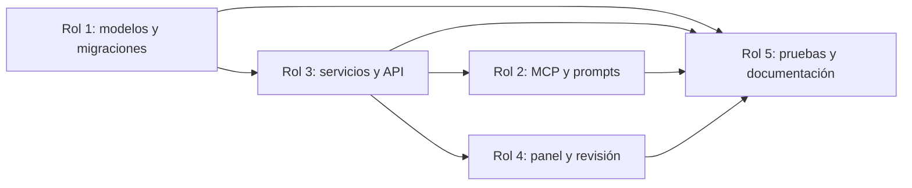

# Plan de trabajo del equipo de 5 integrantes

> **Estado verificado al 18/10/2026.** Este reparto refleja la estructura actual. Los archivos no son exclusivos: cualquier cambio transversal debe revisarse junto con sus pruebas y documentación.

## 1. Alcance común

El producto implementa 27 modelos de dominio, 18 migraciones, 32 pasos metodológicos, 34 herramientas MCP y 35 prompts. El tesista usa MCP o la API; el asesor usa Django Admin/Unfold o la API. No existe una web propia del tesista ni un despliegue público validado.

## 2. Responsabilidades

| Rol | Responsabilidad principal | Archivos actuales | Evidencia mínima |
| :--- | :--- | :--- | :--- |
| 1. Datos y ORM | Modelos, migraciones, restricciones e índices PostgreSQL/pgvector. | `backend/thesis/models/`, `backend/thesis/migrations/`, `backend/config/settings.py` | `manage.py check` y `makemigrations --check --dry-run`. |
| 2. MCP y cliente LLM | Catálogo de herramientas, puente autenticado, prompts y demo stdio. | `mcp_server/server.py`, `project_tools.py`, `django_bridge.py`, `mcp_server/prompts/` | Listado real de herramientas/prompts y demo local. |
| 3. Servicios y API | Contratos P01–P32, materializadores, permisos, transacciones y rutas Ninja. | `backend/thesis/services/`, `backend/thesis/api/projects.py`, `backend/thesis/step_catalogue.py` | Pruebas de dominio, API y conflictos de versión. |
| 4. Revisión del asesor | Configuración de Admin/Unfold y flujo de observaciones/aprobación. | `backend/thesis/admin.py`, `backend/thesis/services/reviews.py` | Capítulo enviado, comentario anclado, resolución y decisión. |
| 5. QA y documentación | Suite pytest, caso E2E, auditoría grounded y consistencia documental. | `backend/thesis/tests/`, `mcp_server/test_local.py`, `core/grounding/`, `docs/` | Suite completa, auditoría 9/9 y enlaces locales válidos. |

## 3. Dependencias entre roles



- MCP y HTTP llaman a los mismos servicios; no deben duplicar reglas.
- La identidad MCP procede de `TESISMCP_MCP_TOKEN`, nunca de un `user_id` enviado por el modelo.
- Cada mutación de pasos compara `expected_version` con `lock_version`.
- Las revisiones y eventos académicos se conservan; una corrección crea una revisión nueva.
- Las afirmaciones de P16 deben conservar fuente, página, cita literal y huella.

## 4. Orden de trabajo vigente

1. Ejecutar la auditoría grounded antes de editar afirmaciones académicas o documentación de fuentes.
2. Crear o ajustar contratos y reglas de dominio.
3. Actualizar el materializador y la persistencia canónica cuando corresponda.
4. Exponer la operación en API y MCP solo si ambos clientes la necesitan.
5. Añadir una prueba cuando el cambio introduzca una regla, un riesgo de seguridad o una integración.
6. Actualizar documentación y ejecutar todas las verificaciones.

## 5. Comandos de integración

```bash
python3 -m core.grounding.audit_cli
DJANGO_DEBUG=1 .venv/bin/python backend/manage.py check
DJANGO_DEBUG=1 .venv/bin/python backend/manage.py makemigrations --check --dry-run
DJANGO_DEBUG=1 .venv/bin/pytest --reuse-db -q
DJANGO_DEBUG=1 .venv/bin/python mcp_server/test_local.py
```

## 6. Entregables pendientes

- Evidencia de uso con tesistas y asesores reales.
- Capturas actuales del panel del asesor y del cliente MCP.
- Datos crudos y cálculo reproducible para P32.
- Carátula y anexos institucionales completos en el exportador.
- Infraestructura con HTTPS, secretos y almacenamiento persistente compartido.
