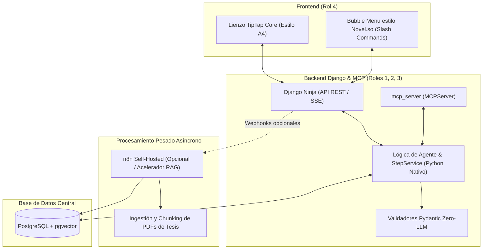

# Investigación de Herramientas Open-Source para Acelerar TesisMCP: Wordcraft, TipTap, Novel.so y n8n

> **Estado respecto del producto actual (18/10/2026):** esta es una consulta histórica y puede describir alternativas descartadas. El alcance vigente usa `MCPServer` por `stdio`, API Django Ninja y panel Django Admin/Unfold para el asesor; no incluye frontend propio del tesista ni infraestructura pública seleccionada. Consulte [Estado verificable del producto](../../07_desarrollo_prototipo/estado_version_producto.md).

- **Fecha:** 2026-10-17
- **Categoría:** `arquitectura_y_backend`
- **Estado:** Resuelta / Análisis Comparativo Realizado
- **Participante / Rol:** Estudiante / Equipo TesisMCP (Roles 2, 3 y 4: MCP, API REST y Frontend)

---

## ❓ 1. Pregunta o Planteamiento del Estudiante

> **"Hay versiones o herramientas open source que pueden acortar el tiempo de trabajo, por ejemplo para TipTap ya existen alternativas de código abierto (como WordCraft que se copió con IA de Word). También tenemos opciones como n8n, entre otras que pueden recortar el tiempo."**

Se solicitó investigar mediante navegación web:
1. ¿Qué es exactamente **Wordcraft** y qué alternativas open-source existen para interfaces de escritura asistida por IA (Novel.so, TipTap AI, BlockNote)?
2. ¿Cómo encaja **n8n** como orquestador de agentes IA, flujos RAG y validación metodológica junto a Django y PostgreSQL?
3. Análisis de viabilidad técnica, costos, integración con Git y riesgos de evaluación ante el jurado universitario de Curso Integrador 1.

---

## 💡 2. Hallazgos y Evaluación Técnica Imparcial

### 2.1. El Ecosistema "Wordcraft": Dos Proyectos Distintos

La investigación arrojó que existen **dos proyectos open-source de alto perfil** con el nombre "Wordcraft", con enfoques radicalmente distintos:

1. **Google Research PAIR Wordcraft (`PAIR-code/wordcraft`)**:
   - **Propósito:** Prototipo experimental de Google enfocado en escritura creativa de cuentos de ficción.
   - **Tecnología:** TypeScript + Lit/Vue en frontend, conectado a la API de Gemini mediante prompts *few-shot*.
   - **Veredicto para TesisMCP:** **No viable como base directa**. Carece de soporte para normas académicas (citas APA 7/IEEE, numeración ordinal de problemas, formato tabular formal o exportación a Word/PDF reglamentario). Sin embargo, sus **patrones de interacción UI** (burbujas de sugerencia, autocompletado y botones contextuales de reescritura) son un excelente modelo visual.

2. **WordCraft de Storytold (`storytold/wordcraft`) [Hallazgo Relevante]**:
   - **Propósito:** Reimplementación *clean-room* de código abierto de Microsoft Word escrita en **Rust + egui**.
   - **Capacidades:** Cinta de opciones (*ribbon*), estilos tipográficos, control de cambios (*track changes*), comentarios en el margen, notas al pie y citas formales (APA, MLA, IEEE). Abre y guarda `.docx` (OOXML), `.odt`, `.tex` (LaTeX) y exporta a `.pdf`.
   - **Conectividad Agéntica:** **Incluye un Servidor MCP nativo integrado (`wordcraft-cli mcp`)** con herramientas como `inspect_document`, `execute`, `type_text`, `select_text`, `render_page` y `save_document`.
   - **Veredicto para TesisMCP:** Es un motor extraordinario para **procesamiento *headless* y validación de documentos Word vía MCP en backend**. No obstante, para la interfaz web principal del usuario, su canvas en WebAssembly puede ser más rígido de personalizar que un editor HTML/DOM nativo.

---

### 2.2. Comparativa de Editores Web: Novel.so vs. TipTap Core vs. BlockNote

| Criterio | Novel.so (`novel.sh`) | TipTap Core (DIY + Endpoints Propios) | TipTap AI Oficial (`@tiptap-pro/ai-toolkit`) | BlockNote (`blocknotejs.org`) |
| :--- | :--- | :--- | :--- | :--- |
| **Licencia** | Apache 2.0 (Open Source) | MIT (100% Open Source) | Comercial Propietaria | MPL-2.0 / GPL-3.0 |
| **Costo** | **$0** (Gratuito) | **$0** (Gratuito) | **$49 a $249+ USD / mes** ❌ | **$0** (Gratuito núcleo) |
| **Filosofía UI** | Estilo Notion (Bloques + Markdown + Bubble Menu) | Headless agnóstico (Personalizable a hoja A4 Word) | Headless con widgets listos | Estilo Notion (Bloques modulares para React) |
| **Stack** | Next.js / React + Tailwind + Vercel AI SDK | React, Vue o Vanilla JS / Alpine.js (nativo en Django) | React / Vue / JS con servidor Cloud | React + Mantine / Tailwind |
| **Capacidades IA** | Menú flotante (`/` y bubble): autocompletado, corrección gramatical, expansión. | A medida: endpoints de Django Ninja vía streaming (SSE). | Autocompletado y reescritura gestionados en nube de TipTap. | Bloques personalizados extensibles con IA. |
| **Adecuación Tesis** | Media (orientado a notas y markdown, no a hojas A4). | **Alta** (permite simular hojas A4, numeración y citas inline `[1]`). | Media-Baja (costo inviable para estudiantes). | Media (bloques modulares, no hojas A4). |

> **Conclusión de UI:**  
> La combinación más rápida y profesional para el **Rol 4** es usar **TipTap Core (MIT)** con diseño CSS de hoja A4 paginada, adoptando el diseño de menú flotante (*bubble menu*) de **Novel.so**, pero conectado a nuestros endpoints de Django. Descartamos TipTap AI oficial por sus planes de pago mensuales.

---

### 2.3. Análisis de n8n: ¿Conviene para la Orquestación de Agentes y RAG?

`n8n` es una plataforma líder de automatización que hoy en día integra nodos avanzados de Inteligencia Artificial (basados en LangChain), soporte para `pgvector`, agentes autónomos y protocolos MCP.

#### Puntos Fuertes de n8n para TesisMCP:
1. **Velocidad de Prototipado Inmediata (1 a 3 días):** Permite levantar un pipeline completo de ingestión de PDFs, extracción de texto, división en chunks, embeddings vectoriales y consultas a LLMs sin escribir código complejo de grafos.
2. **Conexión Directa con PostgreSQL:** Puede conectarse a la misma base de datos Postgres del proyecto y escribir en tablas de vectores o consultar el estado de la tesis.
3. **Observabilidad Visual Nativa:** Puedes ver exactamente qué pensó el agente en cada nodo, qué prompt se envió y qué herramientas ejecutó en tiempo real.
4. **Costo $0:** Se puede auto-hospedar mediante Docker (*Self-Hosted*) de forma gratuita bajo su licencia *Fair-Code* para fines académicos.

#### Riesgos y Desventajas Críticas en Curso Integrador 1:
1. **Riesgo ante el Jurado Académico (Evaluación de Software):**  
   Si el jurado de la carrera de Ingeniería de Sistemas o Software ve que la lógica nuclear de los agentes y RAG está armada con cajitas en un entorno *Low-Code* (n8n), pueden argumentar que **"no hubo desarrollo de ingeniería de software formal en el backend"**. En la universidad se exige ver código en Python con pruebas unitarias (`pytest`), modelos Django y patrones de diseño.
2. **Control de Versiones y Trabajo en Equipo (Git):**  
   Los flujos de n8n se guardan como archivos JSON monolíticos en base de datos. Si dos integrantes del equipo editan el flujo al mismo tiempo, resolver conflictos de merge en Git es una pesadilla comparado con ramas de código `.py`.
3. **Consumo de Infraestructura Extra:**  
   n8n corre sobre Node.js y requiere su propio contenedor Docker, sumando entre **500 MB y 1 GB adicional de RAM** al entorno local.

---

## 🎯 3. Veredicto y Recomendación de Ingeniería

Para aprovechar la velocidad de las herramientas open-source sin arriesgar la calificación académica del equipo, la arquitectura ideal debe ser:

1. **Frontend:** Usar **TipTap Core** adaptando la experiencia de usuario y menús contextuales de **Novel.so**.
2. **Backend de Agentes:** Mantener el código del agente y las reglas metodológicas en **Python nativo (`server.py` + `StepService` + Pydantic)**. Esto garantiza que el repositorio de GitHub contenga código de ingeniería puro evaluable con la máxima nota.
3. **Rol para n8n:** Utilizar n8n como acelerador para tareas pesadas en segundo plano (como el pipeline de procesar los PDFs subidos y extraerles metadatos/citas), comunicándose con Django mediante webhooks.

---

## 🔗 4. Referencias y Archivos Vinculados

- [WordCraft en Rust con MCP nativo (storytold/wordcraft)](https://github.com/storytold/wordcraft)
- [Novel.so: Editor estilo Notion con IA (steven-tey/novel)](https://github.com/steven-tey/novel)
- [BlockNote: Editor modular de bloques](https://github.com/TypeCellOS/BlockNote)
- [Guía de Integración del Servidor MCP](../../../mcp_server/README.md)
- [Plan de Trabajo por Roles del Equipo](../../07_desarrollo_prototipo/plan_trabajo_equipo_5_integrantes.md)
