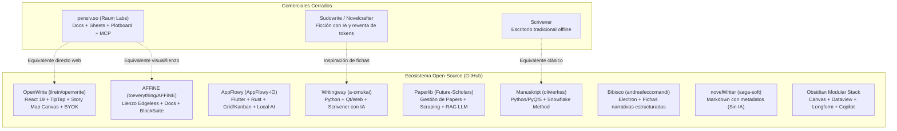
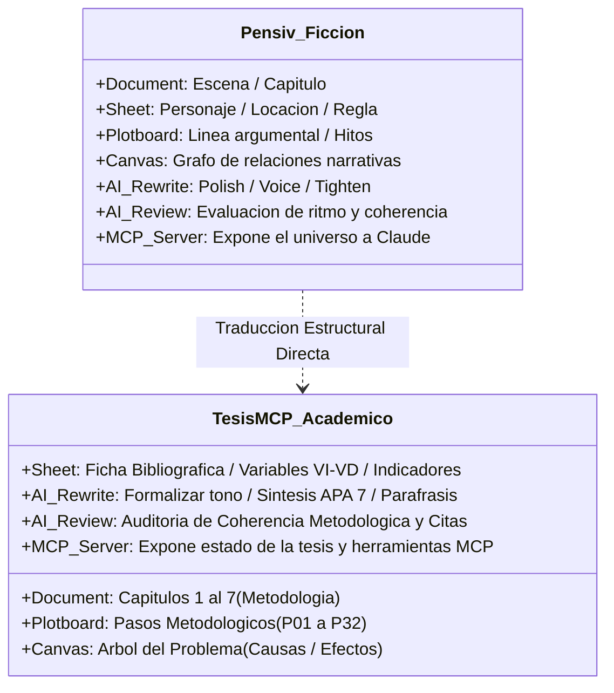

# Investigación y Análisis Crítico: ¿Qué es pensiv.so y qué alternativas Open-Source existen para TesisMCP?

> **Estado respecto del producto actual (18/10/2026):** esta es una consulta histórica y puede describir alternativas descartadas. El alcance vigente usa `MCPServer` por `stdio`, API Django Ninja y panel Django Admin/Unfold para el asesor; no incluye frontend propio del tesista ni infraestructura pública seleccionada. Consulte [Estado verificable del producto](../../07_desarrollo_prototipo/estado_version_producto.md).

- **Fecha:** 2026-10-17
- **Categoría:** `modulo_asesor_y_ui`
- **Estado:** Resuelta / Verificada empíricamente en web y repositorios GitHub
- **Participante / Rol:** Estudiante / Equipo TesisMCP (Rol 4: Frontend y UI / Rol 1: Arquitectura)

---

## ❓ 1. Pregunta o Duda Planteada

> **"¿Existen herramientas abiertas como `pensiv.so` pero abiertas? Open-source."**

La consulta surge al descubrir la plataforma **`pensiv.so`** (a la cual redirige `novel.so`) y observar que ofrece un entorno de trabajo no lineal que combina documentos, bases de datos de entidades, tableros de trama, lienzos visuales y asistencia de IA con soporte de protocolo MCP.

Para responder con total rigor técnico, neutralidad y precisión empírica, se investigaron a fondo:
1. Las características funcionales y la arquitectura de datos de `pensiv.so`.
2. Las alternativas de código abierto disponibles en GitHub (novelistas, gestión de conocimiento y entornos académicos).
3. La aplicabilidad real y traducción metodológica de estos patrones hacia **TesisMCP**.
4. Una evaluación crítica de factibilidad para un equipo de 5 estudiantes de ingeniería de software en Curso Integrador 1.

---

## 🔍 2. ¿Qué es exactamente `pensiv.so`?

**Pensiv** (desarrollado por **Raum Labs, Inc.**) es un entorno de trabajo digital para manuscritos y narrativas extensas (*long-form writing workspace*) diseñado específicamente para novelistas, guionistas y creadores de contenido complejo. Se posiciona en la industria como la evolución moderna con IA de herramientas de escritorio clásicas como **Scrivener**.

### 2.1. Propuesta de Valor Central
* **Ruptura con el documento lineal plano:** A diferencia de Microsoft Word o Google Docs (que fuerzan a redactar cientos de páginas en un solo flujo vertical), Pensiv organiza el trabajo en un **Proyecto** modular donde coexisten texto, fichas de entidades, tableros Kanban y pizarras infinitas.
* **Asistencia de IA contextual y con control humano (*Human-in-the-Loop*):** La IA no genera texto a ciegas en el vacío; consulta las fichas del proyecto y **nunca modifica el archivo directamente sin la autorización explícita del usuario**. Muestra tarjetas de aprobación (*Accept once, Allow for session, Always allow, Reject*).
* **Soporte Nativo de Servidor MCP (Model Context Protocol):** Pensiv proporciona una URL de servidor MCP y tokens para que clientes externos (como Claude Desktop, Cursor, Zed o ChatGPT) puedan leer el contexto completo del proyecto e interactuar con sus archivos.
* **Privacidad y enfoque Local-First:** Permite proyectos locales (*local-only*), almacenamiento cifrado en reposo (AES) y garantiza que los textos no se utilizan para reentrenar modelos fundacionales.

### 2.2. Las 4 Entidades Base de Datos de Pensiv
1. **Document (Manuscrito):** Capítulos o escenas con texto enriquecido, notas al margen (*Document Notes*), comentarios e historial de revisiones.
2. **Sheet (Fichas Estructuradas):** Base de datos tipo tabla/formulario para entidades del universo. Categorías fijas: *Character, Event, Organization, Item, Location, Worldbuilding, Other*. Soportan propiedades tipadas (fechas, relaciones, etiquetas) y herencia padre-hijo.
3. **Plotboard (Tablero de Trama):** Tablero kanban bidimensional. Las columnas representan actos o hitos narrativos (*Plot Cards*) y dentro se apilan escenas o unidades menores (*Part Cards*). Cuenta con zoom dinámico y generación automática de resúmenes por IA.
4. **Canvas (Lienzo Infinito):** Pizarra blanca donde se incrustan tarjetas de texto libre, tarjetas vivas de documentos/fichas (mostrando el contenido real) y conexiones gráficas para mapear la red de relaciones (*Relationship Graph*).

### 2.3. Mecanismos de IA Clave
* **Agente con 3 Modos:**
  * **Default:** Puede buscar en el proyecto, redactar, crear y editar fichas.
  * **Ask:** Modo de consulta pura tipo chatbot; no altera ningún archivo del proyecto.
  * **Plan:** Elabora una lista de pasos previos y solicita confirmación antes de tocar el sistema de archivos.
* **AI Rewrite (7 Lentes de Estilo con Diff Visual):**
  * *Polish* (pulir estilo y fluidez), *Tighten* (eliminar relleno y concisión), *Voice* (ajustar tono según la ficha vinculada), *Expand* (desarrollar argumentos), *Flow* (transiciones lógicas), *Detail* (profundidad sensorial/técnica), *Grammar* (ortografía y sintaxis).
  * Renderiza los cambios en un **bloque de diff visual** (tachado rojo / agregado verde) para aceptar o descartar con un clic.
* **AI Review:** Evaluación global de capítulos mediante gráficos de radar y notas de 1 a 5 estrellas evaluando coherencia, ritmo, profundidad y estilo.
* **Autofill de Propiedades:** Extrae automáticamente valores para las propiedades estructuradas de una ficha analizando su texto libre, reduciendo la carga de llenado manual.

---

## 🌐 3. Mapeo Exhaustivo de Alternativas Open-Source

En el ecosistema de código abierto existen proyectos maduros y emergentes que resuelven problemas idénticos o análogos. A continuación se detallan los más relevantes:

---

### 3.1. `OpenWrite` (`ilrein/openwrite`) — *El equivalente más directo y moderno*
* **Repositorio:** [`https://github.com/ilrein/openwrite`](https://github.com/ilrein/openwrite)
* **Licencia:** AGPL-3.0
* **Stack Tecnológico:** TypeScript de extremo a extremo: **React 19**, TanStack Router, **TailwindCSS**, **shadcn/ui**, **TipTap** en el editor de texto. Backend en **Hono** sobre Cloudflare Workers / D1 (SQLite) con Drizzle ORM y Better Auth.
* **Características Clave:**
  * **Story Map Nodal con IA:** Canvas interactivo donde el usuario introduce una premisa y la IA genera un árbol jerárquico (*Premisa ➔ Actos ➔ Capítulos ➔ Escenas*). Cada nodo de capítulo se puede "promover" directamente hacia el manuscrito para redactar.
  * **Editor TipTap:** Editor ligero con guardado automático, conteo de palabras en tiempo real y detección segura de ediciones concurrentes.
  * **Codex:** Base de datos estructurada para personajes, ubicaciones, conceptos del mundo y puntos de trama organizados por proyecto.
  * **Asistente de IA (BYOK - Bring Your Own Key):** Conexión directa sin suscripciones con OpenRouter, OpenAI, Anthropic, Gemini, Groq y modelos locales con **Ollama**.

### 3.2. `AFFiNE` (`toeverything/AFFiNE`) — *La fusión de Lienzo Edgeless y Documento*
* **Repositorio:** [`https://github.com/toeverything/AFFiNE`](https://github.com/toeverything/AFFiNE)
* **Licencia:** MPL-2.0 (Mozilla Public License 2.0)
* **Stack Tecnológico:** TypeScript, Rust, motor **BlockSuite** y React.
* **Características Clave:**
  * **Fusión de Documento y Pizarra (Edgeless Canvas):** Cualquier bloque de texto enriquecido, nota adhesiva, base de datos multitabla o tarjeta se puede colocar libremente en una pizarra infinita (estilo Miro) o conmutar a vista de documento lineal (estilo Notion).
  * **Multimodal AI:** Asistente capaz de transformar esquemas en mapas conceptuales, generar resúmenes y crear bloques directamente en el lienzo.
  * **Local-first y colaborativo:** Almacenamiento local mediante CRDTs y sincronización opcional con servidor propio.

### 3.3. `Writingway` (`a-omukai/Writingway`) — *Scrivener con IA en código abierto*
* **Repositorio:** [`https://github.com/a-omukai/Writingway`](https://github.com/a-omukai/Writingway)
* **Licencia:** Open Source
* **Stack Tecnológico:** Python, PyQt / Interfaz Web.
* **Características Clave:**
  * **Taller conversacional interactivo:** Chat en tiempo real para brainstorming y desarrollo de escenas.
  * **Compendio contextual dinámico:** Fichas de entidades que la IA consulta automáticamente durante la redacción para mantener la consistencia.
  * **Vista de estructura del proyecto:** Visualización de capítulos, escenas y líneas argumentales.

### 3.4. `AppFlowy` (`AppFlowy-IO/AppFlowy`) — *El clon open-source de Notion*
* **Repositorio:** [`https://github.com/AppFlowy-IO/AppFlowy`](https://github.com/AppFlowy-IO/AppFlowy)
* **Licencia:** AGPL-3.0
* **Stack Tecnológico:** Flutter + Rust (núcleo de sincronización y base de datos local).
* **Características Clave:**
  * Manejo unificado de Documentos jerárquicos, Tableros Kanban y Tablas tipo Sheets.
  * Capa de IA para resúmenes automáticos y consultas contextuales sobre las bases de datos.
  * Total soberanía de datos (local-first).

### 3.5. `Paperlib` (`Future-Scholars/paperlib`) — *El especialista académico*
* **Repositorio:** [`https://github.com/Future-Scholars/paperlib`](https://github.com/Future-Scholars/paperlib)
* **Licencia:** GPL-3.0
* **Stack Tecnológico:** TypeScript, React, Electron.
* **Características Clave:**
  * Diseñado específicamente por investigadores para gestionar literatura científica, tesis y conferencias (ICLR, NeurIPS, IEEE).
  * **Scraping exhaustivo de metadatos:** Extrae con precisión título, autores, DOI, resumen y año.
  * **IA Académica:** Resumen automático de papers mediante LLMs, etiquetado semántico y búsqueda bibliográfica en lenguaje natural.

### 3.6. Clásicos Estructurados: `Manuskript` y `Bibisco`
* **Manuskript (`olivierkes/manuskript` - GPL-3.0, Python/PyQt5):** Implementa el **Método Snowflake** (Premisa en 1 frase ➔ Párrafo de 5 frases ➔ Fichas de desarrollo ➔ Escaleta de escenas).
* **Bibisco (`andreafeccomandi/bibisco` - GPL-3.0, Node.js/Electron):** Enfoque metódico en cuestionarios profundos sobre entidades, estructura dramática (premisa, fábrica e hilos narrativos) y control de revisiones.

### 3.7. El Ecosistema Modular de `Obsidian`
Aunque el núcleo de Obsidian es privativo, su suite de plugins comunitarios es 100% de código abierto y replica exactamente la experiencia de Pensiv:
* **Obsidian Canvas:** Pizarra infinita para interconectar notas y documentos visualmente.
* **Dataview / Datacore:** Motor de consultas tipo SQL para crear tablas estructuradas (Sheets) a partir de los metadatos YAML de las notas.
* **Longform:** Plugin para ordenar capítulos y compilar manuscritos completos de tesis.
* **Smart Connections / Copilot:** RAG semántico local con embeddings sobre las notas y PDFs.

---

## 📊 4. Matriz Comparativa: Pensiv vs Alternativas Open-Source

| Criterio | Pensiv.so | OpenWrite | AFFiNE | AppFlowy | Paperlib | Manuskript |
| :--- | :--- | :--- | :--- | :--- | :--- | :--- |
| **Código** | Privativo (SaaS/Local) | **Open Source (AGPL-3)** | **Open Source (MPL-2)** | **Open Source (AGPL-3)** | **Open Source (GPL-3)** | **Open Source (GPL-3)** |
| **Stack Principal** | Web / Electron | **TypeScript / React 19** | **TS / Rust / BlockSuite** | **Flutter / Rust** | **TS / React / Electron** | **Python 3 / PyQt5** |
| **Editor de Texto** | Bloques / Prosa rica | **TipTap (ProseMirror)** | **BlockSuite (Bloques)** | **AppFlowy Editor** | Markdown básico | Markdown / Plain Text |
| **Lienzo / Canvas** | Canvas infinito con tarjetas | Story Map Nodal | Edgeless Canvas infinito | No (solo Kanban/Grid) | No | No (fichas index cards) |
| **Fichas de Entidades** | Sheets tipadas (7 clases) | Codex estructurado | Database multi-vista | Database tipo Notion | Ficha bibliográfica | Fichas de personajes |
| **Soporte de IA** | Agente (Default/Ask/Plan) + Rewrite + Review | Chat asistente con BYOK (OpenRouter, Ollama) | AFFiNE AI multimodal | AppFlowy AI | LLM summary & tagging | Sin IA nativa |
| **Soporte MCP** | **Nativo (Server URL)** | No nativo (fácil adaptar) | No nativo | No nativo | No nativo | No nativo |
| **Enfoque Académico** | Ficción / Guiones | Ficción / Narrativa | Notas y proyectos | Productividad general | **Papers científicos** | Novelas / No-ficción |

---

## 🎓 5. Traducción Metodológica para TesisMCP

¿Por qué estas herramientas de novelistas son tan pertinentes para una tesis de ingeniería? Porque **una tesis no es un texto libre; es una obra estructurada con rigurosas restricciones de consistencia**.

A continuación se muestra la correspondencia unívoca entre los conceptos de Pensiv/OpenWrite y los requisitos metodológicos de **TesisMCP**:

### 5.1. Correspondencia Detallada

1. **De `Manuscript Document` a `Capítulos de Tesis (1 al 7)`:**  
   En lugar de un documento gigante, la tesis se desacopla en documentos independientes por capítulo:
   - Cap. 1: Introducción y Planteamiento del Problema.
   - Cap. 2: Marco Teórico y Estado del Arte.
   - Cap. 3: Metodología y Diseño de la Solución.
   - Cap. 4 al 7: Desarrollo, Resultados, Discusión y Conclusiones.

2. **De `Sheets / Codex` a `Fichas Metodológicas y Variables de Investigación`:**  
   En lugar de fichas de "Personajes" o "Criaturas", las entidades en TesisMCP son:
   - **Ficha de Variable Independiente (VI):** Nombre, dimensiones, indicadores empíricos y escala de medición.
   - **Ficha de Variable Dependiente (VD):** Métricas de impacto, fórmula matemática y fuente de datos.
   - **Ficha de Fuente Bibliográfica (Grounding):** Metadatos DOI, autores verificados en carátula, número físico de páginas y citas textuales exactas.

3. **De `Plotboard / Story Map` a `Árbol del Problema y Pipeline Metodológico`:**  
   El concepto de **Story Map nodal de OpenWrite** (*Premisa ➔ Actos ➔ Capítulos*) encaja con:
   - **Nodo Raíz:** Problema Central identificado en la realidad problemática.
   - **Nodos Hijos Superiores:** Efectos del problema (justifican el impacto de la investigación).
   - **Nodos Hijos Inferiores:** Causas raíces (definen las variables de intervención y los objetivos específicos).
   - **Promoción a Documento:** Al aprobar el Árbol del Problema, el sistema autogenera la estructura del Capítulo 1 y la Matriz de Consistencia.

4. **De `AI Rewrite (Lentes)` a `Reescritura de Tono Científico y Paráfrasis APA 7`:**  
   Adaptar los botones de Pensiv a normas universitarias:
   - *Formalizar:* Elevar el registro a tercera persona impersonal académica.
   - *Sintetizar:* Resumir antecedentes extensos conservando las cifras empíricas textuales.
   - *Verificar Citación:* Asegurar que toda afirmación cite explícitamente una ficha bibliográfica existente con `@`.

5. **De `AI Review` a `Auditoría Anti-Alucinación y Coherencia Cruzada`:**  
   El sistema de revisión no evalúa "emoción", sino:
   - ¿El objetivo general responde directamente al problema principal?
   - ¿Las citas en el texto coinciden con las referencias registradas?
   - ¿Los porcentajes reportados están respaldados por las fuentes primarias?

---

## ⚖️ 6. Veredicto del Mentor: Análisis de Factibilidad y Recomendación de Ingeniería

> [!WARNING] Alerta de Alcance y Trampa Tecnológica (Scope Creep)
> Un error común en estudiantes de ingeniería es intentar **bifurcar (*forkear*) o clonar un monstruo como AFFiNE o AppFlowy**.
> * **AFFiNE** tiene cientos de miles de líneas de código en Rust, TypeScript y WebAssembly con un motor propietario de bloques (*BlockSuite*). Modificarlo requeriría meses de aprendizaje solo para entender su arquitectura.
> * **AppFlowy** requiere programar en Flutter y Rust móvil, alejando al equipo de las tecnologías web requeridas para el despliegue del proyecto.

### 6.1. La Ruta Inteligente para TesisMCP: ¿Qué conviene reutilizar?

En lugar de construir una aplicación gigante desde cero o clonar un proyecto inmanejable, la recomendación de arquitectura consiste en **ensamblar las mejores bibliotecas especializadas y desacopladas**:

| Capa del Sistema | Tecnología Recomendada | Justificación Técnica |
| :--- | :--- | :--- |
| **Editor Central (Documento)** | **Novel (`novel.sh`) / TipTap** | Paquete npm moderno (`npm i novel`), basado en React y Tailwind, con soporte probado para menús contextuales, extensiones de citas bibliográficas y notas al pie. |
| **Árbol del Problema (Lienzo Nodal)** | **React Flow (`@xyflow/react`)** | La misma biblioteca estándar utilizada por OpenWrite y herramientas de diagramación. Permite dibujar el árbol de causas/efectos de forma reactiva y conectar los nodos a la base de datos de la tesis. |
| **Fichas Estructuradas (Sheets)** | **Tablas Shadcn UI + PostgreSQL** | Formularios tipados para Variables, Matriz de Consistencia y Fuentes con validación estricta vía Pydantic / Zod. |
| **Inteligencia y Control de Verdad** | **FastMCP Server en Python (`core.grounding`)** | Mantiene la regla de oro del proyecto: validación de PDFs con `pdftotext`, conteo físico de páginas y prevención de alucinaciones. |

### 6.2. Conclusión
La existencia y éxito de herramientas como **Pensiv** y **OpenWrite** demuestran que el paradigma de **escritura asistida por IA con entidades estructuradas, lienzos nodales y soporte MCP** es la dirección correcta y moderna de la ingeniería de software. 

Para **TesisMCP**, adoptar la metáfora de Pensiv adaptada al rigor académico (Árbol del Problema en lugar de Plotboard, Fichas de Variables en lugar de Sheets de Personajes, y Servidor MCP para interoperabilidad) otorga al proyecto una ventaja competitiva excepcional frente a cualquier editor de texto convencional.
