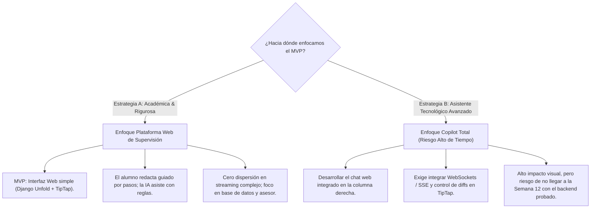

# Evaluación Imparcial: Opciones de UI, Sincronización y Viabilidad del Modelo de Negocio

> **Estado respecto del producto actual (18/10/2026):** esta es una consulta histórica y puede describir alternativas descartadas. El alcance vigente usa `MCPServer` por `stdio`, API Django Ninja y panel Django Admin/Unfold para el asesor; no incluye frontend propio del tesista ni infraestructura pública seleccionada. Consulte [Estado verificable del producto](../../07_desarrollo_prototipo/estado_version_producto.md).

- **Fecha:** 2026-10-17
- **Categoría:** `modulo_asesor_y_ui`
- **Estado:** Análisis Crítico y Guía de Decisión
- **Participante / Rol:** Estudiante / Equipo TesisMCP (Mentoría Técnica y Arquitectura)

---

## ❓ 1. Planteamiento del Estudiante

El estudiante plantea la siguiente segmentación y propuesta:
1. **Opción 1 (Web Copilot en panel derecho):** Para usuarios no técnicos que no quieren leer demasiado o les da pereza copiar y pegar.
2. **Opción 2 (Sidecar en Antigravity/IDE):** Para usuarios técnicos acostumbrados a editores de código.
3. **Opción 3 (WebSockets / Live Sync):** Duda sobre cuál es su público objetivo real.
4. **Propuesta de Negocio (Modelo Freemium/Premium):** Ofrecer modelos propios más baratos que pagar Claude/Antigravity completo, combinado con BYOA (*Bring Your Own Agent*).
5. **Directriz de Mentoría:** Mantener postura crítica, técnica e imparcial, señalando riesgos y permitiendo al estudiante tomar decisiones informadas sin sesgo complaciente.

---

## 💡 2. Análisis Crítico e Imparcial (Evaluación Técnica y de Negocio)

### 2.1. Aclaración Fundamental sobre la Opción 3 (¿Cuál es su público objetivo?)

Hay una confusión conceptual en clasificar la Opción 3 como una "alternativa de cara al usuario".  
**La Opción 3 (WebSockets / Sincronización en tiempo real) no es un producto distinto, es una pieza de infraestructura.**

* **Para quién es:** No es para "un tipo de alumno". Es para la **interacción simultánea entre el Asesor y el Tesista**, o entre un proceso en segundo plano (búsqueda RAG de 20 PDFs) y la pantalla.
* **El problema que resuelve:** En cualquier aplicación colaborativa moderna (como Google Docs, Overleaf o Figma), si el asesor añade un comentario o aprueba un capítulo desde su oficina, el tesista no debería tener que presionar `F5` para enterarse.
* **Evaluación Imparcial (Contra):** Para el **MVP de Semana 12**, implementar WebSockets (Django Channels + servidor Redis + gestión de reconexiones) añade una complejidad operativa innecesaria. Es deuda técnica prematura. Para un prototipo académico, un mecanismo simple de *Server-Sent Events (SSE)* o un refresco al guardar es suficiente.

---

### 2.2. El "Sesgo del Desarrollador" en la Opción 2 (Sidecar en IDE / Antigravity)

* **La Realidad Empírica:** Quienes estudian Ingeniería de Sistemas o Software representan menos del 10% de la población universitaria que realiza tesis. La inmensa mayoría de tesistas pertenecen a Psicología, Derecho, Administración, Medicina o Ingeniería Civil.
* **El Riesgo:** Diseñar la experiencia de usuario pensando en Antigravity, Cursor o VS Code es un error clásico de desarrollo: **construir para uno mismo en lugar de construir para el usuario final**.
  - Un tesista de Derecho o Administración **nunca** instalará Python, ni clonará un repositorio, ni abrirá Antigravity.
* **Veredicto Técnico:** La Opción 2 sirve exclusivamente para **ti mismo y tu equipo** durante el desarrollo y depuración local. No puede ser la propuesta de valor central del proyecto ante el jurado de Curso Integrador.

---

### 2.3. El Riesgo de Alcance de la Opción 1 (Web Copilot en Panel Derecho)

* **La Ventaja:** Es la única opción que realmente resuelve la necesidad del 90% de los estudiantes (todo en una sola pestaña del navegador).
* **El Riesgo Crítico (Trade-off de tiempo):** Construir una interfaz web de 3 columnas con editor enriquecido (TipTap/ProseMirror), streaming de texto por IA en tiempo real, diff de versiones e inserción de citas en el panel derecho es un esfuerzo de desarrollo de semanas.
* **Advertencia:** Si el equipo se obsesiona con hacer un chat web idéntico a Notion AI para la Semana 12, descuidarán lo que el docente y el jurado evalúan: los contratos Pydantic, la base de datos PostgreSQL, la trazabilidad del método científico y la interacción con el asesor.

---

### 2.4. Análisis de Viabilidad: Vender Modelos de IA "Premium" vs BYOA

La propuesta de negocio de cobrar suscripciones ofreciendo modelos "más baratos que Claude o Antigravity" presenta dos barreras críticas que debes considerar:

#### A. La Economía Real de los Tokens (Unit Economics)
* Empresas como Anthropic cobran \$20/mes por Claude Pro asumiendo pérdidas (*venture capital*) o subsidiando el cómputo masivo.
* Si tú revendes llamadas vía API de Claude 3.5 Sonnet o GPT-4o:
  - Cada paso metodológico que incluye contexto RAG (resúmenes de antecedentes, directivas y normas) consume fácilmente entre 8,000 y 25,000 tokens por consulta.
  - El costo por llamada API puede rondar entre \$0.05 y \$0.25 USD.
  - Si un alumno redacta y refina 40 borradores al mes, el costo directo de API puede alcanzar \$10 a \$20 USD sin contar servidores ni margen de ganancia.
* **Conclusión Financiera:** No puedes ser "más barato que las grandes empresas" revendiendo sus propias APIs cerradas, a menos que alojes modelos Open Source propios (ej. Llama 3 o DeepSeek) en servidores dedicados con GPU, lo cual exige una inversión fija mensual elevada (\$100–\$300 USD/mes).

#### B. El Riesgo Regulatorio y Ético Universitario (SUNEDU / UTP / Concytec)
* Si TesisMCP se promociona como un servicio que vende "texto generado por IA para la tesis", la universidad lo catalogará inmediatamente como una herramienta de **plagio asistido o suplantación de autoría (*ghostwriting*)**, provocando su prohibición institucional.
* **El verdadero valor académico defendible:** TesisMCP debe posicionarse como un **sistema de aseguramiento metodológico y supervisión**. El valor no está en regalar texto, sino en validar que la formulación del problema coincida con el objetivo general, que las citas existan en la literatura y que el asesor tenga el control de aprobación en cada etapa.

---

## 🧭 3. Marco de Decisión para el Equipo

Para no dispersar esfuerzos en Curso Integrador 1, te planteo dos caminos estratégicos para que tú y tu equipo decidan:

### Preguntas para que evalúes y decidas:
1. **¿Qué evalúa con mayor peso tu docente de Curso Integrador 1?** ¿La complejidad visual de un chat en la web o la robustez del modelo de datos, los contratos Pydantic y la secuencia metodológica?
2. **¿Con qué capacidad real de frontend cuenta tu equipo?** ¿El Rol 4 domina JavaScript/Tailwind para levantar un Copilot en 2 semanas, o es más seguro apoyarse en `django-unfold` para el MVP y dejar el chat interactivo para la Fase 2?

---

## 🔗 4. Referencias y Archivos Vinculados

- [Propuesta de Conector en Panel Derecho](./2026-10-17_conector_agente_panel_derecho.md)
- [Plan de Trabajo por Rol (5 Integrantes)](../../07_desarrollo_prototipo/plan_trabajo_equipo_5_integrantes.md)
- [Sistema de Comentarios y Modelo de Revisión](../../05_modulo_colaborativo_asesor/sistema_comentarios_y_revision.md)
