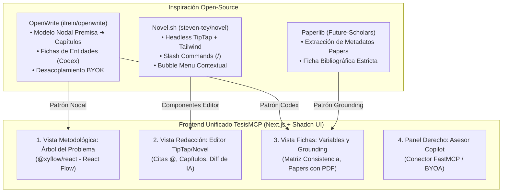

# Decisión de Arquitectura Frontend: Selección Tecnológica y Diseño de la Interfaz de TesisMCP

> **Estado respecto del producto actual (18/10/2026):** esta es una consulta histórica y puede describir alternativas descartadas. El alcance vigente usa `MCPServer` por `stdio`, API Django Ninja y panel Django Admin/Unfold para el asesor; no incluye frontend propio del tesista ni infraestructura pública seleccionada. Consulte [Estado verificable del producto](../../07_desarrollo_prototipo/estado_version_producto.md).


- **Fecha:** 2026-10-17
- **Categoría:** `modulo_asesor_y_ui`
- **Estado:** Resuelta / Propuesta de Diseño Aprobada
- **Participante / Rol:** Estudiante / Equipo TesisMCP (Rol 4: Frontend y UI / Rol 1: Arquitectura)

---

## ❓ 1. Preguntas Planteadas

> **1. "Para nuestro proyecto, ¿cuál conviene?"**  
> **2. "¿Y cómo quedaría ese frontend?"**

El estudiante solicita una recomendación directa, imparcial y aplicable sobre qué tecnología o proyecto open-source adoptar como referencia constructiva, y cómo debe diseñarse la arquitectura de interfaz de usuario (UI/UX) para cumplir con los objetivos académicos de **TesisMCP** en el marco de Curso Integrador 1.

---

## ⚖️ 2. Análisis Comparativo: ¿Cuál herramienta conviene para TesisMCP?

Para un equipo universitario de 5 integrantes con un plazo semestral y un backend basado en **Python (FastMCP, Pydantic, Capa Grounding)** y **PostgreSQL**, evaluamos cada alternativa candidata:

### 2.1. Descarte Crítico de Opciones Incompatibles

1. **AFFiNE (`toeverything/AFFiNE`): ❌ DESCONVENIENTE COMO BASE**
   * *Motivo:* Monorepo masivo (>500,000 líneas de código) en Rust, TypeScript y WebAssembly con un motor propietario de bloques (*BlockSuite*). Intentar desacoplar su editor o lienzo para integrarlo con Django/FastAPI requeriría meses solo para entender su arquitectura interna. Generaría un alto riesgo de *scope creep* y parálisis del proyecto.
2. **AppFlowy (`AppFlowy-IO/AppFlowy`): ❌ DESCONVENIENTE COMO BASE**
   * *Motivo:* Construido en **Flutter/Dart y Rust**. Es una aplicación principalmente concebida para escritorio y móviles. No encaja con la necesidad de desplegar una aplicación web multiusuario accesible en navegador para alumnos y jurados universitarios.
3. **Manuskript / Bibisco / novelWriter: ❌ OBSOLETAS PARA WEB MODERNA**
   * *Motivo:* Aplicaciones de escritorio en PyQt5 o Electron monopuesto. Su interfaz y patrones de interacción no son extensibles ni compatibles con una arquitectura SaaS web contemporánea.

---

### 2.2. La Selección Ganadora: Arquitectura Compuesta ("Lo Mejor de OpenWrite + Novel.sh")

> [!IMPORTANT] Veredicto de Ingeniería
> La solución óptima **NO es clonar una aplicación entera**, sino construir un frontend web desacoplado en **Next.js (React 19) + TailwindCSS + Shadcn UI**, tomando prestados e integrando los dos mejores patrones de código abierto disponibles:
> 1. **La Arquitectura Conceptual de `OpenWrite` (`ilrein/openwrite`):**
>    - Adopta el modelo de datos desacoplado: Capítulos + Fichas de Entidades (*Codex/Sheets*) + Story Map Nodal (*React Flow*).
> 2. **El Editor Headless de `Novel.sh` (`npm i novel` / TipTap):**
>    - Proporciona la experiencia de edición tipo Notion/Pensiv: barra espaciadora con menú slash `/`, menú flotante contextual (*bubble menu*) para reescritura de IA con vista de diferencias (*diff view*), y autocompletado sin fricciones.



---

## 🎨 3. ¿Cómo quedaría ese Frontend? (Diseño y Arquitectura de Pantallas)

Para materializar la visión del usuario (panel izquierdo documental, centro de redacción, panel derecho de IA y asesor, más las vistas estructuradas de Pensiv), la interfaz se organiza mediante una **Barra Superior de Modos de Trabajo** y un **Layout de Tres Paneles Inteligentes**.

### 3.1. Barra de Navegación Superior (Selector de Perspectiva)
El estudiante o asesor puede alternar entre 4 modos según la tarea que esté desarrollando:
1. 📝 **Redacción (Documento):** Vista de escritura centrada en capítulos con citas y autocompletado.
2. 🌳 **Árbol del Problema (Lienzo Metodológico):** Lienzo interactivo nodal para estructurar causas, problema central y efectos.
3. 📚 **Fuentes y Grounding (Biblioteca):** Gestor de antecedentes y papers validados con visor PDF y extracción de páginas.
4. 📊 **Matriz de Consistencia y Avance:** Tabla estructurada de coherencia metodológica y dashboard del asesor.

---

### 3.2. Mockup y Wireframe de la Vista Principal: Modo Redacción

```
+--------------------------------------------------------------------------------------------------------------------+
|  TesisMCP   [Proyecto: Sistema Web IA UCV]   |   [📝 Redacción]  [🌳 Árbol Problema]  [📚 Fuentes]  [📊 Consistencia]  |  [Usuario: Estudiante] [⚙️]  |
+--------------------------------------------------------------------------------------------------------------------+
|  PANEL IZQUIERDO: RECURSOS Y ESTRUCTURA      |  PANEL CENTRAL: EDITOR DE CAPÍTULO (TipTap / Novel)                 |  PANEL DERECHO: ASESOR Y COPILOT MCP         |
|                                              |                                                                     |                                              |
|  📁 Capítulos de la Tesis                    |  Capítulo 1: Introducción y Realidad Problemática                   |  🤖 Asesor Metodológico (Modo: Revisión)     |
|  ├─ [x] 1. Introducción y Problema           |  -------------------------------------------------                  |  ------------------------------------------- |
|  │  ├─ 1.1. Realidad Problemática (Activo)   |  En el contexto de la gestión académica universitaria, la falta de  |  [💡 Observación del Asesor Humano]:         |
|  │  ├─ 1.2. Formulación del Problema         |  seguimiento sistemático en los proyectos de titulación genera      |  "En el párrafo 2 falta sustentar la cifra   |
|  │  └─ 1.3. Objetivos (General y Espec.)     |  retrasos significativos en la graduación de los egresados...       |  de tasa de titulación con un antecedente    |
|  ├─ [ ] 2. Marco Teórico y Antecedentes      |                                                                     |  local verificado."                          |
|  ├─ [ ] 3. Metodología                       |  De acuerdo con [@Chauca2024], la implementación de una plataforma  |                                              |
|  └─ [ ] 4. Desarrollo de la Solución         |  web basada en metodología ágil logró optimizar la gestión de       |  ------------------------------------------- |
|                                              |  proyectos de tesis alcanzando una eficiencia del 44.52%            |  ⚡ Acciones Rápidas del Agente MCP:         |
|  📋 Fichas Metodológicas (Sheets)            |  en la entrega de informes [Pág. 103].                              |  [🔍 Buscar Cita en Papers Locales]          |
|  ├─ 🔹 Variable Independiente:               |                                                                     |  [✨ Formalizar a Tono Académico (APA 7)]    |
|  │  "Sistema Web con FastMCP"                |  +---------------------------------------------------------------+  |  [📐 Auditar Coherencia con Matriz]          |
|  ├─ 🔹 Variable Dependiente:                 |  | 🪄 Menú Flotante IA (Novel.sh):                               |  |                                              |
|  │  "Gestión de Proyectos de Tesis"          |  | [Formalizar tono] [Sintetizar] [Parafrasear] [Verificar Cita] |  |  ------------------------------------------- |
|  └─ 🔹 Muestra:                              |  +---------------------------------------------------------------+  |  💬 Chat con Asesor / Agente BYOA:           |
|     "n = 103 egresados (UCV Piura)"          |                                                                     |  Estudiante: "¿Cómo conecto la causa raíz 1  |
|                                              |  +---------------------------------------------------------------+  |  con el objetivo específico 1?"              |
|  📚 Fuentes Vinculadas (@)                   |  | ⚖️ Diff View (Propuesta de IA antes de aplicar):              |  |                                              |
|  ├─ [PDF] Chauca (2024) [132 págs]           |  | [- El sistema web hace que la tesis sea más rápida -]          |  |  Agente MCP:                                 |
|  ├─ [PDF] UDEP Piura (2025) [85 págs]        |  | {+ La adopción de la arquitectura web optimizó significati-   |  |  "Según tu Árbol del Problema, la causa es   |
|  └─ [PDF] UNJBG Tacna (2021) [98 págs]       |  |    vamente los tiempos de revisión (+19.00 puntos porcentuales) +} | 'revisión manual de borradores'. Por tanto,  |
|                                              |  |  [✅ Aceptar Cambio]                [❌ Descartar]             |  |  tu Objetivo 1 debe ser: 'Implementar el     |
|                                              |  +---------------------------------------------------------------+  |  módulo de revisión asíncrona con FastMCP'." |
|                                              |                                                                     |                                              |
|  [+ Subir Nuevo PDF / Enlace]                |  Palabras: 1,420 | Citas Validadas: 4/4 | Grounding: 100%           |  [Conectar con Claude Desktop / Cursor URL]  |
+--------------------------------------------------------------------------------------------------------------------+
```

---

### 3.3. Wireframe de la Vista Nodal: Modo Árbol del Problema (React Flow)

Cuando el usuario hace clic en la pestaña **[🌳 Árbol Problema]**, el panel central se transforma en un lienzo interactivo nodal inspirado en el *Story Map* de **OpenWrite** y el *Canvas* de **Pensiv**:

```
+--------------------------------------------------------------------------------------------------------------------+
|  TesisMCP   [Proyecto: Sistema Web IA UCV]   |   [📝 Redacción]  [🌳 Árbol Problema (Activo)]  [📚 Fuentes]  [📊 Consist.]  |
+--------------------------------------------------------------------------------------------------------------------+
|                                                                                                                    |
|         [EFECTO 1: Baja tasa de titulación]               [EFECTO 2: Sobrecarga del asesor docente]                 |
|                   ▲                                                 ▲                                              |
|                   │                                                 │                                              |
|                   +-----------------------+-------------------------+                                              |
|                                           │                                                                        |
|                                           │                                                                        |
|                        +--------------------------------------+                                                    |
|                        |  🔴 PROBLEMA CENTRAL:                |                                                    |
|                        |  Deficiencias en el seguimiento y    | ──> [Promover a Formulación del Problema Cap. 1.2] |
|                        |  control metodológico de tesis en    |                                                    |
|                        |  estudiantes de Ingeniería (UCV)     |                                                    |
|                        +--------------------------------------+                                                    |
|                                           │                                                                        |
|                   +-----------------------+-------------------------+                                              |
|                   │                                                 │                                              |
|                   ▼                                                 ▼                                              |
|     [CAUSA 1: Inconsistencias entre            [CAUSA 2: Demoras en la revisión           [CAUSA 3: Alucinación     |
|      problema, objetivos y variables]           manual de observaciones]                  en citas bibliográficas] |
|                   │                                                 │                                      │       |
|                   ▼                                                 ▼                                      ▼       |
|     [OBJ. ESP. 1: Desarrollar módulo           [OBJ. ESP. 2: Implementar módulo           [OBJ. ESP. 3: Implementar|
|      de validación de consistencia]             de retroalimentación FastMCP]               capa Grounding estricta]|
|                   │                                                 │                                      │       |
|                   ▼                                                 ▼                                      ▼       |
|     (Genera Sección Cap. 3.1)                 (Genera Sección Cap. 3.2)                  (Genera Sección Cap. 3.3) |
|                                                                                                                    |
|  [Herramientas: ➕ Agregar Causa | ➕ Agregar Efecto | 🪄 Sugerir Relaciones con IA | 💾 Sincronizar con Matriz]    |
+--------------------------------------------------------------------------------------------------------------------+
```

---

## 🛠️ 4. Especificación Técnica de Componentes y Librerías

Para implementar esta interfaz de manera modular y escalable, utilizaremos librerías probadas del ecosistema React/TypeScript:

| Componente de UI | Librería Recomendada | Paquete / Fuente | Justificación Técnica |
| :--- | :--- | :--- | :--- |
| **Editor de Texto y Citas** | **Novel.sh / TipTap** | `npm i novel @tiptap/react` | Proporciona el editor tipo Notion sin atar el backend. Soporta extensiones de `@menciones` para citas APA, menú flotante y slash commands `/`. |
| **Lienzo del Árbol de Problemas** | **React Flow** | `npm i @xyflow/react` | El estándar de la industria (usado por OpenWrite). Ligero, reactivo, permite arrastrar nodos, conectar causas con efectos y exportar el grafo a JSON. |
| **Sistema de Diseño y Layout** | **TailwindCSS + Shadcn UI** | `@shadcn/ui` (Tabs, Sheet, Resizable Panels, Dialog) | Proporciona paneles redimensionables (`react-resizable-panels`), pestañas fluidas, modales y botones accesibles sin sobrecargar peso. |
| **Visor de PDFs y Evidencia** | **PDF.js / React-PDF** | `@react-pdf-viewer/core` | Permite renderizar el PDF al lado del texto para verificar que la página física y la cita textual correspondan a la realidad. |
| **Bloque de Diff Visual** | **Diff Match Patch** | `diff-match-patch` / `diff` | Renderiza tachados rojos y agregados verdes para la aprobación explícita de revisiones generadas por la IA (*Human-in-the-Loop*). |
| **Conexión con el Servidor FastMCP** | **Fetch / SSE Client / WebSocket** | Nativo de TypeScript | Conecta el panel derecho directamente con los endpoints de FastMCP en Python (`core.grounding`). |

---

## 📋 5. Plan de Implementación por Fases (Curso Integrador 1)

Para garantizar que el equipo de 5 estudiantes complete el prototipo con éxito sin desbordar el cronograma del curso:

1. **Sprint 1 (Estructura Base del Layout):**
   - Configuración de Next.js con TailwindCSS y Shadcn UI.
   - Creación del layout de tres paneles con `react-resizable-panels` (Izquierda: Árbol de archivos y fichas; Centro: Editor; Derecha: Panel del Asesor).
2. **Sprint 2 (Editor y Citas Grounded):**
   - Montaje del editor Novel (`novel.sh`) en el panel central.
   - Implementación de la extensión `@mención` para insertar antecedentes bibliográficos con tooltip de metadatos (Autores, Año, Pág.).
3. **Sprint 3 (Árbol del Problema Nodal):**
   - Integración de React Flow (`@xyflow/react`) en la pestaña "Árbol Problema".
   - Sincronización bidireccional: lo que se defina en el árbol autocompleta la Matriz de Consistencia y la estructura de capítulos.
4. **Sprint 4 (Conector FastMCP y Diff View):**
   - Conexión del panel derecho con el servidor FastMCP en Python para invocar herramientas de auditoría (`audit_cli`) y reescritura.
   - Renderizado de propuestas de IA con tarjetas de aprobación (*Aceptar / Descartar*).
