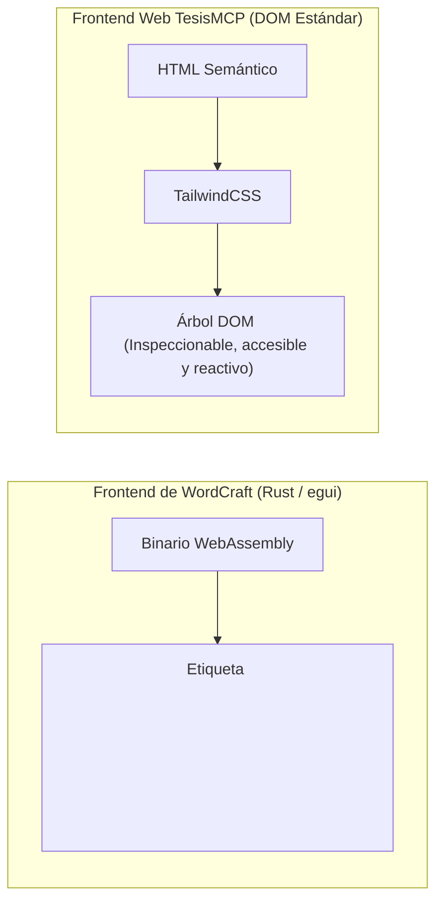

# Viabilidad de Reutilizar el Frontend: Canvas en Rust/Wasm vs. DOM Web (TipTap / Novel.so)

> **Estado respecto del producto actual (18/10/2026):** esta es una consulta histórica y puede describir alternativas descartadas. El alcance vigente usa `MCPServer` por `stdio`, API Django Ninja y panel Django Admin/Unfold para el asesor; no incluye frontend propio del tesista ni infraestructura pública seleccionada. Consulte [Estado verificable del producto](../../07_desarrollo_prototipo/estado_version_producto.md).


- **Fecha:** 2026-10-17
- **Categoría:** `modulo_asesor_y_ui`
- **Estado:** Análisis Crítico de Frontend y UX
- **Participante / Rol:** Estudiante / Equipo TesisMCP (Rol 4: Frontend y UI)

---

## ❓ 1. Planteamiento del Estudiante

> **"Pero es una copia de Word, ¿no? Yo hablaba de copiar o usar el frontend."**

El estudiante aclara que su objetivo es reutilizar o copiar la interfaz visual de usuario (el lienzo central tipo Word/Google Docs con barra de herramientas, márgenes y comentarios) para incrustarlo directamente en la aplicación web de TesisMCP.

---

## 💡 2. Respuesta Técnica Imparcial (La Realidad de su Frontend)

### 2.1. ¿Por qué NO se puede "copiar el HTML/CSS" de `storytold/wordcraft`?

Existe una barrera arquitectónica fundamental entre cómo está construido `storytold/wordcraft` y cómo funciona una aplicación web moderna:

* **WordCraft NO está hecho con HTML, CSS, React ni Tailwind:**  
  Está programado en **Rust** usando una biblioteca gráfica llamada **`egui`** (*Immediate Mode GUI*).
* **Cómo corre en el navegador (WebAssembly):**  
  Para funcionar en la web, WordCraft compila todo su código de Rust a **WebAssembly (Wasm)** y dibuja los botones, menús y hojas directamente sobre una etiqueta `<canvas>` de HTML5 usando la tarjeta gráfica (GPU/WebGL).



#### Consecuencias críticas si intentas "usar su frontend":
1. **Es una "caja negra" de píxeles:** En un `<canvas>`, el navegador no ve párrafos `<p>`, ni títulos `<h1>`, ni botones reales. No puedes hacer clic derecho e "Inspeccionar elemento" con las DevTools de Chrome.
2. **Incompatibilidad con Tailwind y Django:** No puedes aplicarle estilos de TailwindCSS ni conectarle fácilmente componentes de React o Alpine.js.
3. **Curva de aprendizaje imposible para el Rol 4:** Cualquier cambio en la interfaz (cambiar un color, agregar un botón o mover una barra) te obligaría a **programar en lenguaje Rust**, instalar el compilador `cargo`, compilar a WebAssembly y enlazar memoria lineal.

---

### 2.2. ¿Qué proyectos SÍ tienen un frontend que se puede copiar y pegar en la web?

Si el objetivo es **tomar un frontend web real de código abierto (HTML + Tailwind + JavaScript) que luzca como Word o Google Docs con IA**, las opciones viables y listas para producción son:

#### 1. Novel.so (`novel.sh`) — La opción más rápida para "copiar componentes"
* **Stack:** React + TailwindCSS + TipTap.
* **Por qué sí es copiable:** El repositorio de GitHub de `steven-tey/novel` es código abierto puro en React. Puedes copiar su carpeta de componentes (`components/editor`) y pegarla directamente en tu frontend.
* **Qué obtienes de inmediato:** Menús flotantes con autocompletado de IA, atajos de teclado tipo Notion y barra de formateo rápido.

#### 2. TipTap Core con plantilla CSS de "Hoja A4 Universitaria"
* **Stack:** HTML/DOM nativo + TipTap (MIT).
* **Cómo se logra la apariencia de Word:**
  Basta con definir un contenedor central en CSS con las dimensiones exactas de una hoja A4:
  ```html
  <!-- Lienzo estilo Google Docs / Word en Tailwind -->
  <div class="bg-gray-100 min-h-screen p-8 flex justify-center">
    <div class="bg-white shadow-xl w-[210mm] min-h-[297mm] p-[25.4mm] text-gray-900 border border-gray-200">
      <!-- Aquí se monta el editor TipTap -->
      <div id="editor"></div>
    </div>
  </div>
  ```
* **Ventaja:** Cero WebAssembly, cero Rust. Es 100% editable con TailwindCSS, pesa menos de 100 KB y se integra con Django en un solo día.

---

## 🧭 3. Veredicto del Profesor

* **Uso correcto de `storytold/wordcraft`:** Excelente herramienta de **backend** para convertir y validar archivos `.docx` formales sin pagar Office.
* **Uso para el Frontend de la Web:** **Descartado**. No intentes incrustar su canvas de WebAssembly para la vista principal del usuario; romperá la experiencia web y complicará innecesariamente al equipo.
* **La decisión inteligente para el Rol 4 (Frontend):** Usa **TipTap Core** estilizado con la hoja A4 en Tailwind y copia los menús flotantes de **Novel.so**. Obtienes el aspecto visual de Google Docs/Word con el 10% del esfuerzo y total control en JavaScript/HTML.

---

## 🔗 4. Referencias y Archivos Vinculados

- [Análisis de storytold/wordcraft en Backend](../servidor_mcp_e_ia/2026-10-17_storytold_wordcraft_integracion_mcp.md)
- [Comparativa Open-Source: TipTap, Novel.so y n8n](../arquitectura_y_backend/2026-10-17_herramientas_opensource_tiptap_wordcraft_n8n.md)
- [Sistema de Comentarios y Lienzo Central](../../05_modulo_colaborativo_asesor/sistema_comentarios_y_revision.md)
