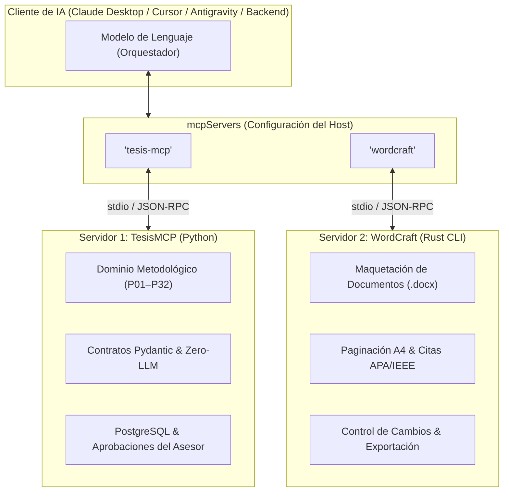

# Arquitectura MCP: ¿Unificar herramientas de WordCraft o mantener servidores separados?

> **Estado respecto del producto actual (18/10/2026):** esta es una consulta histórica y puede describir alternativas descartadas. El alcance vigente usa `MCPServer` por `stdio`, API Django Ninja y panel Django Admin/Unfold para el asesor; no incluye frontend propio del tesista ni infraestructura pública seleccionada. Consulte [Estado verificable del producto](../../07_desarrollo_prototipo/estado_version_producto.md).


- **Fecha:** 2026-10-17
- **Categoría:** `servidor_mcp_e_ia`
- **Estado:** Decisión Arquitectónica Resuelta
- **Participante / Rol:** Estudiante / Equipo TesisMCP (Rol 2: Servidor MCP & Agente IA)

---

## ❓ 1. Planteamiento del Estudiante

> **"Vale, pero ¿las herramientas del MCP de WordCraft se pueden tomar como referencia para nuestro MCP o conviene tenerlos separados?"**

La duda plantea dos caminos de diseño de software:
1. **Opción A (Unificación):** Reimplementar las herramientas de WordCraft (`inspect_document`, `type_text`, `select_text`, etc.) dentro de nuestro propio servidor `mcp_server/server.py` en Python.
2. **Opción B (Servidores Separados / Multi-MCP):** Mantener `TesisMCP` (metodología y base de datos) y `WordCraft` (formato y maquetación Word) como dos servidores independientes que colaboran a través del cliente de IA.

---

## 💡 2. Evaluación Técnica Imparcial (Ingeniería de Software)

### 2.1. Por qué NO conviene intentar absorber las herramientas en nuestro código

Intentar programar las herramientas de WordCraft dentro de nuestro `server.py` en Python sería un error crítico de arquitectura:

1. **Dependencia del motor interno de Rust:**  
   Herramientas como `inspect_document` o `execute(command_id)` en WordCraft no son simples funciones de texto; interactúan directamente con el motor de renderizado de Rust, el layout de párrafos en caché y el árbol de objetos OOXML de Word.
2. **Reinventar la rueda:**  
   Para que `type_text` o `render_page` funcionen en Python con la misma fidelidad, tendríamos que reescribir un procesador de textos completo en Python. Eso consumiría meses de desarrollo sin aportar valor al objetivo de tesis.

---

### 2.2. Qué SÍ debemos tomar como referencia (Patrones de Diseño de Tools)

Aunque no copiemos su código interno, el diseño de herramientas de WordCraft nos enseña **dos principios clave de ingeniería para nuestro propio MCP**:

#### A. El principio de Inspección Semántica (`inspect_state` vs capturas visuales)
* WordCraft no obliga al agente a tomar capturas de pantalla ni a procesar imágenes para saber qué hay en el documento; le entrega un árbol estructurado (`JSON AST`).
* **Aplicación en TesisMCP:** En lugar de devolverle a la IA textos planos largos, nuestras herramientas (como `preparar_paso` o `consultar_detalle_paso`) devuelven esquemas JSON limpios con las variables vigentes, el estado del candado (`lock_version`) y los requisitos exactos de titulación.

#### B. Granularidad y Control Atómico
* WordCraft separa la consulta (`inspect`) de la mutación (`execute`).
* **Aplicación en TesisMCP:** Respetamos el principio *Human-in-the-Loop*. La IA puede consultar (`preparar_paso`) y sugerir (`generar_propuesta`), pero la mutación persistente en base de datos (`guardar_borrador`) exige confirmación del tesista.

---

### 2.3. La Decisión Correcta: Arquitectura Multi-MCP (Separación de Responsabilidades)

El protocolo MCP fue concebido específicamente para permitir que **un mismo cliente de IA se conecte a múltiples servidores simultáneamente**.



#### Cómo opera el modelo con ambos servidores conectados:

1. **Configuración en el cliente (ej. `claude_desktop_config.json` o backend):**
   ```json
   {
     "mcpServers": {
       "tesis-mcp": {
         "command": "python",
         "args": ["-m", "mcp_server.server"]
       },
       "wordcraft": {
         "command": "wordcraft-cli",
         "args": ["mcp"]
       }
     }
   }
   ```

2. **Flujo de Ejecución:**
   - El estudiante le pide a la IA: *"Redacta el problema del paso P06 y agrégalo al documento Word de la tesis"*.
   - **Paso 1:** La IA invoca `tesis-mcp:preparar_paso(step_code="P06")` y obtiene las causas, efectos y variables aprobadas en la base de datos PostgreSQL.
   - **Paso 2:** La IA redacta el problema metodológico respetando los contratos Pydantic.
   - **Paso 3:** La IA invoca `wordcraft:type_text(section="2.1", text=...)` para escribir el texto maquetado con estilo de título APA en el archivo `.docx`.

---

## ⚖️ 3. Matriz Comparativa: Unificado vs. Separado

| Criterio | Servidor Único (Todo en Python) | Servidores Separados (Multi-MCP) |
| :--- | :--- | :--- |
| **Principio de Responsabilidad Única (SRP)** | ❌ Se mezcla la lógica de tesis con el motor gráfico de Word. | ✅ Totalmente desacoplado: Metodología vs. Maquetación. |
| **Tiempo de Desarrollo** | ❌ Meses para intentar maquetar `.docx` a bajo nivel en Python. | ✅ Inmediato: Cada servidor hace lo que mejor sabe hacer. |
| **Mantenimiento y Bugs** | ❌ Un error en el parser de Word rompe todo el servidor MCP. | ✅ Si falla WordCraft, TesisMCP sigue funcionando y guardando en BD. |
| **Evaluación Académica** | ⚠️ Código monolítico propenso a deuda técnica. | ✅ Arquitectura distribuida basada en micro-servidores de contexto. |

---

## 📌 4. Veredicto del Profesor

1. **Conviene tenerlos 100% separados:**  
   `TesisMCP` se enfoca en la **verdad académica, validación con Pydantic y persistencia en PostgreSQL**. `WordCraft` se utiliza como herramienta auxiliar externa para la maquetación y exportación de archivos `.docx`.
2. **Lo que tomamos como referencia de WordCraft:**  
   El diseño de herramientas atómicas, estructuradas en JSON (AST) y la filosofía de que el agente pueda inspeccionar el estado antes de proponer cambios.

---

## 🔗 5. Referencias y Archivos Vinculados

- [Guía Maestra de MCP](2026-10-17_guia_completa_aprendizaje_mcp.md)
- [Análisis de storytold/wordcraft](2026-10-17_storytold_wordcraft_integracion_mcp.md)
- [Servidor Base de TesisMCP](../../../mcp_server/server.py)
