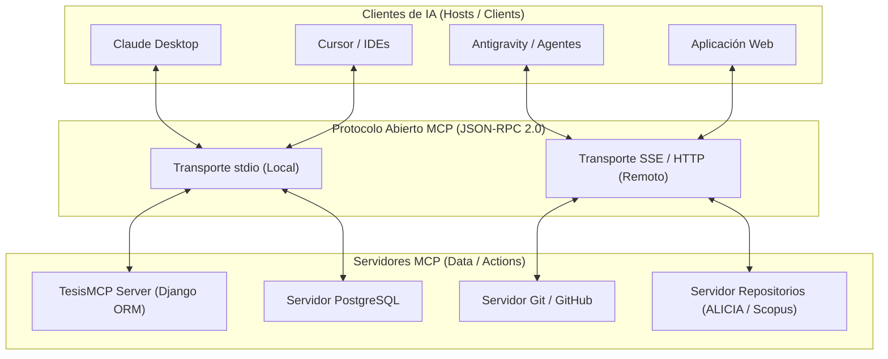
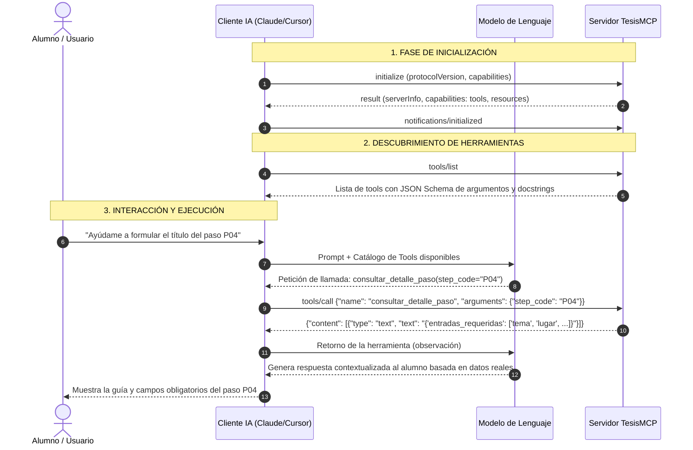
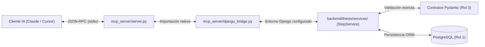

# Guía Maestra de Aprendizaje: Todo sobre MCP (Model Context Protocol)

> **Estado respecto del producto actual (18/10/2026):** esta es una consulta histórica y puede describir alternativas descartadas. El alcance vigente usa `MCPServer` por `stdio`, API Django Ninja y panel Django Admin/Unfold para el asesor; no incluye frontend propio del tesista ni infraestructura pública seleccionada. Consulte [Estado verificable del producto](../../07_desarrollo_prototipo/estado_version_producto.md).


- **Fecha:** 2026-10-17
- **Categoría:** `servidor_mcp_e_ia`
- **Estado:** Resuelta
- **Participante / Rol:** Estudiante / Equipo TesisMCP (Especialmente Rol 2: Servidor MCP & Agente IA)

---

## ❓ 1. Pregunta o Duda Planteada

> **"Quiero aprender de todo al respecto del MCP"**  
> ¿Qué es exactamente el Model Context Protocol (MCP)? ¿Por qué surgió, cómo funciona a nivel arquitectónico, cuáles son sus componentes fundamentales, cómo se implementa en código con Python y cómo se aplica de forma práctica dentro de nuestro proyecto **TesisMCP**?

---

## 💡 2. Respuesta Fundamentada: Fundamentos y Arquitectura

### 2.1. ¿Por qué nació MCP? El Problema de la Fragmentación $N \times M$

Antes de MCP, si una empresa o desarrollador quería conectar modelos de lenguaje (Claude, GPT, Gemini, Llama) con sus datos o herramientas (bases de datos, Git, APIs de Jira, archivos locales), existía un grave problema de **integración propietaria**:
- OpenAI usaba su propio formato de *Function Calling* y plugins.
- LangChain / LlamaIndex tenían sus propios conectores y abstracciones.
- Editores como Cursor o Claude Desktop implementaban extensiones a su manera.

Esto generaba un problema de orden **$N \times M$**: para conectar $N$ modelos o clientes de IA con $M$ herramientas o fuentes de datos, se requerían $N \times M$ adaptadores diferentes.

Anthropic introdujo **MCP (Model Context Protocol)** a finales de 2024 como un **estándar abierto** (Open Source) para transformar ese escenario en un problema de orden **$N + M$**:
- Cualquier **cliente/editor de IA** (Claude Desktop, Cursor, Antigravity, VS Code) que hable el protocolo MCP puede conectarse inmediatamente a cualquier **servidor MCP**.
- Cualquier **herramienta o base de datos** expuesta como servidor MCP puede ser utilizada por cualquier modelo de IA compatible, sin escribir una sola línea de código de adaptación específica para dicho modelo.



> **Analogía Clave:** MCP es al mundo de los Modelos de Lenguaje lo que **LSP (Language Server Protocol)** de Microsoft fue a los editores de código: un protocolo universal para desacoplar el cliente (editor/IA) del proveedor de capacidades (lenguaje/herramientas).

---

### 2.2. Arquitectura: Host, Cliente, Servidor y Transporte

En el ecosistema MCP participan cuatro conceptos de software:

1. **MCP Host:** La aplicación principal con la que interactúa el usuario (por ejemplo, Claude Desktop, Cursor, Antigravity). Es quien orquesta el modelo de IA.
2. **MCP Client:** El módulo dentro del Host que mantiene la conexión 1 a 1 con un Servidor MCP específico, traduce solicitudes y recibe respuestas.
3. **MCP Server:** Un proceso independiente y ligero que expone recursos, herramientas y plantillas mediante la especificación MCP.
4. **Capa de Transporte:** El canal bidireccional por el que viajan los mensajes JSON-RPC 2.0:
   - **`stdio` (Standard Input / Standard Output):** El cliente lanza el servidor MCP como un subproceso hijo en la misma máquina local (`python -m mcp_server.server`). La comunicación ocurre leyendo y escribiendo en la entrada/salida estándar. Es ultra rápido, seguro (no abre puertos de red) y es el estándar para desarrollo y herramientas de escritorio.
   - **`SSE` (Server-Sent Events) sobre HTTP:** El servidor corre como un servicio web en red (por ejemplo, en Koyeb, Render o Docker). El cliente abre un canal SSE para recibir eventos del servidor y envía peticiones mediante HTTP POST. Es ideal para despliegues distribuidos en la nube.

---

### 2.3. Los Tres Primitivos Fundamentales de MCP

El protocolo define exactamente **tres capacidades primarias** que un servidor puede ofrecer a un modelo:

| Primitivo | Decorador Python | ¿Qué es? | ¿Cómo lo usa la IA? | Ejemplo en TesisMCP |
| :--- | :---: | :--- | :--- | :--- |
| **Tools (Herramientas)** | `@app.tool()` | Funciones ejecutables con argumentos estructurados. | La IA **decide invocarlas activamente** para consultar o cambiar datos cuando necesita resolver una instrucción. | `consultar_detalle_paso(step_code="P04")` |
| **Resources (Recursos)** | `@app.resource()` | Datos o documentos pasivos de solo lectura (con URIs tipo `tesis://guia/capitulo1`). | El cliente o la IA **los leen como contexto estático**, similar a adjuntar un archivo adjunto sin ejecutar lógica. | Lectura de la directiva de titulación o de la plantilla de formato UTP. |
| **Prompts (Plantillas)** | `@app.prompt()` | Plantillas preconfiguradas y parametrizadas de conversación. | Ayudan al usuario a iniciar tareas complejas guiadas con instrucciones predefinidas. | `iniciar_redaccion_paso(step_code="P01")` |

---

### 2.4. El Ciclo de Vida de una Llamada MCP (Bajo el Capó)

Todo el intercambio de mensajes entre el cliente de IA y el servidor MCP se realiza en formato estándar **JSON-RPC 2.0**:



---

## 🛠️ 3. Implementación en Código: Python SDK 2.x

En el SDK oficial de Python (`mcp >= 2.0`, instalado en `.venv`), la clase canónica moderna es `MCPServer` (ubicada en `mcp.server.mcpserver`).

### 3.1. Servidor Mínimo y Tipado con Pydantic / Type Hints

El servidor MCP inspecciona automáticamente los **type hints** y los **docstrings** de tus funciones Python para construir el JSON Schema que la IA lee para saber cómo usar cada herramienta:

```python
from mcp.server.mcpserver import MCPServer
from typing import Dict, Any, List, Optional

# 1. Instanciación del servidor
app = MCPServer(
    name="TesisMCP",
    description="Servidor MCP para la supervisión y asistencia metodológica de tesis."
)

# 2. Definición de una herramienta (@app.tool)
@app.tool()
def consultar_detalle_paso(step_code: str) -> Dict[str, Any]:
    """
    Obtiene el detalle completo, objetivo y campos requeridos para un paso metodológico.
    
    Args:
        step_code: Código del paso (ejemplo: 'P01', 'P04').
    """
    # Lógica de negocio (en TesisMCP delega a StepService)
    return {
        "codigo": step_code.upper(),
        "estado": "VALIDADO",
        "entradas_requeridas": ["tema", "unidad_analisis", "lugar", "periodo"]
    }

# 3. Ejecución por stdio
if __name__ == "__main__":
    app.run()
```

---

## 🎯 4. MCP en TesisMCP: ¿Por qué es el Corazón de Nuestro Proyecto?

En **TesisMCP**, el servidor MCP resuelve los cuatro problemas más críticos de la asistencia académica con IA:

### 1. Elimina la Alucinación y la Pérdida de Contexto
En un chat normal de ChatGPT o Claude, el estudiante debe copiar y pegar sus variables en cada mensaje; con el tiempo, la ventana de contexto se llena y la IA olvida o inventa el título. Con MCP, la herramienta `preparar_paso` lee directamente de la base de datos PostgreSQL el título aprobado y la hipótesis vigente.

### 2. Impone la Secuencia Metodológica (P01 a P32)
La IA no puede redactar el Capítulo 3 (Metodología) si el estudiante no ha completado el paso P06 (Formulación del problema). La herramienta MCP verifica la precondición en la base de datos antes de permitir avanzar.

### 3. Principio de Mínimo Privilegio (Seguridad de Datos)
El modelo de lenguaje **nunca tiene acceso directo a la base de datos con contraseñas ni permisos SQL**. La IA solo puede ejecutar las funciones controladas que exponemos en `server.py`, pasando por los validadores Pydantic del backend.

### 4. Arquitectura de Integración Limpia (`django_bridge.py`)

Para que el servidor MCP acceda a los modelos de Django y a los validadores sin duplicar código, se conecta mediante un puente oficial:



---

## 🧪 5. Guía de Práctica: Cómo Probar y Ver MCP Funcionando Hoy

Dispones de dos formas inmediatas para ver MCP en acción en este proyecto:

### A. Ejecutar el Script de Pruebas Unitarias Directas
En tu terminal, ejecuta:
```bash
.venv/bin/python mcp_server/test_local.py
```
*Este script simula un cliente de IA: inicializa el servidor en memoria, consulta la lista de herramientas registradas y ejecuta llamadas a `estado_servidor`, `listar_pasos_mvp` y `consultar_detalle_paso`.*

### B. Usar el MCP Inspector (Interfaz Gráfica Oficial de Anthropic)
Ejecuta:
```bash
npx @modelcontextprotocol/inspector .venv/bin/python mcp_server/server.py
```
*Se abrirá una página web en `http://localhost:5173` donde podrás presionar botones para ejecutar cada herramienta, ingresar parámetros en cajas de texto y observar en tiempo real el JSON-RPC enviado y recibido.*

---

## 🔗 4. Referencias y Archivos Vinculados

- [Servidor Base Implementado](../../../mcp_server/server.py)
- [Guía Técnica del Servidor MCP](../../../mcp_server/README.md)
- [Script de Pruebas Locales](../../../mcp_server/test_local.py)
- [Estructura Metodológica de Capítulos P01 a P08](../../03_metodologia_y_prompts/estructura_capitulos_1_a_7.md)
- [Contratos Pydantic y Validadores de Dominio](../../03_metodologia_y_prompts/contratos_pydantic_y_validadores_mvp.md)
