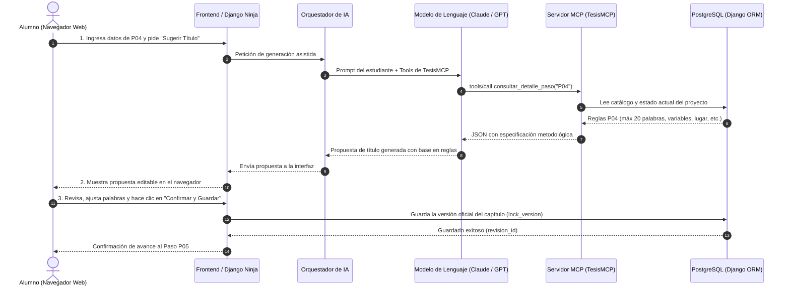

# ¿Por qué usar stdio si iremos a la nube? Flujo entre la Web, la IA y el Servidor MCP

> **Estado respecto del producto actual (18/10/2026):** esta es una consulta histórica y puede describir alternativas descartadas. El alcance vigente usa `MCPServer` por `stdio`, API Django Ninja y panel Django Admin/Unfold para el asesor; no incluye frontend propio del tesista ni infraestructura pública seleccionada. Consulte [Estado verificable del producto](../../07_desarrollo_prototipo/estado_version_producto.md).


- **Fecha:** 2026-10-17
- **Categoría:** `servidor_mcp_e_ia`
- **Estado:** Resuelta
- **Participante / Rol:** Estudiante / Equipo TesisMCP (Roles 2 y 3: Servidor MCP, API REST y Arquitectura)

---

## ❓ 1. Pregunta o Duda Planteada

> **"¿Por qué usa `stdio` si lo llevaremos a la nube o se espera publicarlo en internet? ¿Se trata de que la IA solo accede al MCP y luego la respuesta desde el MCP se manda recién a la página web?"**

La duda se divide en dos aspectos clave de arquitectura:
1. ¿Por qué el código actual de `mcp_server/server.py` arranca con transporte `stdio` si el objetivo del proyecto es desplegarse en servidores en la nube (Render/Koyeb/Docker)?
2. ¿Cuál es el flujo real de datos entre el usuario en el navegador web, el modelo de inteligencia artificial (LLM), el servidor MCP y la base de datos?

---

## 💡 2. Respuesta Fundamentada

### 2.1. ¿Por qué usamos `stdio` ahora y cómo cambiará en la Nube?

En el protocolo MCP existen dos transportes oficiales:
* **`stdio` (Standard Input / Standard Output):** Comunicación mediante pipes locales entre dos procesos en la misma máquina.
* **`SSE` (Server-Sent Events) sobre HTTP:** Comunicación remota mediante peticiones web sobre red.

La razón por la cual comenzamos con `stdio` y la transición a la nube se explica en tres razones técnicas:

#### 1. Simplicidad y velocidad en Desarrollo Local (MVP)
Durante el desarrollo del MVP y las pruebas locales con herramientas como **Claude Desktop**, **Cursor** o scripts de test (`test_local.py`), `stdio` es el estándar porque:
- No requiere abrir puertos TCP/IP ni lidiar con cortafuegos (firewalls).
- No requiere configurar certificados HTTPS ni lidiar con problemas de CORS (Cross-Origin Resource Sharing).
- El cliente de IA levanta el servidor como un subproceso hijo local (`python -m mcp_server.server`) de forma transparente y con latencia cero.

#### 2. El código de `server.py` es agnóstico al transporte
El SDK oficial de Python (`mcp >= 2.0` con `MCPServer`) fue diseñado para que **la lógica de las herramientas (@app.tool) sea 100% independiente del transporte**.  
Para migrar el servidor de `stdio` a un servicio web en la nube, **no se reescriben las herramientas**; únicamente se modifica el método de arranque al final del archivo:

```python
# Modo local (actual):
if __name__ == "__main__":
    app.run(transport="stdio")

# Modo producción en la nube (vía SSE sobre HTTP):
if __name__ == "__main__":
    app.run(transport="sse", host="0.0.0.0", port=8000)
```
Al correr en modo `sse`, cualquier cliente o agente en cualquier lugar de internet puede conectarse a `https://api.tesismcp.edu.pe/mcp/sse`.

#### 3. En contenedores Docker en la nube, `stdio` también es válido
Incluso en servidores en la nube, si se despliega un contenedor que incluye el backend orquestador y el proceso MCP dentro del mismo pod/contenedor, `stdio` puede utilizarse como mecanismo de **comunicación entre procesos (IPC) interna**, garantizando máxima seguridad ya que el servidor MCP no queda expuesto a puertos externos de internet.

---

### 2.2. ¿Cómo fluyen los datos? Aclaración del Flujo Web vs IA vs MCP

En **TesisMCP** conviven dos modalidades de interacción arquitectónica, ambas respaldadas por los mismos servicios de dominio ([`StepService`](../../02_arquitectura_y_sistema/arquitectura_global.md)):

---

#### Modalidad 1: Aplicación Web en la Nube (El Tesista usa el Navegador)

En esta modalidad (la principal cuando el sistema se publica en internet):
1. El estudiante ingresa desde su navegador web (Chrome/Firefox) a la plataforma TesisMCP.
2. En la pantalla del paso metodológico (ej. Paso `P04: Delimitación final y título`), el estudiante llena sus variables iniciales y presiona **"Solicitar asistencia IA"**.
3. **El Servidor Web (Django Backend) actúa como intermediario:**
   - Envía el prompt y las variables al LLM (Claude/OpenAI) a través de su API oficial.
   - El LLM, para saber qué reglas debe cumplir el paso P04, invoca la herramienta MCP `consultar_detalle_paso(step_code="P04")`.
   - El Servidor MCP ejecuta la función, consulta los contratos metodológicos y le devuelve a la IA las restricciones (ej. *"máximo 20 palabras, variables + unidad + lugar + tiempo"*).
   - El LLM redacta la propuesta de título respetando esas restricciones exactas y se la devuelve a Django.
4. **La plataforma web muestra la propuesta en pantalla al alumno.**
5. **Paso crítico de control humano (*Human-in-the-Loop*):** La IA **NO** guarda directamente en la base de datos definitiva. El estudiante lee la propuesta, puede editarla a su gusto, y presiona **"Confirmar y Guardar"**.
6. La aplicación web envía el texto final confirmado a la base de datos PostgreSQL mediante el endpoint seguro de Django Ninja.



---

#### Modalidad 2: Cliente de Escritorio / IDE (El Tesista usa Claude Desktop o Cursor)

En esta modalidad:
1. El estudiante no abre la web para redactar, sino que abre **Claude Desktop** o **Cursor** en su computadora.
2. Claude Desktop se conecta a `mcp_server/server.py` usando `stdio` localmente.
3. El estudiante le dice a Claude: *"Claude, revisa en mi tesis qué paso me toca y ayúdame a formular el título"*.
4. Claude ejecuta automáticamente:
   - `listar_pasos_mvp()` -> descubre que está en P04.
   - `consultar_detalle_paso("P04")` -> obtiene los requisitos oficiales de titulación.
5. Claude propone el texto en el chat.
6. Cuando el alumno aprueba el texto, una herramienta MCP (`guardar_borrador`) conectada mediante `django_bridge.py` envía la información directamente a la base de datos PostgreSQL central.
7. Cuando el **Asesor** entra a la página web del sistema, ya ve reflejado el avance del alumno listo para ser revisado y comentado.

---

## 📌 3. Síntesis y Conclusión

| Pregunta | Respuesta Concreta |
| :--- | :--- |
| **¿Por qué `stdio` ahora?** | Porque es el medio estándar, ultra rápido y libre de configuración de red para programar, probar localmente y conectar con IDEs (Claude Desktop, Cursor) en el MVP. |
| **¿Cómo irá a la nube?** | Con el mismo código de herramientas, solo activando el transporte `sse` sobre HTTP (`app.run(transport="sse")`) en el servidor en la nube (Docker / Koyeb / Render). |
| **¿La IA solo accede al MCP?** | Sí, la IA accede únicamente a las herramientas y recursos que expone el Servidor MCP. No tiene credenciales directas de PostgreSQL ni permisos arbitrarios sobre el servidor. |
| **¿La respuesta va directo a la página?** | La propuesta viaja a la página web para que el tesista la inspeccione y la confirme. El guardado final en la base de datos siempre requiere confirmación humana (*Human-in-the-Loop*). |

---

## 🔗 4. Referencias y Archivos Vinculados

- [Guía Maestra de MCP](2026-10-17_guia_completa_aprendizaje_mcp.md)
- [Arquitectura Global de TesisMCP](../../02_arquitectura_y_sistema/arquitectura_global.md)
- [Secuencia del Sistema y Paso a Paso](../../02_arquitectura_y_sistema/secuencia_del_sistema.md)
- [Servidor Base en Python](../../../mcp_server/server.py)
