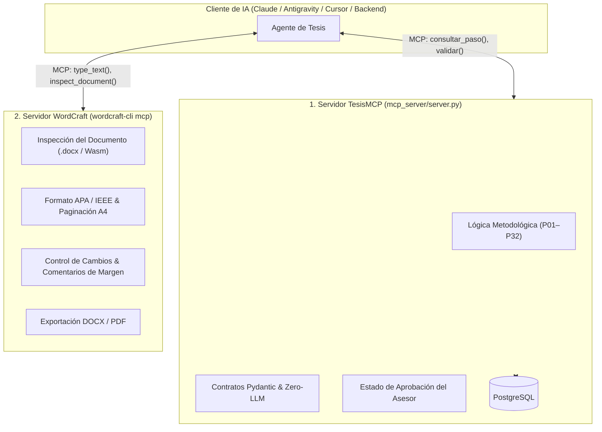

# Análisis Técnico de storytold/wordcraft: Integración de Word en Rust con Servidor MCP

> **Estado respecto del producto actual (18/10/2026):** esta es una consulta histórica y puede describir alternativas descartadas. El alcance vigente usa `MCPServer` por `stdio`, API Django Ninja y panel Django Admin/Unfold para el asesor; no incluye frontend propio del tesista ni infraestructura pública seleccionada. Consulte [Estado verificable del producto](../../07_desarrollo_prototipo/estado_version_producto.md).


- **Fecha:** 2026-10-17
- **Categoría:** `servidor_mcp_e_ia`
- **Estado:** Análisis Arquitectónico Aprobado
- **Participante / Rol:** Estudiante / Equipo TesisMCP (Roles 2 y 5: Servidor MCP y Exportación/Calidad)

---

## ❓ 1. Planteamiento y Clarificación

> **"El que yo te decía es: `storytold/wordcraft`"**

El estudiante aclara que la herramienta a la que se refería no es el prototipo de investigación de ficción de Google PAIR, sino **`storytold/wordcraft`**, la reimplementación de código abierto de Microsoft Word construida desde cero en **Rust**.

Se evalúan sus capacidades técnicas, su arquitectura diseñada para agentes de inteligencia artificial y cómo se conecta con el núcleo de **TesisMCP**.

---

## 💡 2. ¿Qué es exactamente `storytold/wordcraft`?

[`storytold/wordcraft`](https://github.com/storytold/wordcraft) es una reimplementación *clean-room* (desarrollada desde cero a partir de especificaciones públicas) de **Microsoft Word**, escrita íntegramente en **Rust** con interfaz en **egui** renderizada sobre GPU.

### Principales Capacidades de Escritura y Diseño:
* **Formatos Nativos:** Lee y escribe directamente archivos `.docx` (OpenXML), `.odt`, `.rtf`, `.html`, `.md`, `.tex` (LaTeX) y exporta a `.pdf` con texto real seleccionable y marcadores.
* **Flujo Editorial Completo de Word:** Cinta de opciones (*ribbon*), estilos tipográficos en vivo, tablas de contenido automáticas, notas al pie y **gestor de citas bibliográficas formateadas en APA, MLA e IEEE**.
* **Revisión y Supervisión:** Control de cambios (*track changes*), globos de comentarios en los márgenes y aceptación/rechazo de revisiones (exactamente lo que requiere el módulo del asesor en TesisMCP).
* **Multiplataforma:** Ejecución nativa en Linux, macOS, Windows y en el **navegador web mediante WebAssembly (Wasm)** sin necesidad de Electron.

---

## 🤖 3. La Clave de Oro: "Built for Agents" y su Servidor MCP Nativo

A diferencia de Microsoft Word o LibreOffice, `storytold/wordcraft` fue diseñado con una premisa moderna: **cada acción de la interfaz es un comando tipado con ID (422 comandos en total)** que pueden ser operados indistintamente por un humano con el ratón o por un **agente de inteligencia artificial mediante MCP**.

### El Servidor MCP Integrado (`wordcraft-cli mcp`)
El proyecto incluye un binario de línea de comandos que expone inmediatamente un **Servidor MCP nativo**:

```bash
# Modo headless (procesamiento y validación en segundo plano de documentos Word):
claude mcp add wordcraft -- wordcraft-cli mcp

# Modo control en vivo de la aplicación abierta:
wordcraft --control 7981 &
claude mcp add wordcraft-app -- wordcraft-cli mcp --connect 127.0.0.1:7981
```

### Herramientas que expone al LLM:
| Herramienta MCP | ¿Qué le permite hacer al Agente de IA? |
| :--- | :--- |
| `inspect_document` | Analiza el árbol estructural del documento (párrafos, estilos, citas) sin necesidad de capturas de pantalla ni OCR. |
| `type_text` | Escribe texto con estilos específicos en el punto exacto del documento. |
| `select_text` | Selecciona oraciones, palabras o secciones por posición semántica o expresiones regulares. |
| `execute` / `batch` | Dispara cualquiera de los 422 comandos de Word (insertar tabla, aplicar estilo APA, agregar salto de página). |
| `render_page` | Renderiza una página específica en alta resolución para inspección visual. |
| `save_document` | Guarda el archivo consolidado en `.docx` o exporta a `.pdf`. |

---

## 🏗️ 4. Sinergia Arquitectónica con TesisMCP: El Enfoque de "Dos Servidores MCP"

El descubrimiento de `storytold/wordcraft` abre una oportunidad de arquitectura sumamente limpia para nuestro proyecto: **separar la lógica metodológica de la manipulación física de documentos**.



### ¿Cómo colaboran ambos servidores?
1. **`TesisMCP` (Nuestro servidor Python):**  
   Gobierna la verdad metodológica. Conoce qué paso toca (`P04`), valida que el problema y los objetivos cumplan los contratos Pydantic del **Rol 3** y guarda el avance del alumno en **PostgreSQL**.
2. **`WordCraft` (Servidor Rust):**  
   Gobierna el lienzo del documento. Recibe el texto validado, lo maqueta en una hoja A4 con márgenes oficiales de titulación, inserta las citas bibliográficas en IEEE/APA y genera el archivo `.docx` final para descargar.

---

## ⚖️ 5. Evaluación de Viabilidad Práctica para el Equipo de 5 Integrantes

### Dónde nos ahorra semanas de trabajo:
1. **Motor de Exportación a Word (.docx) del Rol 5:**  
   En lugar de escribir cientos de líneas en `python-docx` para formatear tablas, notas y citas a mano, `wordcraft-cli` permite compilar y validar documentos con fidelidad nativa de Microsoft Word.
2. **Validación visual por IA:**  
   La herramienta `inspect_document` permite que el agente verifique si el documento cumple con la estructura requerida sin tener que lidiar con parsers de XML complejos.

### Precauciones indispensables (Para no perder el foco del curso):
1. **No reemplazar la base de datos central:**  
   Los documentos `.docx` generados son **entregables**, pero la **fuente de verdad indiscutible de TesisMCP debe permanecer en PostgreSQL**. El asesor califica revisiones en la base de datos, no archivos sueltos en el disco.
2. **Evolución gradual:**  
   Para la **Semana 12 (MVP)**, el equipo debe consolidar los pasos `P01` a `P08` en PostgreSQL y Django Ninja. `wordcraft-cli` puede ser integrado como la herramienta de compilación oficial del informe en la segunda fase (Semanas 13 a 18).

---

## 🔗 6. Referencias y Repositorios

- [Repositorio Oficial: storytold/wordcraft en GitHub](https://github.com/storytold/wordcraft)
- [Documentación del Protocolo MCP de WordCraft](https://github.com/storytold/wordcraft/blob/main/docs/mcp.md)
- [Servidor Base de TesisMCP en Python](../../../mcp_server/server.py)
- [Modelo de Comentarios y Revisión de Tesis](../../05_modulo_colaborativo_asesor/sistema_comentarios_y_revision.md)
